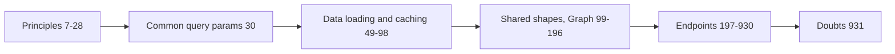

<!-- generated by darshan-singh-meel-knowledge-graph -->
web/API.md (946 lines): the JSON API contract between server.py and the React app (same shapes inside Streamlit via st_react), with principles, common params, caching, shared shapes and every endpoint.

## Content
- Contract; types in `web/src/api/types.ts` kept in step — web/API.md:1-5.
- Principles: read-only, only POST `/api/reload` and `/api/mine/load`; the only write-like call is `CALL SP_ACCESS_SNAPSHOT('AUTO')` — web/API.md:9-11; no logic in server.py — web/API.md:12-14; one lock — web/API.md:16-19; error JSON — web/API.md:27-28.
- Endpoints, e.g. `GET /api/meta` 199, `POST /api/reload` 236, `POST /api/mine/load` 259, `GET /api/list` 299, `GET /api/user` 307, `GET /api/check` 486, `GET /api/request` 531, `GET /api/whatif` 715, `GET /api/changes` 802, `GET /api/activity` 826, `GET /api/graph` 924 — web/API.md line numbers.

## Relates to
- server.py (ROUTES), access.py, web/src/api/client.ts, web/src/api/types.ts; processes/access-requests.md (request endpoint).

## Caching as documented
- Shared data and My access: 24 h in memory (`TTL`), `.cache/` for `CACHE_HOURS`, cookie `Max-Age` 86400, answers kept in `ANSWERS` — web/API.md:65-95; matches cache.py:27-28, server.py:28, server.py:65-66.
- `/api/home` and `/api/access` have their own sections.

## Added with the progress lines and switches
- `GET /api/progress?view=`: `{running, view, lines: [{t, text}], job}` of the read running now; `job` = the last background refresh `{id, what, state, ok, message}`, null before any; never starts a load; producer `server.progress()`, lines from `a.say()` — web/API.md:250-257.
- `POST /api/reload`: `load` reads the missing parts and answers when done; `page` / `rebuild` read every part again under their own key and swap it in — locally in a thread (`{ok, started, job}`), inside Streamlit (`server.BACKGROUND = False`) when done; a second refresh while one runs gives `ok: false`; a page that would wait for a load answers 409 `shared_loading` — web/API.md:236-248 (server.py:2354-2421, server.py:186).
- `skipped` on `/api/home` and `/api/rules`: rules that did not run (`a.skipped_rules()`, HIERARCHY=0 / ACTIVITY=0) — web/API.md:271, web/API.md:643-652.

## Code vs docs

