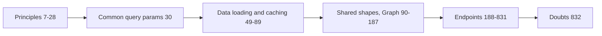

<!-- generated by darshan-singh-meel-knowledge-graph -->
web/API.md (847 lines): the JSON API contract between server.py and the React app (same shapes inside Streamlit via st_react), with principles, common params, caching, shared shapes and every endpoint.

## Content
- Contract; types in `web/src/api/types.ts` kept in step — web/API.md:1-5.
- Principles: read-only, only POST `/api/reload` and `/api/mine/load`; the only write-like call is `CALL SP_ACCESS_SNAPSHOT('AUTO')` — web/API.md:9-11; no logic in server.py — web/API.md:12-14; one lock — web/API.md:16-19; error JSON — web/API.md:27-28.
- Endpoints, e.g. `GET /api/meta` 190, `POST /api/reload` 227, `POST /api/mine/load` 236, `GET /api/list` 259, `GET /api/user` 267, `GET /api/check` 442, `GET /api/request` 487, `GET /api/whatif` 670, `GET /api/changes` 757, `GET /api/activity` 781, `GET /api/graph` 825 — web/API.md line numbers.

## Relates to
- server.py (ROUTES), access.py, web/src/api/client.ts, web/src/api/types.ts; processes/access-requests.md (request endpoint).

## Possibly stale (inferred)
- Headings say "Shared data: one copy, 1 hour" and "My access ... 1 hour" with 3600 s — web/API.md:65-68, web/API.md:72-78; code uses `TTL = 24 * 3600` — cache.py:22, server.py:25, and line 61 of the same doc says 24 h — web/API.md:61.
- Mentions `@st.cache_data(ttl=3600)` on `app.shared` — web/API.md:68; app.py now only runs st_react.app (CLAUDE.md:31-34).
