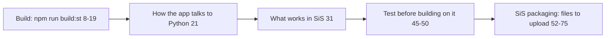

web/ST.md (75 lines): how the same React app runs as one Streamlit component (st_react.py) and how it is packaged for Streamlit in Snowflake.

## Content
- `app.py` only calls `st_react.app()`; API calls come back as the component value and are answered by server.py — web/ST.md:1-5.
- Build and bundle rules (no CDN, no worker, committed dist-st) — web/ST.md:8-19.
- Manual SiS test checklist — web/ST.md:45-50.
- Upload list matches sql/4_streamlit.sql, checked by `test_sis_upload`; do not upload web/src, node_modules, dist, .env, .streamlit, settings.local.sql — web/ST.md:52-72; asset cleanup and exactly 4 assets — web/ST.md:74-75.

## Relates to
- st_react.py, app.py, server.py, sql/4_streamlit.sql, sql/4_streamlit_verify.sql, environment.yml, sis/.env; processes/build-web.md, deploy-snowflake.md.
