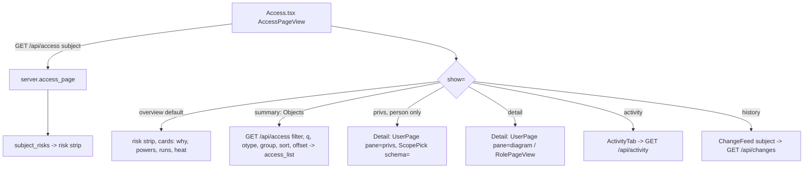

<!-- generated by darshan-singh-meel-knowledge-graph -->
# Flow: Access page (tabs, database or schema filter, type filter)

One-line summary: the Access page of a person or role is split into tabs — Overview, Objects, Privileges and Diagram (person) or "Diagram, held by & holds" (role), Activity, History — all fed by `GET /api/access` except the embedded User / Role page, the Activity tab and the change feed; the object list filters by type (`otype=`) and the User / Role tabs by database or schema (`schema=`, `ScopePick`).

## Steps

1. Tabs: `overview` (no `show` in the URL), `summary` "Objects" with the data count, for a person `privs` "Privileges" and `detail` "Diagram", for a role one `detail` tab "Diagram, held by & holds", then `activity` and `history`; a role asked for `privs` falls back to `detail` — web/src/pages/Access.tsx:75, web/src/pages/Access.tsx:102-113.
2. Privileges and Diagram embed the User or Role page in the Access page's context (`Detail`, `inside: true`, `pane=privs|diagram`) — web/src/pages/Access.tsx:275-284.
3. Risk strip above the tab content: `<Risks list={d.risks} />` — web/src/pages/Access.tsx:115; the server sends `risks=subject_risks(name, user)` — server.py:1707 ([home.md](home.md)).
4. Objects tab: the list asks `/api/access` with `filter`, `q`, `usage`, `group`, `sort`, `otype`, `cell` / `min`, `offset`; any filter change resets the page — web/src/pages/Access.tsx:59-80; type picker lists the types present with counts — web/src/pages/Access.tsx:188-189.
5. `access_list()` keeps data objects (and database / schema USAGE with `usage=1`) matching the level, name, `otype=` and heat cell, sorted and grouped by schema or type — server.py:1624-1645; `access_page()` returns one page plus `types`, runs, powers, heat, why and the admin roles reached — server.py:1658-1708.
6. Database or schema filter: `ScopePick` (`schema=` a database or `DB.SCHEMA`; picking clears any graph focus) on the User, Role and Map pages, so it applies inside the Privileges and Diagram tabs — web/src/pages/common.tsx:213-225, web/src/pages/User.tsx:27, web/src/pages/Role.tsx:91, web/src/pages/Map.tsx:175; the server keeps it only when it is one of the subject's scopes (`scope_of`) — server.py:1285-1287.
7. Activity tab: `ActivityTab what=user|role` ([activity-tab.md](activity-tab.md)); History: `ChangeFeed subject=` ([what-changed.md](what-changed.md)) — web/src/pages/Access.tsx:112-113.

## Tests
- `test_access_type`: the object type filter and the types present with counts — test_server.py:267.
- `test_access_home`: one row per object at its highest level, counted once — test_server.py:873.
- `test_risks`: the risk strip on Access Overview — test_server.py:1905.
