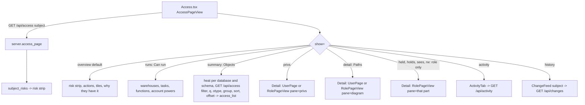

<!-- generated by darshan-singh-meel-knowledge-graph -->
# Flow: Access page (tabs, database or schema filter, type filter)

One-line summary: the Access page of a person or role is split into tabs — Overview, Objects, Privileges, Paths, Can run, Activity, History, and for a role also Held by, What it holds, All protected and Read-only writes; each tab is an entry of the left nav — all fed by `GET /api/access` except the embedded parts of the User / Role page (a role also asks `GET /api/role` once for its tab counts), the Activity tab and the change feed; the object list filters by type (`otype=`) and the User / Role tabs by database or schema (`schema=`, `ScopePick`).

## Steps

1. Tabs: `overview` (no `show` in the URL), `summary` "Objects" with the data count, `privs` "Privileges", `detail` "Paths", for a role the rest of `roleTabs` (`held`, `holds`, `sees`, `rw`; web/src/pages/Role.tsx:84-90), `runs` "Can run" (runnable things plus account powers, red when there are powers), `activity`, `history`; an old link `show=detail&part=held` opens that part — web/src/pages/Access.tsx:76-80, web/src/pages/Access.tsx:110-123.
2. Privileges, Paths and the role parts embed one part of the User or Role page in the Access page's context (`inner()` / `Detail`, `inside: true`, `pane=`); `apiParams` leaves `pane` out, so every tab shares one fetch, and the embedded page shows no head, picker, strip or tabs of its own — web/src/pages/Access.tsx:287-301, web/src/ctx.tsx:25.
2a. Head: the identity line says status, default role, secondary roles and default warehouse (person) or owner and holders (role); Can they?, Show as graph and More (What they see, Compare with…, Granted vs used) only on the Overview; Why they have it shows 3 roles, then "+N more" — web/src/pages/Access.tsx:97-109, web/src/pages/Access.tsx:147-160.
3. Risk strip on the Overview: `<Risks list={d.risks} />` — web/src/pages/Access.tsx:125; the server sends `risks=subject_risks(name, user)` — server.py:1709 ([home.md](home.md)).
4. Objects tab: "Where the access is" (heat per database and schema in their own columns, a cell filters the list — web/src/pages/Access.tsx:177-195), then the list, which asks `/api/access` with `filter`, `q`, `usage`, `group`, `sort`, `otype`, `cell` / `min`, `offset`; any filter change resets the page — web/src/pages/Access.tsx:60-85; type picker lists the types present with counts — web/src/pages/Access.tsx:202-203.
5. `access_list()` keeps data objects (and database / schema USAGE with `usage=1`) matching the level, name, `otype=` and heat cell, sorted and grouped by schema or type — server.py:1625-1646; `access_page()` returns one page plus `types`, runs, powers, heat, why and the admin roles reached — server.py:1659-1710.
6. Database or schema filter: `ScopePick` (`schema=` a database or `DB.SCHEMA`; picking clears any graph focus) on the User, Role and Map pages, inside Access on a role's parts only (a person's embedded part has no scope picker) — web/src/pages/common.tsx:213-225, web/src/pages/User.tsx:28, web/src/pages/Role.tsx:106, web/src/pages/Map.tsx:170; the server keeps it only when it is one of the subject's scopes (`scope_of`) — server.py:1285-1287.
7. Activity tab: `ActivityTab what=user|role` ([activity-tab.md](activity-tab.md)); History: `ChangeFeed subject=` ([what-changed.md](what-changed.md)) — web/src/pages/Access.tsx:122-123.

## Tests
- `test_access_type`: the object type filter and the types present with counts — test_server.py:267.
- `test_access_home`: one row per object at its highest level, counted once — test_server.py:881.
- `test_risks`: the risk strip on Access Overview — test_server.py:1919.
