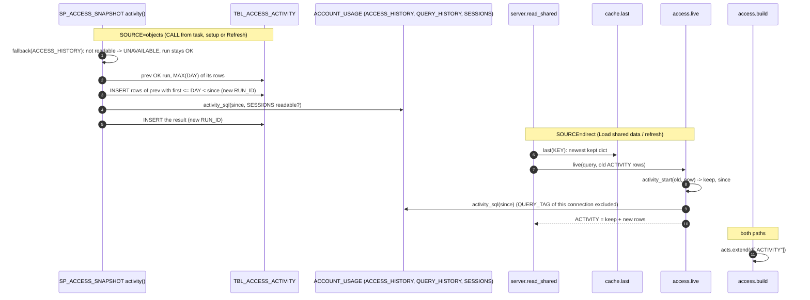

<!-- generated by darshan-singh-meel-knowledge-graph -->
# Flow: table activity read (snapshot and direct, incremental)

One-line summary: the 60 days of table use come from `ACCESS_HISTORY` + `QUERY_HISTORY` + `SESSIONS` through one SELECT (`activity_sql`), kept in `TBL_ACCESS_ACTIVITY` (SOURCE=objects) or in the cached dict (SOURCE=direct); each read copies the days it already has and reads only from the day before the last one; the app's own queries (QUERY_TAG `access-explorer`) are left out.

## Steps

1. Settings: `ACTIVITY_DAYS = 60` and `QUERY_TAG = "access-explorer"` in the procedure (`sql/1_setup.sql:170-171`) and in `access.py` (`access.py:63-64`); `test_sql.test_activity` checks they match (`test_sql.py:307`).
2. The app's connection carries the tag: `session_parameters={"QUERY_TAG": access.QUERY_TAG}` — `sf.py:34`. Inside Snowflake `connect()` returns the app's active session (`sf.py:20-22`), where this parameter is not set.
3. Snapshot path: `run()` calls `keep("activity", *activity(session, run_id, mode))` after object use — `sql/1_setup.sql:616`.
4. `activity()`: `fallback(session, "ACCESS_HISTORY", mode)` -> UNAVAILABLE with the reason, no fallback — `sql/1_setup.sql:565-567`, `sql/1_setup.sql:199-209`.
5. Window: previous OK run (`MAX_BY(RUN_ID, FINISHED_AT)`), `first = CURRENT_DATE() - ACTIVITY_DAYS`, `last = MAX(DAY)` of that run, `since = max(first, last - 1 day)` — `sql/1_setup.sql:568-571`.
6. Copy: rows of the previous run with `DAY >= first AND DAY < since` go in under the new `RUN_ID` — `sql/1_setup.sql:573-575`.
7. Read: `SESSIONS` readable (`fallback(..., "SESSIONS", "AUTO")`) decides the client column; `INSERT ... SELECT '<run>', A.* FROM (activity_sql(since, client))` — `sql/1_setup.sql:576-578`; source ACCOUNT_USAGE, note "no client" when SESSIONS is not readable — `sql/1_setup.sql:579`.
8. Error -> this run's ACTIVITY rows deleted, UNAVAILABLE — `sql/1_setup.sql:580-582`. Row count per run — `sql/1_setup.sql:620-622`; a FAILED run drops its rows from every `DATA` table (ACTIVITY included, `sql/1_setup.sql:163`) — `sql/1_setup.sql:623-625`.
9. The SELECT: ACCESS_HISTORY since the day (READ / WRITE / DDL objects) joined to QUERY_HISTORY (role, statement, tag filter) and SESSIONS (client) — `sql/1_setup.sql:528-556`, same text as `access.py:921-949`.
10. Reader (objects): `snapshot()` reads `TBL_ACCESS_ACTIVITY` of the last OK run as an OPTIONAL table; a setup without it gives `None` — `access.py:60-61`, `access.py:464-468`.
11. Direct path: `read_shared()` passes `cache.last(KEY)`'s ACTIVITY rows to `live()` — `server.py:90-92`; `last()` looks in memory, then `<key>.pkl`, `.old.pkl` (set aside by a refresh), `.prev.pkl` — `cache.py:93-104`.
12. `live()`: ACCESS_HISTORY readable (same check as object use) -> `activity_start(old, now)`, SESSIONS check, `keep + query(activity_sql(since, client))`; else `ACTIVITY = []`, UNAVAILABLE — `access.py:883-892`, `access.py:952-959`.
13. `build()` clears and fills `acts` from `d["ACTIVITY"]` (None or missing -> empty) — `access.py:1020-1022`, `access.py:1063`.
14. The DuckDB copy writes `TBL_ACCESS_ACTIVITY` (and `_PREV`) with the columns of `cache.COLUMNS` — `cache.py:177-178`, `cache.py:219`.
15. Check after a run: `2_snapshot_verify.sql` ACTIVITY (days, users, objects, rows with a client, queries per action) — `sql/2_snapshot_verify.sql:39-42`; one run in all data tables — `sql/2_snapshot_verify.sql:14`.
16. Setup: table DDL `sql/1_setup.sql:108-120`; `GRANT SELECT ... TO ROLE &APP_ROLE` (may fail) `sql/1_setup.sql:880-881`; cleanup `sql/3_cleanup.sql:65-66`.

## Example (fake Snowflake in `test_live`)

- First read, now 2026-11-03: the activity SELECT carries `'access-explorer'`, `'2026-09-04'::DATE` and SESSIONS (`test_access.py:491-492`).
- Second read with earlier rows up to 2026-10-19: the SELECT starts at `'2026-10-18'::DATE` and the kept rows come first (`test_access.py:494-497`).
- SP on DuckDB (no ACCESS_HISTORY): `("UNAVAILABLE", "...ACCESS_HISTORY...")`, no rows for the run (`test_sql.py:308-310`).

Related: [activity logic](../logic/activity.md) · [Activity tab request](activity-tab.md) · [TBL_ACCESS_ACTIVITY](../data/TBL_ACCESS_ACTIVITY.md) · [direct read](direct-live.md) · [snapshot read](snapshot-objects.md).
