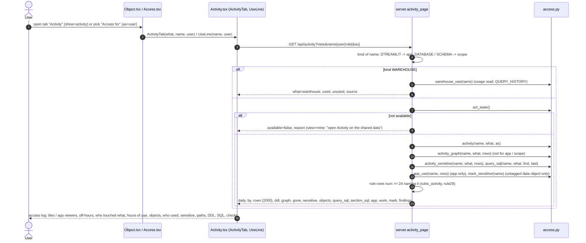

<!-- generated by darshan-singh-meel-knowledge-graph -->
# Flow: Activity tab (web -> /api/activity -> access.activity)

One-line summary: the Activity tab of an object, a person or a role (and the one-line "Used: ..." in the Object page's "Access for" strip) asks `GET /api/activity`; `server.activity_page` picks the view from the object's type (warehouse, Streamlit app, database / schema scope, or object), checks that activity was read, then sends `access.activity()` numbers, the grant-path diagram (`activity_graph`, object / user / role only), the sensitive view, copy-only SQL (`query_sql`), the app's viewers (`app_use`), tag text for an untagged table (`mark_sensitive`), the business hours and the rule >= 24 findings on that name; `Activity.tsx` shows it as one access log of stacked sections.

## Steps

1. Object page: tab "Activity" next to History (not on the admin-holders page) — `web/src/pages/Object.tsx:72`; renders `ActivityTab what="object"` with `user={c.params.as}` — `web/src/pages/Object.tsx:76`. A Streamlit app's Who-has-access page also shows `AppNote` (owner's data its viewers see) with a "Who opened it" link to this tab — `web/src/pages/Object.tsx:68`, `web/src/pages/Object.tsx:83-98`.
2. Access page (person or role): tab "Activity" — `web/src/pages/Access.tsx:106`; `ActivityTab what={user ? "user" : "role"}` — `web/src/pages/Access.tsx:110`.
3. "Access for" strip on the Object page: `UseLine` for the picked user — `web/src/pages/Object.tsx:121`; it asks the same endpoint with `as=` and shows queries, roles, clients and last day, or "Not used in N days"; a click sets `show=activity, as=<user>` — `web/src/pages/Activity.tsx:53-67`.
4. `ActivityTab` calls `useApi("activity", {view, name|user|role, as})` — `web/src/pages/Activity.tsx:35-39`, `web/src/api/client.ts:69`; with `as` set it shows "Only X's use" and an "All users" button that clears `as` — `web/src/pages/Activity.tsx:42-50`.
5. Route: `GET /api/activity` -> `serve("activity")` -> `ROUTES["activity"] = activity_page`; in WITH_REFS, so `refs` (kinds, labels) come along — `server.py:2387-2388`, `server.py:2271-2273`. Inside Snowflake the same handler answers through the st_react bridge (`flows/streamlit-in-snowflake.md`).
6. `activity_page(p, view)`: `what` = object (name=), user (user=) or role (role=); an object of kind STREAMLIT becomes `app`, DATABASE or SCHEMA becomes `scope`; `as=` only on an object or app — `server.py:1659-1665`.
7. Warehouse: no ACCESS_HISTORY rows, so the answer is `warehouse_use(name)` (users with queries from the usage read, and users who can use it but did not), `available` unless the usage source is UNAVAILABLE — `server.py:1668-1672`, `access.py:4651-4657`.
8. `act_state()`; My access without activity -> reason "open Activity on the shared data" — `server.py:1665-1667`, `access.py:4275-4282`. Not available -> `available=false, reason`, plus `work` and `note` — `server.py:1673-1677`.
9. `activity(name, what, who)` -> first, last, daily, by, rows (with hours, weekend, first_day, kind, interactive), ddl — `server.py:1678`, `access.py:4289-4339`.
10. `activity_graph(name, what, rows)` -> graph built by `build_graph("Who used it, through which grant", ...)` and `gone` (uses with no grant path now); skipped for app and scope — `server.py:1679`, `server.py:1683-1685`, `access.py:4588-4612`.
11. `activity_sensitive(name, what, rows)`, `query_sql(name, what, first, last)`, `section_sql` (the SQL behind each section, `activity_section_sql` per `ACT_SECTIONS` key, server.py:1687; [show-sql.md](show-sql.md)), `objects` (kind and sensitive flag of each object in the rows), for an untagged data object `mark_sensitive(name)`, for an app `app_use(name, rows)` — `server.py:1686-1691`, `access.py:4342-4359`, `access.py:4636-4648`.
12. Findings: rule rows (`S["rows"]`, from `findings()`: rules 24-28 via `rules_activity`, 29 via `rule29`) with number >= 24 whose grantee is the name or whose path names it, narrowed to `as` — `server.py:1691-1694`, `access.py:5540-5541`.
13. Rows sent: first `MAX_ACTIVITY` (2000), `total` = all — `server.py:1653`, `server.py:1682`. Business hours: `work = {start, end}` from `WORK_HOURS` — `server.py:1674`, `access.py:70`.
14. Screen (`Activity`): warehouse -> `Warehouse` panel; not available -> empty state; no rows -> "No activity" (an app still shows its viewers) — `web/src/pages/Activity.tsx:85-101`, `web/src/pages/Activity.tsx:218-244`.
15. Access log, top to bottom — `web/src/pages/Activity.tsx:103-138`:
    - lead sentence per `what` and the source line (UTC window, no query text) — `web/src/pages/Activity.tsx:140-146`, `web/src/pages/Activity.tsx:113-114`;
    - tiles (reads / writes / DDL / clients for an object; objects touched / busiest / sensitive otherwise; people off-hours; warnings) or, for an app, `AppViewers` (opened, can open never did, saw data they can't read, opened without access now, and the table of who can and who did) — `web/src/pages/Activity.tsx:148-171`, `web/src/pages/Activity.tsx:185-215`;
    - top bar: Change object picker and the business-time slider UTC-12..+14 (shared by every section) — `web/src/pages/Activity.tsx:107-113`;
    - overview sections only on a database, schema, person or role page (a table, view or app shows the one-object sections) — `web/src/pages/Activity.tsx:117-121`:
    - `OffHours`: people or objects with weekend or outside-business-hours queries — `web/src/pages/Activity.tsx:247-294`;
    - `Touched`: heat grid (`Heat`) of rows x columns or days, last 30 days or the window, all or off-hours, all or sensitive objects — `web/src/pages/Activity.tsx:298-324`, `web/src/pages/Activity.tsx:334-374`;
    - `Hours`: queries per hour of day per user or object, business hours shaded, hours shifted by the business-time slider — `web/src/pages/Activity.tsx:378-424`;
    - `Detail`: objects busiest first (search, sensitive filter), then the picked object: `ObjTiles`, `ByClient`, `Kinds`, `Matrix`, `ByType` (DML / Read / DDL per day as `DayStack`, `DayPanel` for the busiest or pinned day), `ByDay` (per day by user, role, client, statement, R / W / DDL or object kind, top 4 and Other, or a day-by-day table; combinations by `combine`) — `web/src/pages/Activity.tsx:427-474`, `web/src/pages/Activity.tsx:576-678`, `web/src/components/visuals.tsx:77-153`;
    - `WhoUsed`, `Sensitive`, `Paths` (object / user / role only), DDL changes, `QuerySql` (copy button); each `Sec` card with a `sql` key has its own SQL button (`SectionSql` context, `web/src/pages/Activity.tsx:70-75`), `Checks` (findings with "Open finding and fix") — `web/src/pages/Activity.tsx:681-814`.
16. Off-hours everywhere use `offOf(row, work)`: weekend queries plus weekday hours outside `[start, end)` after the UTC offset — `web/src/pages/Activity.tsx:25-26`. Names link to the Object or Access page with `show=activity` — `web/src/pages/Activity.tsx:91-92`.
17. Types: `ActivityPage` (what incl. app / scope / warehouse, kind, app, warehouse, work, query_sql, objects), `ActivityBy`, `ActivityRow` (hours, weekend, weekend_hours, first_day, kind, interactive), `ActivitySensitive`, `ActivityKey`; `WhoPage.app` — `web/src/api/types.ts:1216-1260`, `web/src/api/types.ts:985-986`.

## Example (fake data, `test_server.test_activity`, `test_server.py:634-654`)

| Request | Answer |
|---|---|
| `/api/activity?name=SALES.CORE.TBL_CUSTOMER` | `what=object`, 60 daily values, findings `[24]`, newest DDL row `ALTER_TABLE_ADD_COLUMN`, a graph, sensitive people, `mark=None` (already tagged), `work = {start: 7, end: 19}`, `query_sql` reads ACCESS_HISTORY, `objects[TBL_CUSTOMER] = {kind: table, sensitive: true}` |
| `/api/activity?user=ENGINEER_01` | findings `{24, 27}` |
| `/api/activity?role=SYSADMIN` | top user OPS_01, `graph=None`, `gone[0].role = SYSADMIN` |
| `/api/activity?name=SALES.CORE` | `what=scope` |
| `/api/activity?name=WH_SALES_XS` | `what=warehouse` |
| `/api/activity?name=SALES.MART.ST_CUSTOMER_LOOKUP` | `what=app`, top user SUPPORT_01, `graph=None`, `app.saw = {SUPPORT_01: [SALES.MART.VW_CUSTOMER]}` |
| `/api/who?name=SALES.MART.ST_CUSTOMER_LOOKUP` | `app.exposed = {SUPPORT_01: [SALES.MART.VW_CUSTOMER]}` |
| `/api/activity?name=SALES.CLEAN.TBL_ORDER` | `mark.sql` holds `SET TAG` |
| `...TBL_CUSTOMER&as=ENGINEER_01` | `user=ENGINEER_01`, only that user in `by.user`, findings `[24]`, fewer queries |
| `...TBL_CUSTOMER&as=HR_01` | no rows (granted or not, no use) |

Front end: `visuals.test.tsx` "activity day chart" / "activity combinations" / "pin and isolate" check `DayStack` (top five keys plus Other, readout, pin, key focus, weekend shading, lanes) and `combine` — `web/src/components/visuals.test.tsx:182-228`.

Related: [activity logic](../logic/activity.md) · [activity read](activity-read.md) · [web request](web-request.md).
