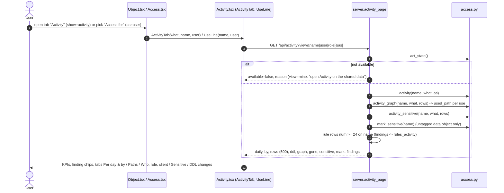

<!-- generated by darshan-singh-meel-knowledge-graph -->
# Flow: Activity tab (web -> /api/activity -> access.activity)

One-line summary: the Activity tab of an object, a person or a role (and the one-line "Used: ..." in the Object page's "Access for" strip) asks `GET /api/activity`; `server.activity_page` checks that activity was read, then sends `access.activity()` numbers, the grant-path diagram (`activity_graph`), the sensitive view (`activity_sensitive`), tag text for an untagged table (`mark_sensitive`) and the rule 24-28 findings on that name.

## Steps

1. Object page: tab "Activity" next to History (not on the admin-holders page) — `web/src/pages/Object.tsx:71`; renders `ActivityTab what="object"` with `user={c.params.as}` — `web/src/pages/Object.tsx:75`.
2. Access page (person or role): tab "Activity" — `web/src/pages/Access.tsx:106`; `ActivityTab what={user ? "user" : "role"}` — `web/src/pages/Access.tsx:110`.
3. "Access for" strip on the Object page: `UseLine` for the picked user — `web/src/pages/Object.tsx:102`; it asks the same endpoint with `as=` and shows queries, roles, clients and last day, or "Not used in N days"; a click sets `show=activity, as=<user>` — `web/src/pages/Activity.tsx:35-49`.
4. `ActivityTab` calls `useApi("activity", {view, name|user|role, as})` — `web/src/pages/Activity.tsx:17-21`, `web/src/api/client.ts:69`; with `as` set it shows "Only X's use" and an "All users" button that clears `as` — `web/src/pages/Activity.tsx:24-32`.
5. Route: `GET /api/activity` -> `serve("activity")` -> `ROUTES["activity"] = activity_page`; in WITH_REFS, so `refs` (kinds, labels) come along — `server.py:2365-2366`, `server.py:2249-2251`. Inside Snowflake the same handler answers through the st_react bridge (`flows/streamlit-in-snowflake.md`).
6. `activity_page(p, view)`: `what` = object (name=), user (user=) or role (role=); `as=` only on an object — `server.py:1655-1657`.
7. `act_state()`; My access without activity -> reason "open Activity on the shared data" — `server.py:1658-1660`, `access.py:4248-4255`. Not available -> `available=false, reason` only — `server.py:1661-1664`.
8. `activity(name, what, who)` -> first, last, daily, by, rows, ddl — `server.py:1665`, `access.py:4262-4298`.
9. `activity_graph(name, what, rows)` -> graph built by `build_graph("Who used it, through which grant", ...)` and `gone` (uses with no grant path now) — `server.py:1666-1671`, `access.py:4322-4346`.
10. `activity_sensitive(name, what, rows)` and, for an untagged data object, `mark_sensitive(name)` — `server.py:1673-1674`.
11. Findings: rule rows (`S["rows"]`, from `findings()`, rules 24-28 via `rules_activity`) with number >= 24 whose grantee is the name or whose path names it, narrowed to `as` — `server.py:1675-1677`, `access.py:5211`.
12. Rows sent: first `MAX_ACTIVITY` (500), `total` = all — `server.py:1649`, `server.py:1669`.
13. Screen: banner when partly read (no client), KPI row (queries, distinct users/roles/clients, sensitive seen in clear, DDL changes), finding chips that open Risks — `web/src/pages/Activity.tsx:61-72`; tabs — `web/src/pages/Activity.tsx:73-79`.
14. "Per day & by": `DayStack` stacked bars per user / role / client / statement / table and a table with mini bars — `web/src/pages/Activity.tsx:90-115`, `web/src/components/visuals.tsx:74-112`. Names link to the Object or Access page with `show=activity` — `web/src/pages/Activity.tsx:57-58`.
15. "Paths": the grant-path graph and the uses without a path — `web/src/pages/Activity.tsx:127-145`. "Sensitive": per table and per user + role what they see — `web/src/pages/Activity.tsx:147-184`. "Who, role, client" and "DDL changes": the rows table, DDL rows marked — `web/src/pages/Activity.tsx:186-201`.
16. Types: `ActivityPage`, `ActivityBy`, `ActivityRow`, `ActivitySensitive`, `ActivityKey` — `web/src/api/types.ts:1213-1247`.

## Example (fake data, `test_server.test_activity`, `test_server.py:634-648`)

| Request | Answer |
|---|---|
| `/api/activity?name=SALES.CORE.TBL_CUSTOMER` | `what=object`, 60 daily values, findings `[24]`, newest DDL row `ALTER_TABLE_ADD_COLUMN`, a graph, sensitive people, `mark=None` (already tagged) |
| `/api/activity?user=ENGINEER_01` | findings `{24, 27}` |
| `/api/activity?role=SYSADMIN` | top user OPS_01, `graph=None`, `gone[0].role = SYSADMIN` |
| `/api/activity?name=SALES.CLEAN.TBL_ORDER` | `mark.sql` holds `SET TAG` |
| `...TBL_CUSTOMER&as=ENGINEER_01` | `user=ENGINEER_01`, only that user in `by.user`, findings `[24]`, fewer queries |
| `...TBL_CUSTOMER&as=HR_01` | no rows (granted or not, no use) |

Related: [activity logic](../logic/activity.md) · [activity read](activity-read.md) · [web request](web-request.md).
