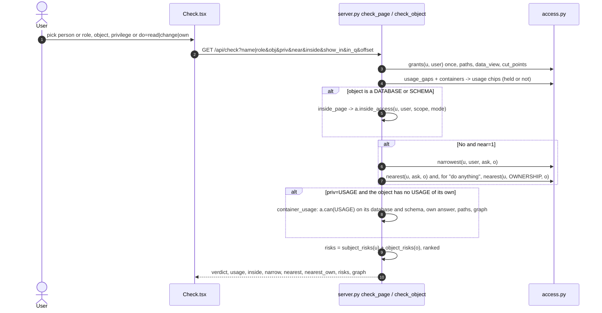

<!-- generated by darshan-singh-meel-knowledge-graph -->
# Flow: Can they? (answer, USAGE chips, inside a database or schema, the narrowest way in)

One-line summary: `GET /api/check` answers whether a person or role can use an object; the answer carries the database and schema USAGE chips, the risk strip of both, for a database or schema the tables and views inside (read / DML / DDL), and for a No the narrowest grant first, then the ways to use it and, apart, the ways to own it. Every privilege Snowflake has on the type can be asked; USAGE on a table answers for its database and schema.

## Steps

1. `check_page()` calls `check_object()` — server.py:2611-2618. It reads the subject's grants once (`a.grants(u, user)`), picks the object (`obj=`, `on=` or the first data object) and the privilege (`priv=` or `do=` read / change / own) — server.py:2646-2659. Choices: `a.ask_privs(kind)`, the privileges in the data first, then every other one Snowflake documents for the type (`SNOWFLAKE_PRIVS`; a schema also every `CREATE <type>`) — access.py:4200-4240, server.py:2655.
1a. USAGE on an object without a USAGE privilege of its own (a table): `check_page` adds USAGE to the choices; asked, the object stays and `container_usage()` replaces the answer with USAGE on its database and schema: yes only when both are held, else No naming the missing ones; paths, ownership, admin ways, lanes and the graph (with `focus=`) lead to the containers; no cuts, ways in, held row, rows and columns (the two USAGE chips say it) — server.py:2621-2643.
2. USAGE chips: one per container (`a.containers`), held unless `a.usage_gaps` lists it; objects an admin role's real links reach skip the check — server.py:2751-2753 (Snowflake checks database and schema USAGE first; `test_blocked` — test_access.py:1924).
3. Database or schema: `inside=inside_page(...)` — server.py:2754. `inside_page()` takes `inside=` read | dml | ddl (`a.INSIDE_NEEDS`), `show_in=` all | can | cannot, `in_q=`, pages of `INSIDE_PAGE` (100) with can / cannot / blocked counts and the CREATE privileges on the schema — server.py:2772-2786, access.py:5037.
4. `a.inside_access()`: every table and view inside with what the subject holds, OWNERSHIP or an admin role's real links give everything, no USAGE on its database or schema = blocked; cannot first, then by name — access.py:5040-5067.
5. A No (only when the page asks `near=1`, the slow part): `a.narrowest()` = the asked privilege granted to the smallest role the subject already reaches that has USAGE on the object's schema (else database), text only — access.py:5292-5306; `nearest` for use and, when every privilege is asked, `nearest_own` apart; a one-step way carries its grant text — server.py:2729-2735.
6. Risk strip: the subject's and the object's risks, each line prefixed with its name, ranked — server.py:2769 ([home.md](home.md) for `subject_risks` / `object_risks`).
7. Graph: "Paths combined" built with `focus=` — server.py:2768 ([graph-focus.md](graph-focus.md)).
8. UI: `Risks quiet` at the top, the verdict (a disabled or dormant user is said beside it, with the days since the login), the USAGE chips, then side-menu tabs — web/src/pages/Check.tsx:41-84:
   - **Inside** (a database or schema; the default then): `InsideCard` — web/src/pages/Check.tsx:93-121.
   - **Answer** (else the default): the nearest way in for a No, Why it is blocked (`Blocked`), the graph; without routes also the table of routes and the ways to remove it — web/src/pages/Check.tsx:392-414.
   - **Routes** (with routes): second level Routes (one lane each) / Where to cut (`part=cut`) / Table (`part=table`: one row per privilege, admin routes, ownership) — web/src/pages/Check.tsx:174-245.
   - **Ways in** (a No): `Narrow` before the `WayList`s ("To use it", "To own it") — web/src/pages/Check.tsx:249-315.
   - **Rows & columns** (when there are layers or a read): the three layers, then What they see (use role, rows, columns) — web/src/pages/Check.tsx:319-352.
9. Why it is blocked: `Blocked` draws one coloured line per fact (✓ Has the privilege, ✓ Has / ✕ Missing USAGE per container), then "Smallest fix" with one + Add line per grant and the same as SQL, one GRANT per line; text only, never run — web/src/pages/Check.tsx:369-388.

## Tests
- `test_check`: all table privileges can be asked, one nobody holds too; USAGE on a table asks its containers — test_server.py:296-308.
- `web/src/pages/blocked.test.tsx`: one line per fact and per grant.
- `test_check_inside`: each table and view inside, read / DML / DDL, USAGE chips — test_server.py:283.
- `test_check_narrow`: a Streamlit app asks USAGE; the narrowest grant first, owning apart — test_server.py:275.
- `test_risks`: the risk strip on Can they? and the other pages — test_server.py:1919.
- `test_answer_first`: every screen opens with its answer — test_server.py:1883.
