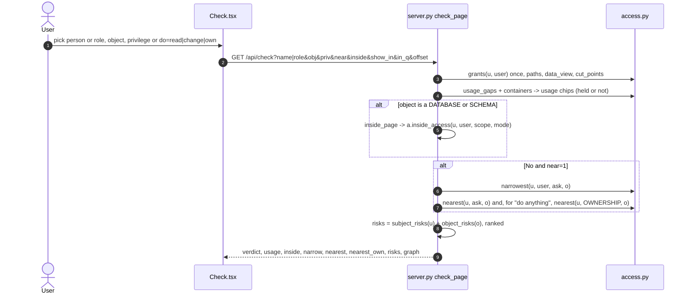

<!-- generated by darshan-singh-meel-knowledge-graph -->
# Flow: Can they? (answer, USAGE chips, inside a database or schema, the narrowest way in)

One-line summary: `GET /api/check` answers whether a person or role can use an object; the answer carries the database and schema USAGE chips, the risk strip of both, for a database or schema the tables and views inside (read / DML / DDL), and for a No the narrowest grant first, then the ways to use it and, apart, the ways to own it.

## Steps

1. `check_page()` reads the subject's grants once (`a.grants(u, user)`), picks the object (`obj=`, `on=` or the first data object) and the privilege (`priv=` or `do=` read / change / own) — server.py:2587-2600.
2. USAGE chips: one per container (`a.containers`), held unless `a.usage_gaps` lists it; objects an admin role's real links reach skip the check — server.py:2692-2694 (Snowflake checks database and schema USAGE first; `test_blocked` — test_access.py:1924).
3. Database or schema: `inside=inside_page(...)` — server.py:2695. `inside_page()` takes `inside=` read | dml | ddl (`a.INSIDE_NEEDS`), `show_in=` all | can | cannot, `in_q=`, pages of `INSIDE_PAGE` (100) with can / cannot / blocked counts and the CREATE privileges on the schema — server.py:2713-2727, access.py:4994.
4. `a.inside_access()`: every table and view inside with what the subject holds, OWNERSHIP or an admin role's real links give everything, no USAGE on its database or schema = blocked; cannot first, then by name — access.py:4997-5024.
5. A No (only when the page asks `near=1`, the slow part): `a.narrowest()` = the asked privilege granted to the smallest role the subject already reaches that has USAGE on the object's schema (else database), text only — access.py:5249-5263; `nearest` for use and, when every privilege is asked, `nearest_own` apart; a one-step way carries its grant text — server.py:2670-2676.
6. Risk strip: the subject's and the object's risks, each line prefixed with its name, ranked — server.py:2710 ([home.md](home.md) for `subject_risks` / `object_risks`).
7. Graph: "Paths combined" built with `focus=` — server.py:2709 ([graph-focus.md](graph-focus.md)).
8. UI: `Risks quiet` at the top, the USAGE chips, `InsideCard` for a database or schema, `Narrow` before the `WayList`s ("To use it", "To own it") — web/src/pages/Check.tsx:52, web/src/pages/Check.tsx:69-76, web/src/pages/Check.tsx:90-106, web/src/pages/Check.tsx:226-238.

## Tests
- `test_check_inside`: each table and view inside, read / DML / DDL, USAGE chips — test_server.py:283.
- `test_check_narrow`: a Streamlit app asks USAGE; the narrowest grant first, owning apart — test_server.py:275.
- `test_risks`: the risk strip on Can they? and the other pages — test_server.py:1905.
- `test_answer_first`: every screen opens with its answer — test_server.py:1869.
