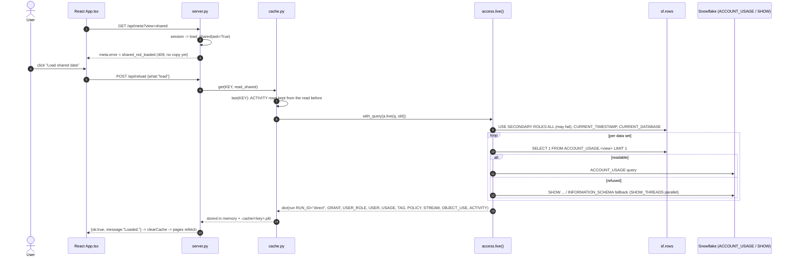

<!-- generated by darshan-singh-meel-knowledge-graph -->
# Flow: shared data read directly (SOURCE=direct, access.live)

One-line summary: no snapshot tables; on a click ("Load shared data") the server runs `access.live()` with the login's role — ACCOUNT_USAGE where readable, else SHOW / INFORMATION_SCHEMA — and keeps the same dict as `snapshot()` in memory and `.cache/`.



## Steps

1. Direct is the default when neither `SOURCE` nor `ACCESS_SNAPSHOT` is set — cache.py:31-36; `DIRECT = SOURCE == "direct"` — server.py:22.
2. A page request never starts the slow read: `load_shared(ask=True)` raises `409 shared_not_loaded` unless `cache.ready(KEY)` — server.py:96-100, cache.py:136-143.
3. `meta()` catches it and sends `error` so the UI shows the load card — server.py:2146-2162; React: `needShared` and the "Load shared data" button — web/src/App.tsx:305, web/src/App.tsx:348, `post("reload", {what:"load"})` — web/src/App.tsx:291.
4. `reload({"what":"load"})` -> `load_shared()` — server.py:2204-2206; refresh `{what:"page"}` / `rebuild` drop the cache and read again at once in direct mode — server.py:2200-2210.
5. `read_shared()` -> `with_query(lambda q: a.live(q, old))` with `old` = the ACTIVITY rows of `cache.last(KEY)` (memory, `.pkl`, `.old.pkl`, `.prev.pkl`) — server.py:87-93, cache.py:93-104, server.py:71-84.
6. `live(query)` setup: `USE SECONDARY ROLES ALL` (refused inside SiS, ignored), `CURRENT_TIMESTAMP`, `CURRENT_DATABASE` (may be refused -> `None`) — access.py:637-646.
7. Grants: ACCOUNT_USAGE `GRANTS_TO_ROLES` / `GRANTS_TO_USERS` if both readable (database role grantee qualified as `DB.ROLE`), else `SHOW ROLES` + `SHOW GRANTS TO/OF ROLE` per role and database roles per database; skipped roles land in notes — access.py:653-698.
8. Future grants: SHOW only; `SHOW DATABASES` refused -> `future_grants=UNAVAILABLE` — access.py:700-728.
9. Users: ACCOUNT_USAGE.USERS else `SHOW USERS` — access.py:730-746. Usage: QUERY_HISTORY 30 days else INFORMATION_SCHEMA 7 days — access.py:748-778.
10. Tags / policies: ACCOUNT_USAGE else per-object INFORMATION_SCHEMA up to `TAG_FALLBACK_MAX` (300) — access.py:798-871, access.py:610.
11. Object use: ACCESS_HISTORY only (`use_sql`), else empty + note — access.py:873-881, access.py:904-918. Activity: ACCESS_HISTORY + QUERY_HISTORY (+ SESSIONS for the client), only the days `old` lacks (`activity_start`), the app's QUERY_TAG left out — access.py:883-892, access.py:921-959 ([flows/activity-read.md](activity-read.md)). Streams: `SHOW STREAMS IN ACCOUNT` — access.py:894-900.
12. Returns `run = dict(RUN_ID="direct", FINISHED_AT=now, SOURCES, NOTES)` — access.py:901.
13. Parallel SHOW statements: `each()` runs `SHOW_THREADS` (16) at a time, returning exceptions instead of failing — access.py:490-504.
14. Kept with `cache.get` (memory + file); SQL copy gets run id `direct-<timestamp>` — cache.py:216-217.
15. Must stay in step with `SP_ACCESS_SNAPSHOT` (rule in docstring) — access.py:613-616; checked by `test_live` — test_access.py:466 and `test_live_inside` (SHOW, USE SECONDARY ROLES, CURRENT_DATABASE refused) — test_access.py:510.

## Example (mock query that answers everything empty; no Snowflake)

Statements `a.live(q)` sends when every ACCOUNT_USAGE view is readable:

```
USE SECONDARY ROLES ALL
SELECT CURRENT_TIMESTAMP() AS T
SELECT CURRENT_DATABASE() AS D
SELECT 1 FROM SNOWFLAKE.ACCOUNT_USAGE.GRANTS_TO_ROLES LIMIT 1
SELECT 1 FROM SNOWFLAKE.ACCOUNT_USAGE.GRANTS_TO_USERS LIMIT 1
SELECT IFF(GRANTED_TO = 'DATABASE_ROLE', ...) ... FROM SNOWFLAKE.ACCOUNT_USAGE.GRANTS_TO_ROLES ...
SELECT GRANTEE_NAME AS USER_NAME, ROLE AS ROLE_NAME, GRANTED_BY FROM SNOWFLAKE.ACCOUNT_USAGE.GRANTS_TO_USERS ...
SHOW DATABASES
SELECT 1 FROM SNOWFLAKE.ACCOUNT_USAGE.USERS LIMIT 1   ... (USERS, QUERY_HISTORY, TAG_REFERENCES, POLICY_REFERENCES, ACCESS_HISTORY)
SHOW STREAMS IN ACCOUNT
```

- Resulting `SOURCES`: `grants/user_roles/users/usage/tags/policies/object_use = ACCOUNT_USAGE`, `future_grants = SHOW`, `streams = SHOW`; `RUN_ID = "direct"`.
- `cache.config({"SOURCE": "direct"})` -> `('snowflake', 'direct', '')`.
