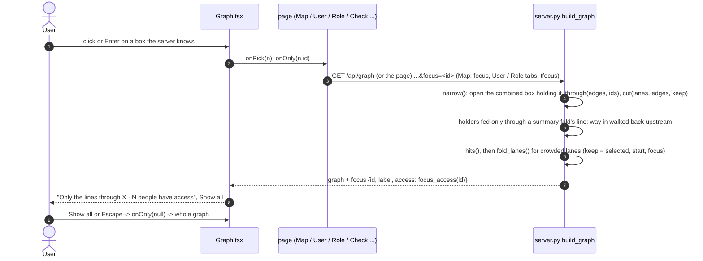

<!-- generated by darshan-singh-meel-knowledge-graph -->
# Flow: graph focus (a click shows only the lines through a box)

One-line summary: a click on any box of a graph asks the server again with `focus=<box>`; `build_graph` narrows the graph to the lines through that box before anything is folded (`narrow` -> `through` -> `cut`), keeps the way in through folded boxes, and sends `focus = {id, label, access}` so the bar above the graph says who has access and offers Show all.

## Steps

1. A click on a box whose id the server knows (drawn nodes, combined boxes and their members) calls `onPick` and `onOnly(id)` at once; other boxes only open — web/src/components/Graph.tsx:123-135.
2. Pages keep the focus in the URL: Map `focus` (with `sel`), the User and Role tabs `tfocus`; a new scope or filter clears it (`UNFOCUS`) — web/src/pages/Map.tsx:76, web/src/pages/Map.tsx:106, web/src/pages/User.tsx:40, web/src/pages/Role.tsx:143, web/src/pages/common.tsx:213.
3. Every graph endpoint passes `focus=p.get("focus")` to `build_graph` / `tab_graph` — server.py:1333, server.py:1338, server.py:2074, server.py:2768, server.py:2890, server.py:4039, server.py:4045.
4. `build_graph(focus=)` narrows first, so a big account sends only those lines; a folded lane of the big graph (`lane:<i>`) is computed once per graph (`later`) — server.py:867-886.
5. `narrow()`: a combined box opens into its members; a member picked inside an opened box opens it with only that member; a summary fold whose own lines do not reach its members stays one box; a box not drawn gives the whole graph and a note — server.py:807-864.
6. `through()` keeps the focus and everything upstream and downstream of it; `cut()` drops other nodes, edges and empty lanes — server.py:777-798.
7. The way in is kept: a holder fed only through a summary fold's own line is walked back upstream from the drawn lines — server.py:846-855.
8. Over `MAX_BOX` objects in more than one schema, the kept objects box again by schema (`scope_key`, `combine_tab`) — server.py:801-804, server.py:859-863.
9. After narrowing, any lane over `MAX_LANE` (24) roles or people folds into one box, in any graph, not only big ones — server.py:62, server.py:888-889, server.py:743-774.
10. `focus_access(o)`: for a database, schema or object, people per level and roles on the way (`a.who_has`); None for a role or a box — server.py:732-740; sent as `focus=dict(id, label, access)` — server.py:989.
11. Bar above the graph: "Only the lines through X", who has access with a link to the object page, Show all (Escape) — web/src/components/Graph.tsx:195-206.

## Tests
- `test_graph_focus`: only the lines through the box on every graph; the access graph's filters — test_server.py:936.
- `test_focus_keeps_way_in`: a holder fed only through a summary fold keeps its way in — test_server.py:249.
- `test_crowded_lane`: a lane over `MAX_LANE` people folds even in a small graph — test_server.py:259.
- `web/src/components/graphfocus.test.tsx`: the click, Show only this, Show all in the component.

Related: [lazy-graph-box.md](lazy-graph-box.md).
