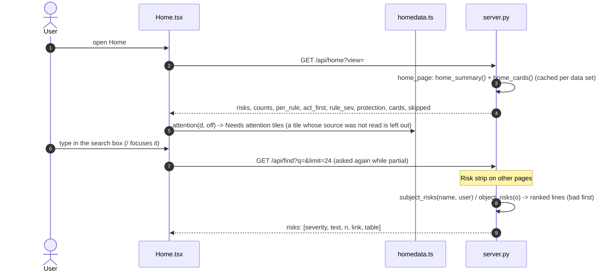

<!-- generated by darshan-singh-meel-knowledge-graph -->
# Flow: Home page and the risk strip

One-line summary: Home opens with a search hero, then (shared data) three tabs, Risks (Needs attention tiles, Act first, the risk cards), At a glance (the account) and Changes, all from one `GET /api/home`; the same server risk lines (`subject_risks`, `object_risks`) feed the risk strip at the top of Access Overview, Role paths, Who has access, What they see and Can they?, which shows the top 3 and "+N more".

## Home

1. `home_page()`: shared view has nobody picked (`me` only on My access); My access gets counts only; shared adds risks, per rule, act first, severity per rule, skipped rules, protection and the cards — server.py:1881-1894.
2. `home_summary()` once per data set: findings per severity and rule, people and roles per severity, the rules to act on first (Critical, then High, rarest first), unmasked sensitive columns (rule 6), dormant readers (rule 7), governance counts — server.py:1897-1933.
3. `home_cards()`: admin holders by admin role, stale people, roles by kind, chain depth, biggest schemas and databases, activity per day, the Object activity card ([object-activity.md](object-activity.md)) — server.py:1942-1984.
4. UI: hero "Who can access what in Snowflake?" with the big search (`/` focuses it; `find` asked with `limit=24`, again while the answer is `partial`) — web/src/pages/Home.tsx:73-99, web/src/pages/Home.tsx:111-120; the user's ladder card on My access; `Shared` = the tabs (`show=` risks by default, `glance`, `changes`): Needs attention, Act first and the risk cards (By area folded) / the account at a glance / What changed — web/src/pages/Home.tsx:188-194, web/src/pages/Home.tsx:226-248. Hero quick links: Ask a question only; recently viewed: the first 3, then "+N more" — web/src/pages/Home.tsx:70, web/src/pages/Home.tsx:170-176.
5. Needs attention tiles from `attention(d, off)`: one number per tile, each opening where it is acted on; a tile whose source was not read is left out, so no 0 that means unknown — web/src/pages/homedata.ts:50-60, web/src/pages/Home.tsx:204-206.
6. Takeaway lines and percentages (`pct` says `<1%` for a small non-zero share, `depthRows` shows every depth) — web/src/pages/homedata.ts:7-30.

## Risk strip

1. `risk(bad, text, n, to, cols, rows)` makes one line with a link and, when it has items, a `table` of the first `RISK_ROWS` (10) rows with the total; `ranked()` puts `bad` lines first and keeps the built order within a tone — server.py:1733-1759.
2. Person or role (`subject_risks`, cached): is an admin role, holds admin roles (shortest path per admin role), account privileges not from PUBLIC, reads sensitive objects unmasked, rule findings, default role is admin, dormant or disabled with roles, very broad access, secondary roles ALL — server.py:1780-1835.
3. Object (`object_risks`, cached): readers and writers from the grants (people without USAGE on its database or schema left out), without the Who has access walk, so Can they? stays fast — server.py:1838-1880.
4. Pages: Access Overview — server.py:1709; What they see (the same lines, quiet) — server.py:2987, web/src/pages/See.tsx:49; Role — server.py:2220; Who has access (object) — server.py:2557; Can they? (both, each line prefixed with its name) — server.py:2769.
5. UI: `Risks` wraps `RiskStrip` (quiet: no "No risks found" line, used on Can they?) — web/src/pages/common.tsx:59-64; `RiskStrip` shows the top 3, the rest behind "+N more"; a line with a table opens it in place (one at a time), "+N more" under it and Open all go to the link's page — web/src/components/kit.tsx:175-209.

## Tests
- `test_risks`: the strip on Access Overview, Role paths, Who has access and Can they? — test_server.py:1919.
- `web/src/pages/homedata.test.ts`, `web/src/pages/homeview.test.tsx`, `web/src/components/risks.test.tsx`: tiles, takeaways, the Home view and the strip.
