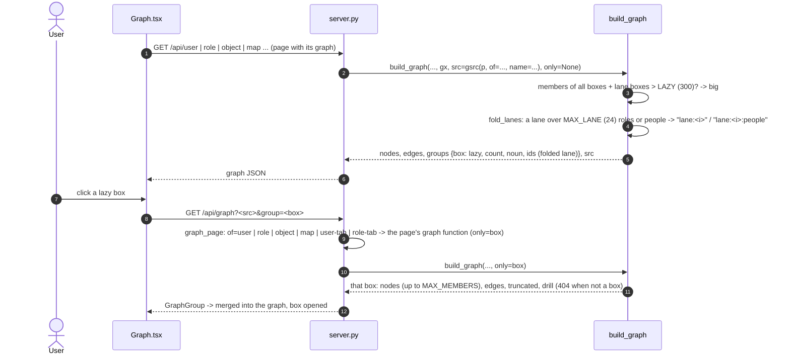

<!-- generated by darshan-singh-meel-knowledge-graph -->
# Flow: lazy graph box (a big graph's combined boxes, opened on demand)

One-line summary: on a big graph `build_graph` folds crowded lanes into one box each and sends every combined box empty (counts only, `lazy`), with `src` = the graph endpoint's params; a click on such a box fetches `GET /api/graph?<src>&group=<box>`, which builds the same graph again and answers that box alone, members and lines included (`server.py:867-996`, `web/src/components/Graph.tsx:123-152`).

## Steps

1. Limits: `LAZY = 300` members over all combined boxes and lanes before boxes go out empty, `MAX_LANE = 24` role or people boxes a lane draws, `MAX_MEMBERS = 1000` members of one opened box — server.py:56-62.
2. A page's graph function passes `src` (the params that draw it again, `gsrc()` over `GSRC`) and `only`: `user_graph`, `role_graph`, `object_graph`, `tab_graph`, `map_graph` — server.py:1341-1343, server.py:63, server.py:1326-1338, server.py:2051-2074, server.py:2311-2316, server.py:1127-1143, server.py:2855-2894.
3. `build_graph`: `big` when `src` is set and the members plus lane boxes pass `LAZY`; `lazy` = big and no `only` — server.py:886-887.
4. `fold_lanes` on a big graph, and on any graph with a lane over `MAX_LANE` (server.py:888-889; [graph-focus.md](graph-focus.md)): per lane the free roles and the free people (users, or the map's people stacks counted by `sizes`) over `MAX_LANE` become one `lane_group` box, `lane:<i>` or `lane:<i>:people`; lines to the members point at the box and carry the member count; the start and the selected box never fold — server.py:743-774, server.py:888-889.
5. Groups: a lazy box sends no nodes and no edges, only kind, label, noun, count, sensitive, findings, classes, `lazy=true` and, for a folded lane, `ids` (its role names, so other boxes' lines can end in it); an opened box sends up to `MAX_MEMBERS` nodes with their lines and `truncated` — server.py:962-981.
6. `only=<box>`: the box alone (404 `not_found` via `need` when it is not a combined box of this graph); the full graph JSON carries `src` only when lazy — server.py:982-984, server.py:991, server.py:517-519.
7. `graph_page(p, view)`: `of=` picks the page's graph (user, role, object, map, check, user-tab, role-tab), `group=` is passed as `only` — server.py:4020-4046.
8. Map (Access graph): `map_graph` rolls objects up to one box per database over `MAX_BOX`, folds crowded people and role lanes, `src` with `of=map`; `map_page` sends the detail of every drawn box, and `node=<id>` answers the detail of a box drawn later (from an opened box) alone — server.py:2855-2894, server.py:2932-2954. Only the Trace tab fetches `/api/map` — web/src/pages/Map.tsx:26-27; a picked box without detail fetches `map?node=` — web/src/pages/Map.tsx:85-86.
9. React: `Graph` keeps the fetched boxes (`got`) and merges them into the graph; a click on a lazy box with `graph.src` calls `get("graph", {...graph.src, group: id})`, shows "fetching" meanwhile and the error text on failure; a box already sent opens at once — web/src/components/Graph.tsx:67-77, web/src/components/Graph.tsx:123-152. `foldRoles` folds crowded role lanes the same way on the client, a lazy folded lane's members known by `ids` — web/src/components/graphs.ts:155, web/src/components/graphs.ts:255. Types `GraphGroup.lazy`, `ids`, `Graph.src` — web/src/api/types.ts:132-133, web/src/api/types.ts:150.

## Example (fake data, tests)

- `test_paged`: with `LAZY=0` every box of `graph?of=user&name=SVC_DEPLOY` (and of the user-tab and role graphs) is lazy and has `src`; `graph?<src>&group=<box>` answers it with nodes and the same count; the members equal those of the box sent whole; `MAX_LANE=2` folds a role lane into `lane:<i>` whose `ids` equal the roles `group=lane:<i>` returns; `group=NOPE` -> 404 — test_server.py:103-132.
- `test_big_lanes`: with `LAZY=0`, `MAX_LANE=1` the people lane of the Object, Role (PUBLIC) and Access graph pages is `lane:0:people` (lazy, noun people, count = len(ids) > 1), its members drawn nowhere else, and `group=lane:0:people` returns exactly those users; `map?role=PUBLIC&node=<id>` returns one detail with leads; `map?user=SVC_DEPLOY` rolls objects into database boxes over `MAX_OBJECTS` — test_server.py:206-230.

Rules: [business_rule:graph_rollup](../logic/rules.md), [business_rule:graph_summary](../logic/rules.md). Paged tables: [paged-tables.md](paged-tables.md).
