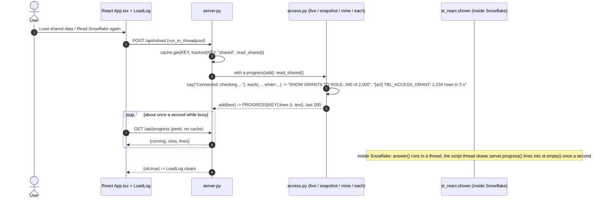

<!-- generated by darshan-singh-meel-knowledge-graph -->
# Flow: progress lines while reading Snowflake

One-line summary: a load or refresh runs inside `server.tracked()`, every read reports what it does through `a.say()`, and the lines reach the screen through `GET /api/progress` locally (the `LoadLog` panel polls it) or through `st_react.shown()` inside Snowflake, where Python is busy and the frame cannot ask.

## Steps

1. `a.progress(fn)` sets the sink in a context variable; `a.say(text)` sends to it (and keeps it as the last line), a no-op outside — access.py:653-680. Two loads at once (shared and My access) keep their own lines. A heartbeat thread adds "Still working after N min: <steps running>" (or the last line) every `BEAT` (60) s, so a statement that runs for minutes still shows signs of life — access.py:650-673.
1a. `a.step(name)` wraps a build step: "<name>…", the heartbeat names it while it runs, then "<name>: done in N s" — access.py:692-704. Used for `built()`'s "Building the role graph", "Checking the rules", "Working out what each fix changes", "Saving the rule results", "Preparing the pages" (server.py:192-205) and the DuckDB copy (cache.py:266); `findings()` adds "Slowest rules: ..." (access.py:6719-6722).
2. `each()` hands the caller's sink and a worker number to its threads (`initializer=start`), labels waves (`what`: a count per tenth, a timeout on its own line) or names each heavy read (`[w2] ...`) — access.py:715-758.
3. `snapshot()`, `mine()` and `live()` say each step and end with `done in N s` — `snapshot()` access.py:517-608, `mine()` access.py:786-942, `live()` access.py:943-1348.
4. `server.tracked(key, view, fn)` keeps `PROGRESS[key] = {view, running, start, lines}` (last `MAX_LINES` 200, under `PLOCK`), says `failed: ...` on an error — server.py:66-71, server.py:130-148. Used by `load_shared`, `load_mine` and a refresh (`renew`) — server.py:221, server.py:298, server.py:3219. With `LOG_LINES` (python server.py, app.py) each line is also printed as `HH:MM:SS [view] text` — server.py:138-139.
5. `server.progress(view)` returns the newest running read (or idle) and `job`, the last background refresh; it only reads `PROGRESS`, so asking never starts a load — server.py:151-158. Route `GET /api/progress` — server.py:3416-3418; `/api/reload` runs in a thread pool so the poll answers meanwhile — server.py:3414. uvicorn leaves `GET /api/progress` out of its access log (`quiet_log` / `NoProgress`, server.py:3475-3486).
6. Local React: `peek()` (GET without the cache, `null` inside Streamlit) — web/src/api/client.ts:46-50; `LoadLog` polls every second while `busy` or `m.loading`, keeps the newest line in view — web/src/components/LoadLog.tsx:6-31, web/src/App.tsx:274, web/src/App.tsx:403; styles `.ae-loadlog` — web/src/components/styles.css:297-302. Until the first answer the app (no meta yet) and every page (`Load`) show `Waiting`: "Loading…" with a spinner, its seconds from 3 s, and from 10 s that the first open of a page on a big account works out its lookups and opens by itself — web/src/components/kit.tsx:239-246, web/src/App.tsx:405, web/src/pages/common.tsx:16.
7. Streamlit in Snowflake: `answer()` serves `progress` too — st_react.py:34-35; `shown(box, r, sid)` runs the request in a thread kept in session state (a rerun waits for it), draws the last 40 lines into the `st.empty()` box above the app once a second, then clears it — st_react.py:54-78, st_react.py:87, st_react.py:96.
8. Contract: `Progress` type — web/src/api/types.ts:168-174; API doc — web/API.md:261-267.

## Example (test_server.test_progress, fake connection)

- Idle: `GET /api/progress` -> `{"running": false, "view": null, "lines": []}`, also through `st_react.answer`.
- During a direct load: `running: true`, `view: "shared"`, first line starts with `Connected`, a line `... GRANTS_TO_ROLES…`; every `t` a float.
- Another host -> 400; `Sec-Fetch-Site: cross-site` -> 403 (same checks as every `/api/` route) — test_server.py:1355-1403.

Rule: [business_rule:progress_lines](../logic/rules.md).
