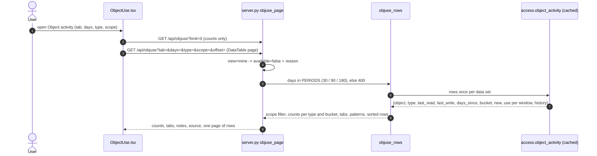

<!-- generated by darshan-singh-meel-knowledge-graph -->
# Flow: Object activity page

One-line summary: the Object activity page (shared data only) lists every table, view, warehouse and Streamlit app by last use, with counts per type and age and the tables read but never written (and the reverse); one pass `access.object_activity()` per data set feeds the page, its CSV and a Home card.

## Steps

1. Page key `objuse`, title "Object activity", shared only (`SHARED_ONLY`), Risk group — server.py:39, server.py:43, server.py:45; the same list in the React app — web/src/App.tsx:30-33.
2. `objuse_page()`: My access gets `available=False` and a reason (no ACCESS_HISTORY there); else the counts, the tab, `use_state()` and one page (`paged`) — server.py:3133-3148.
3. `objuse_rows()`: `days` must be one of `PERIODS`, `scope=` keeps a database or schema and what is inside, tabs `unused` / `read_only` / `write_only` / `all`, `type=` and `q=` filters, sort per tab — server.py:3090-3122, server.py:3080-3087.
4. `object_activity()`: tables and views (read through a view counts as read), warehouses (their queries, `DAYS_USAGE` days), Streamlit apps (queries run for viewers, `ACTIVITY_DAYS` days), procedures / functions / tasks as "no activity data"; no use inside a type's history is `nodata`, not "none"; `new` marks DDL within `ACTIVITY_DAYS` so a fresh object is not taken for a dead one — access.py:6668-6778, access.py:6659-6661.
5. CSV: `objuse_csv()` with the same rows — server.py:3151-3162.
6. Home card: `home_cards()` sends `objuse` (unused in 90 days, new among them, types, types with no data, read-only / write-only counts) — server.py:1979-1984; drawn by `ObjUseCard` — web/src/pages/Home.tsx:452.
7. The page calls `/api/objuse` twice: counts with `limit=0`, rows through the paged table — web/src/pages/ObjectUse.tsx:16, web/src/pages/ObjectUse.tsx:115 ([paged-tables.md](paged-tables.md)).

## Tests
- `test_object_activity`: age buckets, read / write patterns, new objects, no-data types — test_access.py:2226.
- `test_objuse`: counts per type and age, tabs, paging, filters, CSV, Home's card — test_server.py:1223.
