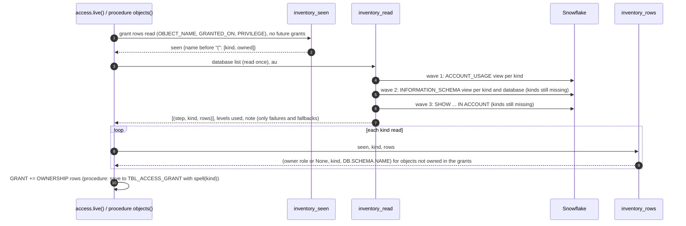

<!-- generated by darshan-singh-meel-knowledge-graph -->
# Flow: object inventory (every object the account lists)

One-line summary: after the grants, the snapshot lists every object of the account per kind (`inventory_sql`) and adds one `OWNERSHIP` grant row for each object the grant read lacks, so objects no grant names (a Streamlit app, a notebook) show too; kinds get one spelling (`spell`).

## Steps

1. Kinds: databases, schemas, tables (any flavour), views, functions, procedures, stages, pipes, sequences, file formats, streams, tasks, tags, masking and row access policies, integrations, compute pools (ACCOUNT_USAGE / INFORMATION_SCHEMA where a view exists), Streamlit apps, notebooks, alerts and warehouses (SHOW only) — access.py:1017-1057, README.md:403-405.
2. `inventory_seen()` keys the grant rows by name before `(` (a function's grant name carries its signature, the inventory's argument names); role and account rows are skipped — access.py:1060-1068.
3. `inventory_read()` reads level by level per kind, the first level that answers; a refused read loses only its own kind; the note lists only kinds no level read and kinds read with a fallback — access.py:1134-1185 ([read-levels.md](read-levels.md)).
4. `inventory_rows()` gives one row per object whose ownership the grants lack: owner role, a database role as `DB.ROLE`, `None` when an application owns it or the read names no owner (listed with no holder); an object already granted keeps its kind; `INFORMATION_SCHEMA` itself is skipped — access.py:1071-1092.
5. Direct mode appends them to `d["GRANT"]` as `OWNERSHIP` rows and says in the load log how many objects have no owner role — access.py:1644-1654.
6. The procedure step `objects` reads the grant rows of its run from `TBL_ACCESS_GRANT`, runs the same functions and saves the rows with `spell(k)`; any error = `UNAVAILABLE`, the run stays OK — sql/1_setup.sql:949-966, sql/1_setup.sql:1201-1202.
7. One spelling per type: `spell()` turns `EXTERNAL_TABLE` (GRANTS_TO_ROLES) into `EXTERNAL TABLE` (SHOW); role links keep theirs — access.py:1946-1949, sql/1_setup.sql:313-314; `tidy()` applies it to older snapshots and Direct rows — access.py:1984.
8. SHOW TABLES / VIEWS name Iceberg, hybrid and materialized kinds through flags (`show_kind`), temporary tables are dropped — access.py:1128-1131, access.py:1174-1178.

## Tests
- `test_inventory`: a notebook and a Streamlit app with no grant row appear, owned by their role; no duplicate OWNERSHIP row; an app-owned object has no holder; a refused read leaves a note — test_access.py:762.
- `test_objects`: the procedure's copy of the functions gives the same — test_sql.py:469.
- `test_type_spelling`: `EXTERNAL_TABLE` and `EXTERNAL TABLE` are one kind — test_access.py:747.
- `test_object_activity` counts the Streamlit app the inventory adds — test_access.py:2226.
