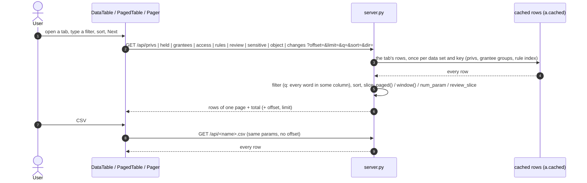

<!-- generated by darshan-singh-meel-knowledge-graph -->
# Flow: tables paged on the server (big accounts)

One-line summary: long tables are filtered, sorted and cut on the server, so a page sends one page of rows plus the total; the React table asks for the next page with `offset` / `limit` (and `q`, `sort`, `dir`), and a CSV export goes through `/api/<name>.csv`, which builds every row with the same filters (`server.py:1456-1460`, `server.py:3223-3229`, `web/src/components/DataTable.tsx:29-31`).

## Steps

1. Page sizes: `paged(p, rows)` -> `(offset, limit, rows[offset:offset + limit])`, limit `PAGE` by default and at most 1000 — server.py:1456-1460. `window(p, key, n)`: a slice from the offset param `key` and `limit` (`PAGE` by default, `0` every row, as the CSV of a `PagedTable` asks), an offset past the end starts at 0 — server.py:3223-3229. `PAGE` = 50 is the one page size for both — server.py:77.
2. User page Privileges tab: `privs_rows` takes the tab's rows once per user context and tab (`a.cached(("privs", key, tab))`, one row per object), keeps rows where every word of `q` is in some column, sorts by `sort` (`PRIV_SORT`, depth by default) and `dir`; `of=role` reads the Role page's effective privileges — server.py:1437-1453, server.py:1411-1413; `privs_page` pages them — server.py:1463-1467; `privs_csv` writes every row — server.py:1470-1476.
3. Role page held by: `held_tab_rows` (tab users / roles / all, `q`, `HELD_SORT`) -> `held_page` — server.py:2101-2114, server.py:2117-2121.
4. Object page who has access: `grantee_tab_rows` (tab, `q`, `GRANTEE_SORT`) -> `grantees_page`, `by=rows` one row per grantee and chain, `by=groups` the `grantee_groups` (cached per object, tab and `q`) with the users and roles they hold — server.py:2306-2319, server.py:2349-2359. The object page's user matrix pages with `m_offset` — server.py:2400.
5. Access page: `access_list` filters (filter, q, heat cell, sort, group) and `access_page` pages them (`paged`, server.py:1666), with the runs and powers capped at `PAGE` and their totals — server.py:1624-1645, server.py:1658-1705.
6. Risks & fixes: `rules_page` counts and groups every finding, then sends one page of findings (`offset`, `limit` up to 500, default `FINDINGS_PAGE` = 100; a bad number gives the default), of one `group=` when asked; each finding row (`finding_row`) leaves out the fix texts, which come from `GET /api/finding?id=` — server.py:3334, server.py:3404-3491, server.py:3460, server.py:3354-3364, server.py:3520-3524.
7. Review: `review_page` pages with `offset` / `limit` (default `REVIEW_PAGE` = 50, at most 1000) through `review_slice`, which sorts by the web column and skips whole objects for an object column — server.py:3645, server.py:3680-3732, server.py:3735-3769.
8. Sensitive data: the objects and readers tables page with `o_offset` / `r_offset` (`window`) — server.py:3288-3292. What changed: events page with `offset` — server.py:3138 ([what-changed.md](what-changed.md)).
9. CSV: `/api/<name>.csv` for rules, review, whatif, privs, access, held, grantees, who builds every row with the page's filters (403 `csv_off` with `CSV=0`) — server.py:4235-4236, server.py:4287-4292.
10. React: `DataTable` with `server={path, params}` asks `GET path` with `q` (sent a moment after the last key), `sort`, `dir`, `offset`, `limit`; a new filter, sort or row set starts on page 1; its CSV button downloads `<path>.csv` — web/src/components/DataTable.tsx:29-31, web/src/components/DataTable.tsx:50-83. Used by the Privileges tabs (`privs`), Role held by (`held`) and Grantees (`grantees`, rows and groups) — web/src/components/PrivilegeTabs.tsx:64, web/src/pages/Role.tsx:61, web/src/components/Grantees.tsx:94-95, web/src/components/Grantees.tsx:118. `PagedTable` (Object matrix, Sensitive objects and readers) keeps the offset in a URL param and the size in `limit`, and exports with `limit=0` — web/src/pages/paged.tsx:1-26, web/src/pages/Object.tsx:388, web/src/pages/Sensitive.tsx:78, web/src/pages/Sensitive.tsx:98. Own pagers: Access (web/src/pages/Access.tsx:78-80, web/src/pages/Access.tsx:224), Risks group items (web/src/pages/Risks.tsx:23-29), Review (web/src/pages/Review.tsx:38-39), What changed (web/src/pages/Changes.tsx:34, web/src/pages/Changes.tsx:62-63).

## Example (fake data, tests)

- `test_paged`: `privs?name=SVC_DEPLOY&tab=all&limit=5` -> 5 rows < total; `offset=5` shares no object with the first page; `sort=object&dir=-1` sorted descending; `q=finance` fewer rows, every one with "finance"; the CSV has total + 1 lines; `access?user=SVC_DEPLOY&limit=3` -> 3 objects of `total`; `filter=own` only own / admin; `group=schema` counts sum to the total — test_server.py:133-150.
- `test_big_lanes`: `grantees?limit=2` and `offset=2` (no overlap), `by=groups` users summing to the object's users, `held?tab=users&limit=1`, `privs?of=role&limit=3`, each CSV complete — test_server.py:232-246.
- `test_rules_paged`: `rules?sev=all` totals agree (per rule, per severity); `limit=3` and `offset=3` give disjoint findings; `limit=x&offset=-1` -> `FINDINGS_PAGE`; `group=<rule>` only that rule; `off=<rule>` hides it from the total; `q`, `by=person|object|grid`; `finding?id=` the full finding, 404 for an unknown id; the side nav counts rules, not findings — test_server.py:1021-1050.
- `test_changes_kept`: `changes?f=gain&limit=1&offset=1` -> one gain event of `events_total=2` — test_server.py:1502-1504.

Rules: [business_rule:missing_data_never_fails](../logic/rules.md). Graph boxes: [lazy-graph-box.md](lazy-graph-box.md).
