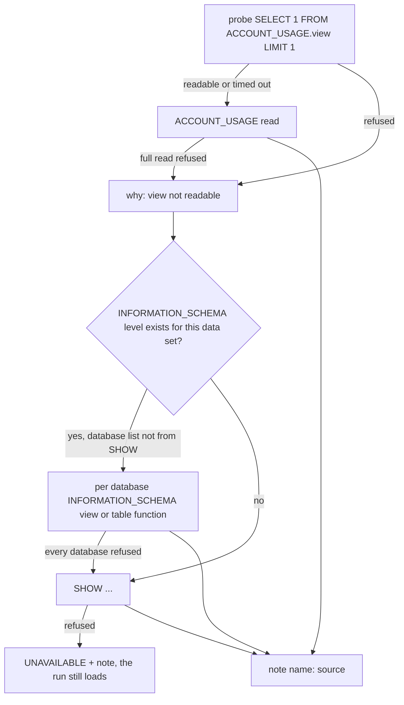

<!-- generated by darshan-singh-meel-knowledge-graph -->
# Flow: every snapshot read tries ACCOUNT_USAGE, then INFORMATION_SCHEMA, then SHOW

One-line summary: each data set of a snapshot (procedure `SP_ACCESS_SNAPSHOT` or Direct mode `access.live()`) is read at the highest level that answers — `ACCOUNT_USAGE` (whole account, lags), else one database's `INFORMATION_SCHEMA`, else `SHOW` (only what the role sees) — and the level used plus the reason for a lower one land in `run.SOURCES` / `run.NOTES`.

## Levels per data set

| Data set (`SOURCES` key) | ACCOUNT_USAGE | INFORMATION_SCHEMA | SHOW | Evidence |
|---|---|---|---|---|
| database list (inventory `DATABASES`) | `DATABASES` (lags up to 3 h) | `INFORMATION_SCHEMA.DATABASES` of the first of up to 5 home databases that answers | `SHOW DATABASES` | access.py:1105-1125, sql/1_setup.sql:832-852 |
| schemas (`schemas`, for future grants) | `SCHEMATA` (lags up to 2 h) | `INFORMATION_SCHEMA.SCHEMATA` per database | `SHOW SCHEMAS IN DATABASE` per database | access.py:1188-1220, sql/1_setup.sql:915-947 |
| object inventory (`objects`) | the kind's view (`TABLES`, `VIEWS`, `FUNCTIONS`, ...) | the kind's view per database, where one exists | `SHOW ... IN ACCOUNT` where SHOW names the owner | access.py:1134-1185, sql/1_setup.sql:861-912 |
| grants, user roles | `GRANTS_TO_ROLES`, `GRANTS_TO_USERS` | none | `SHOW ROLES`, `SHOW GRANTS TO / OF ROLE`, `SHOW DATABASE ROLES` per database of the database list | access.py:1381-1436 |
| future grants | none (no view) | none | `SHOW FUTURE GRANTS IN DATABASE / SCHEMA` over the schema list | access.py:1438-1463, sql/1_setup.sql:456-500 |
| users | `USERS` | none | `SHOW USERS` | access.py:1465-1488 |
| usage | `QUERY_HISTORY` | `INFORMATION_SCHEMA.QUERY_HISTORY` (7 windows of 167 h) | none | access.py:1490-1503, sql/1_setup.sql:530-561 |
| tags, policies | `TAG_REFERENCES`, `POLICY_REFERENCES` | per-object table functions up to `TAG_FALLBACK_MAX` | none | access.py:1505-1601 |
| streams | `STREAMS` (when grants came from ACCOUNT_USAGE) | none | `SHOW STREAMS IN ACCOUNT` | access.py:1627-1642, sql/1_setup.sql:695-711 |
| object use, activity | `ACCESS_HISTORY` (+ `QUERY_HISTORY`, `SESSIONS`) | none | none | access.py:1603-1625 |

## Steps

1. Direct mode probes every view at once (`each`), including `DATABASES`; a lost session or no warehouse (`lost()`) stops the load, a timed-out probe (`slow()`) counts as readable, and each refused view is said in the load log — access.py:1274-1287.
2. `au = unread["DATABASES"] or True` is passed to the three object reads, so a failed probe goes straight to the lower level with its reason — access.py:1289. The procedure's `au_of(mode)` does the same from `P_SOURCE` (`SHOW` = no ACCOUNT_USAGE) — sql/1_setup.sql:370-371.
3. The database list is read once per run and shared by the database roles, the schema list and the inventory: `databases()` in `live()` (home = current database, granted databases, `SNOWFLAKE`) — access.py:1366-1374; `DBS[run_id]` in the procedure (home = `&DB`) — sql/1_setup.sql:374-377.
4. When the database list itself came from `SHOW` (or none was read), the per-database INFORMATION_SCHEMA tries are skipped with the note `INFORMATION_SCHEMA: skipped, database list from SHOW` — access.py:1159-1162, access.py:1208-1213.
5. A database this role cannot see (`unseen()`) is left out quietly; a refused one skips only itself and is named in the note — access.py:1095-1098, access.py:1164-1170.
6. Each step calls `note(name, source, why)`: `SOURCES[name]` = the level, `NOTES[name]` = why a lower level ran — access.py:1253-1257; the procedure's `keep()` — sql/1_setup.sql:1173-1176.
7. Shared functions are the same text in `access.py` and the procedure (`database_list`, `inventory_read`, `schema_list`, `inventory_sql`), checked by `test_objects` — test_sql.py:469.

## Tests
- `test_live` runs the three levels (SHOW, INFORMATION_SCHEMA, ACCOUNT_USAGE) on the same fake answers — test_access.py:614-619.
- `test_show_fallback`: procedure and `live()` give the same grants from the same SHOW answers — test_sql.py:368.

Related: [direct-live.md](direct-live.md), [snapshot-objects.md](snapshot-objects.md), [object-inventory.md](object-inventory.md).
