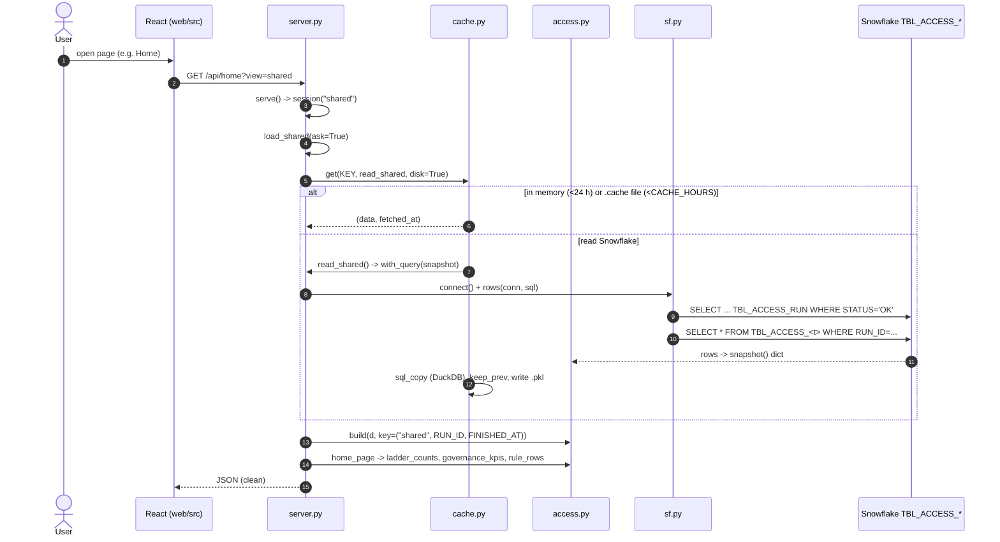
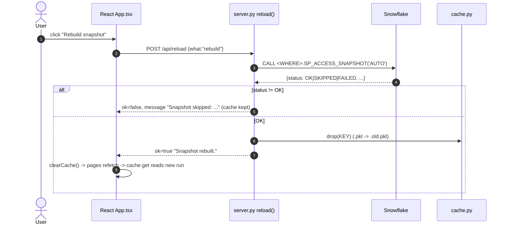

<!-- generated by darshan-singh-meel-knowledge-graph -->
# Flow: shared data from the snapshot tables (SOURCE=objects)

One-line summary: a page asks `/api/<page>`; the server loads the last OK run of the `TBL_ACCESS_` tables once (memory + `.cache/`) through `cache.get` -> `sf.rows`, builds the lookups and answers from `access.py`; "Rebuild snapshot" CALLs `SP_ACCESS_SNAPSHOT` and drops the cache.

## Sequence: first page load

## Steps

1. Settings resolve once at import: `MODE, SOURCE, WHERE = cache.config()` — server.py:21; objects chosen when `SOURCE=objects` or only `ACCESS_SNAPSHOT` is set; location = `ACCESS_SNAPSHOT` or `SNOWFLAKE_DATABASE.SNOWFLAKE_SCHEMA`, else ValueError — cache.py:27-40.
2. Cache key per account + source + location + user + role: `KEY = cache.name(SOURCE, where=WHERE)` — server.py:23, cache.py:43-48.
3. React fetches the page JSON with `get()` (memoised per URL) — web/src/api/client.ts:35-44; Home: `useApi("home", {view})` — web/src/pages/Home.tsx:66.
4. `serve(name, params, sid)` opens `session(view, ...)`, calls `ROUTES[name]`, adds `refs` for pages in `WITH_REFS` — server.py:2277-2284, server.py:2267-2273.
5. `session("shared")` calls `load_shared(ask=True)` and builds the lookups under `LOCK` with the run as key — server.py:182-202.
6. `load_shared` takes `LOAD` (one Snowflake read at a time) and calls `cache.get(KEY, read_shared, disk=MODE=="snowflake")`; errors become `503 shared_unreadable` — server.py:96-105.
7. `cache.get`: memory if younger than `TTL` (24 h), else the `.cache/<key>.pkl` file if younger than `CACHE_HOURS`, else `fn()` — cache.py:107-133. Memory TTL — cache.py:22; `CACHE_HOURS` — cache.py:21.
8. `read_shared()` -> `with_query(lambda q: a.snapshot(q, WHERE))` — server.py:87-88; `with_query` opens one connection, runs every statement via `sf.rows`, closes only if `sf.owned()` — server.py:71-84.
9. `sf.connect()`: inside Snowflake the app's own session (`a.INSIDE`) — sf.py:20-22; else key pair if `SNOWFLAKE_PRIVATE_KEY_FILE`, else SSO `externalbrowser` — sf.py:23-42; `sf.rows` is the only read path — sf.py:50-54.
10. `a.snapshot(query, where)`: last OK run from `TBL_ACCESS_RUN`, error if none; then `SELECT *` per table in `TABLES` filtered by `RUN_ID`; `OPTIONAL` (`OBJECT_USE`, `ACTIVITY`) may be missing -> `None` — access.py:464-479, access.py:60-61.
11. On a fresh read: DuckDB SQL copy if wanted — cache.py:124-125, cache.py:193-198, cache.py:205-262; previous file kept as `<key>.prev.pkl` (for What changed) — cache.py:72-81; atomic write via `.tmp` — cache.py:126-131.
12. `a.build(d, key, builtin)` fills module lookups; same key skips work; keeps up to `KEEP_BUILT` data sets — access.py:1030-1095, access.py:1017.
13. Page handler (e.g. `home_page`) reads only lookups / `S["rows"]` — server.py:1071-1092; `clean()` makes JSON-safe output — server.py:207.

## Sequence: refresh and rebuild

14. Buttons: "Rebuild snapshot" (not in fake mode) — web/src/App.tsx:325 -> `post("reload", {what:"rebuild"})` — web/src/App.tsx:296-299; side "Read Snowflake again" -> `{what:"page"}` — web/src/App.tsx:251, web/src/App.tsx:294. After any action `clearCache()` — web/src/App.tsx:291.
15. `reload("rebuild")`: fake -> "Demo: the CALL runs only on Snowflake"; objects -> `CALL {WHERE}.SP_ACCESS_SNAPSHOT('AUTO')` through `with_query`; non-OK status returns `ok=False` and keeps the copy; OK -> `cache.drop(KEY)` — server.py:2206-2225.
16. `reload("page")`: `cache.drop(KEY)` only (objects: next page reads again) — server.py:2229-2232.
17. `cache.drop`: out of memory, local file set aside as `.old.pkl` so it becomes `.prev.pkl` on the next read — cache.py:146-154, cache.py:72-81.
18. Procedure (owner's rights): inserts its RUNNING row, then steps back (deletes its row, `SKIPPED`) unless it is the earliest RUNNING run of the last hour (sql/1_setup.sql:608-616); fills each table, FAILED deletes this run's rows, OK deletes older runs' rows except those of a run RUNNING for under a day (sql/1_setup.sql:648-653) — sql/1_setup.sql:144-150, sql/1_setup.sql:603-654.
19. Read-only guard: `test_read_only` records every statement and allows only reads plus the `SP_ACCESS_SNAPSHOT` CALL — test_server.py:328.

## Example (FAKE=1, mock query; no Snowflake)

- `cache.config({"ACCESS_SNAPSHOT": "DB1.SNAP"})` -> `('snowflake', 'objects', 'DB1.SNAP')`; `cache.name("objects", where="DB1.SNAP")` -> `local_objects_DB1.SNAP` (no `SNOWFLAKE_ACCOUNT` -> `local`).
- `cache.config({"SOURCE": "objects"})` -> `ValueError: SOURCE=objects needs ACCESS_SNAPSHOT=<DB>.<SCHEMA> ...`.
- `a.snapshot(q, "DB1.SNAP")` with a recording mock serving `a.fake()` sends, in order:
  - `SELECT RUN_ID, FINISHED_AT, SOURCES, NOTES FROM DB1.SNAP.TBL_ACCESS_RUN WHERE STATUS = 'OK' ORDER BY FINISHED_AT DESC LIMIT 1`
  - `SELECT * FROM DB1.SNAP.TBL_ACCESS_GRANT WHERE RUN_ID = 'fake'` … then USER_ROLE, USER, USAGE, TAG, POLICY, STREAM, OBJECT_USE, ACTIVITY.
  - Rows: GRANT 805, USER_ROLE 30, USER 27, USAGE 9, TAG 12, POLICY 6, STREAM 1, OBJECT_USE 341.
- `GET /api/home?view=shared` (fake): `counts={users:27, roles:85, objects:75, sensitive:5}`, `risks={Critical:0, High:20, Medium:31, Low:11}`, `me.user=ENGINEER_01`.
- `reload({"what":"rebuild"})` (fake): `{ok: False, message: "Demo: the CALL runs only on Snowflake (not FAKE=1)."}`.
- Names `DB1.SNAP` are made up for the example.
