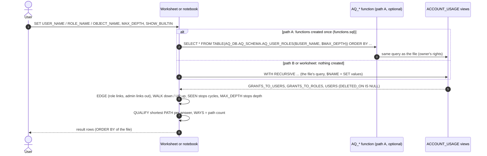

# Flow: standalone queries over ACCOUNT_USAGE (no app)

One-line summary: a user opens a query file in a worksheet, or a Snowflake Notebook cell, sets the inputs, and runs one recursive query over three ACCOUNT_USAGE views; the answer is one row per role / privilege / holder with its shortest path and how many paths lead there. Nothing goes through the app, `sf.rows()` or the `TBL_ACCESS_` tables.

## Steps

1. Pick a question: user's roles (`1_user_roles.sql`), user's access (`2_user_access.sql`), role's access (`3_role_access.sql`), who holds a role (`4_role_holders.sql`), who reaches an object (`5_object_users.sql`) (access_queries/README.md:19-29).
2. Choose how to run (access_queries/README.md:42-84):
   - Worksheet: change the `SET` lines, run the whole file (access_queries/1_user_roles.sql:17-19).
   - Snowflake Notebook `access_examples.ipynb`: run `inputs` (access_queries/access_examples.ipynb:25-44), then path A (`create_1`..`create_5`, then `a_*`) or path B (`b_*`) (access_queries/access_examples.ipynb:59-614, 634-1280).
3. Path A only: run `functions.sql` once in a schema you may create functions in; each function body is the file's query (access_queries/functions.sql:4-13). If the CREATE fails, use path B.
4. The query reads only `GRANTS_TO_ROLES` (access_queries/1_user_roles.sql:32), `GRANTS_TO_USERS` (access_queries/1_user_roles.sql:49) and `USERS` (access_queries/1_user_roles.sql:53), active rows only.
5. Walk: role links from `EDGE` (access_queries/1_user_roles.sql:41-46), start roles plus PUBLIC (access_queries/1_user_roles.sql:57-60), recursive `WALK` (access_queries/1_user_roles.sql:61-69); upwards files use `UP` and `MEMBER` (access_queries/4_role_holders.sql:57-69).
6. Result: shortest path per answer and `WAYS` (access_queries/1_user_roles.sql:70-74); for privileges the role rows are reduced first (`ROLES`, access_queries/2_user_access.sql:75-83).

## Example rows (test data: `access.fake()` plus the extras of access_queries/test_queries.py:223-232, on DuckDB)

`1_user_roles.sql`, `USER_NAME = 'ANALYST_01'` (3 of 6 rows):

| ROLE_NAME | ROLE_KIND | DEPTH | PATH | WAYS |
|---|---|---|---|---|
| GRP_ANALYSTS | ROLE | 1 | ANALYST_01 > GRP_ANALYSTS | 1 |
| F_ANALYST | ROLE | 2 | ANALYST_01 > GRP_ANALYSTS > F_ANALYST | 2 |
| T_SALES_CORE_READ | ROLE | 3 | ANALYST_01 > GRP_ANALYSTS > F_ANALYST > T_SALES_CORE_READ | 2 |

`2_user_access.sql`, `USER_NAME = 'ANALYST_01'` (2 of 12 rows):

| PRIVILEGE | GRANTED_ON | OBJECT_NAME | VIA_ROLE | DEPTH | PATH | WAYS |
|---|---|---|---|---|---|---|
| SELECT | TABLE | SALES.CORE.TBL_CUSTOMER | T_SALES_CORE_READ | 3 | ANALYST_01 > GRP_ANALYSTS > F_ANALYST > T_SALES_CORE_READ | 2 |
| USAGE | DATABASE | SALES | T_SALES_MART_READ | 2 | ANALYST_01 > PUBLIC > T_SALES_MART_READ | 4 |

`5_object_users.sql`, `OBJECT_NAME = 'SALES.CORE.TBL_CUSTOMER'`, `PRIVILEGE = 'SELECT'` (2 of 41 rows):

| GRANTEE | GRANTEE_KIND | PRIVILEGE | GRANTED_ON | HOLDER | DEPTH | PATH | WAYS |
|---|---|---|---|---|---|---|---|
| ANALYST_01 | USER | SELECT | TABLE | T_SALES_CORE_READ | 3 | ANALYST_01 > GRP_ANALYSTS > F_ANALYST > T_SALES_CORE_READ | 2 |
| ADMIN_01 | USER | SELECT | TABLE | T_SALES_CORE_READ | 4 | ADMIN_01 > PUBLIC > T_SALES_MART_READ > F_ANALYST > T_SALES_CORE_READ | 1 |

The README's example output uses `access.fake()` alone, so its WAYS can be lower (access_queries/README.md:122-147).

## Checks

- `python access_queries/test_queries.py` runs every file on DuckDB and compares rows, depth, path and ways with `access.py` (access_queries/test_queries.py:119-167, 233-267).

## Unclear

- Latency (up to about 2 hours) and missing future grants are ACCOUNT_USAGE limits, stated in access_queries/README.md:85-120, not tested.
