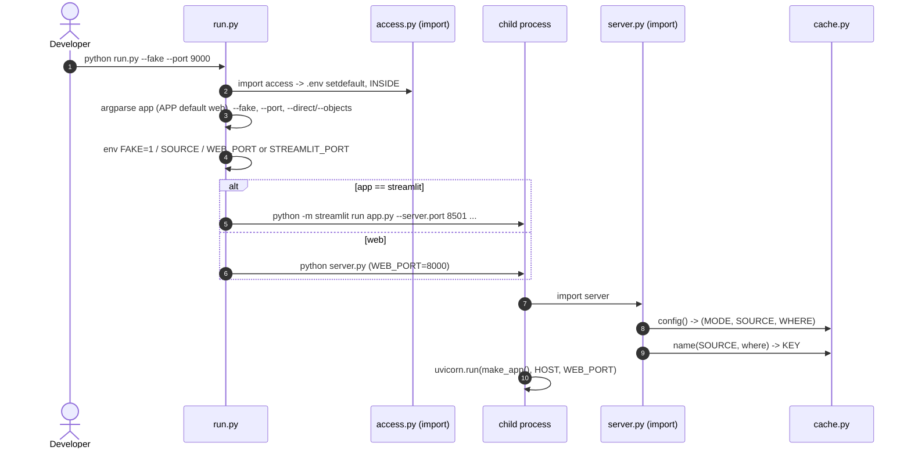

<!-- generated by darshan-singh-meel-knowledge-graph -->
# Flow: startup (run.py modes, ports, env, cache.config)

One-line summary: `python run.py [web|streamlit] [--fake [twin] [--scale N]] [--direct|--objects] [--port N] [--export [--fresh] | --build] [--cache-dir D]` loads `.env` (via `import access`), sets `FAKE` / `SOURCE` / port in a child environment and starts either `server.py` (uvicorn, 8000) or `streamlit run app.py` (8501); on import `server.py` resolves `cache.config()` and the cache key.

## Steps

1. Usage text — run.py:1-17.
2. `import access` loads `.env` (shell wins: `os.environ.setdefault`) — run.py:23, access.py:37-42; `INSIDE` decided at import — access.py:59.
3. Arguments: `app` in `web|streamlit` (default env `APP` or `web`), `--fake` (`1` or `twin`), `--scale`, `--port`, `--direct` / `--objects` -> `source`, `--export` / `--build` (one of them), `--fresh`, `--cache-dir` — run.py:28-40.
4. Child env: `--fake` -> `FAKE=1|twin`, `--scale` -> `FAKE_SCALE`, source -> `SOURCE`, `--cache-dir` -> `CACHE_DIR` as an absolute path (the child runs in the repo folder); `--fresh` without `--export` is an error; `--export` runs `python server.py --export [--fresh]` and exits; `--build` sets `BUILD_ONLY=1` — run.py:41-55, cache.py:27-28 ([two-stage-load.md](two-stage-load.md)).
5. Streamlit: port `--port` or `STREAMLIT_PORT` (8501); `streamlit run app.py --server.address $HOST (127.0.0.1) --server.headless true --browser.gatherUsageStats false` — run.py:56-61 (steps 3-6 are `command()`, run.py:26-65, called from `__main__`, run.py:68-70). Plain `streamlit run app.py`: `[server] address = "127.0.0.1"` — .streamlit/config.toml:4-5.
6. Web: `WEB_PORT` = `--port` or env (8000); `python server.py` — run.py:62-64; runs in the repo folder, exit code passed on — run.py:70.
7. `server.py` import: `MODE, SOURCE, WHERE = cache.config()`, `DIRECT`, `KEY`, `DEMO_USER`, `TTL`, `DIST` — server.py:27-34.
8. `cache.config(env)`: `FAKE=1` -> `('fake','fake','')`; source = `SOURCE` or `objects` if `ACCESS_SNAPSHOT` else `direct`; bad value -> ValueError; objects location from `ACCESS_SNAPSHOT` or `SNOWFLAKE_DATABASE.SNOWFLAKE_SCHEMA`, must be `DB.SCHEMA` — cache.py:43-56.
9. Cache settings: `CACHE_HOURS` (24, 0 = memory only) and memory `TTL` 24 h — cache.py:27-32; `DUCKDB` (0 off, 1 also fake) — cache.py:204.
10. Web server: `uvicorn.run(make_app(), host=HOST (127.0.0.1), port=WEB_PORT (8000))` — server.py:4560-4566.
11. Streamlit: `app.py` -> `st_react.app()` which imports `server` on the first API call — app.py:22, st_react.py:25.
12. Role naming read at import: `ROLE_PREFIXES` -> `FUNC`, `TECH` (default `F_`, `T_`) — access.py:78.
13. Nothing is read from Snowflake at startup: shared data loads on the first page (objects) or on a click (direct) — server.py:220-227.

## Example (FAKE=1)

| Command | Child process | URL |
|---|---|---|
| `python run.py --fake` | `FAKE=1 python server.py`, `WEB_PORT=8000` | http://localhost:8000 |
| `python run.py streamlit --fake` | `python -m streamlit run app.py --server.port 8501 ...` | http://localhost:8501 |
| `python run.py --objects --port 9000` | `SOURCE=objects WEB_PORT=9000 python server.py` | http://localhost:9000 |

- With `FAKE=1`: `cache.config()` -> `('fake', 'fake', '')`, `server.KEY` -> `local_fake`, `a.INSIDE` -> `False`, `server.mine_off()` -> `None`.
- `meta` on fake data: `mode=fake, source=fake, run.run_id=fake, run.finished_at=2026-11-02 07:00, cache_hours=24` (`cache.HOURS` when `cache.local()`, else 0 — server.py:4068, cache.py:69-71; fake data itself is never written to `.cache/`, server.py:192, server.py:223).
