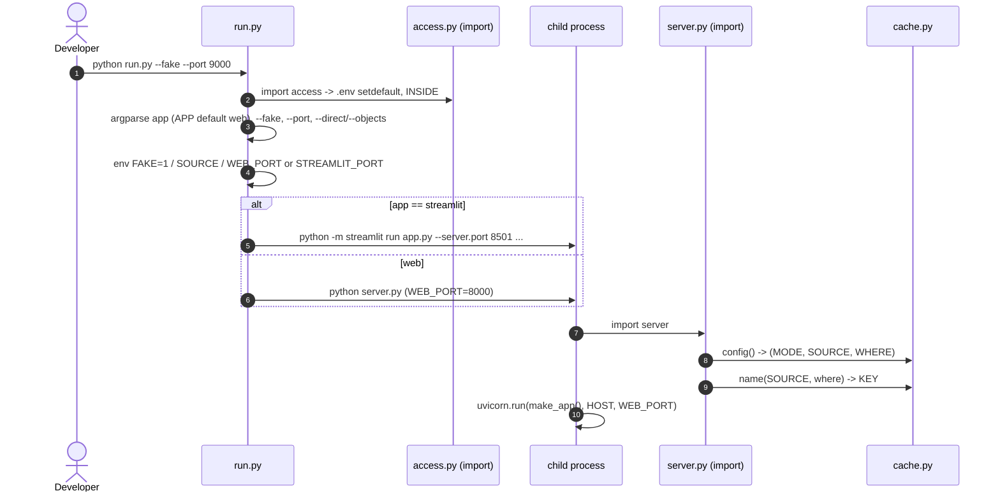

# Flow: startup (run.py modes, ports, env, cache.config)

One-line summary: `python run.py [web|streamlit] [--fake] [--direct|--objects] [--port N]` loads `.env` (via `import access`), sets `FAKE` / `SOURCE` / port in a child environment and starts either `server.py` (uvicorn, 8000) or `streamlit run app.py` (8501); on import `server.py` resolves `cache.config()` and the cache key.

## Steps

1. Usage text — run.py:1-10.
2. `import access` loads `.env` (shell wins: `os.environ.setdefault`) — run.py:16, access.py:19-24; `INSIDE` decided at import — access.py:41.
3. Arguments: `app` in `web|streamlit` (default env `APP` or `web`), `--fake`, `--port`, `--direct` / `--objects` -> `source` — run.py:18-24.
4. Child env: `--fake` -> `FAKE=1`; source -> `SOURCE` — run.py:26-30.
5. Streamlit: port `--port` or `STREAMLIT_PORT` (8501); `streamlit run app.py --server.headless true --browser.gatherUsageStats false` — run.py:31-34.
6. Web: `WEB_PORT` = `--port` or env (8000); `python server.py` — run.py:35-37; runs in the repo folder, exit code passed on — run.py:38.
7. `server.py` import: `MODE, SOURCE, WHERE = cache.config()`, `DIRECT`, `KEY`, `DEMO_USER`, `TTL`, `DIST` — server.py:21-26.
8. `cache.config(env)`: `FAKE=1` -> `('fake','fake','')`; source = `SOURCE` or `objects` if `ACCESS_SNAPSHOT` else `direct`; bad value -> ValueError; objects location from `ACCESS_SNAPSHOT` or `SNOWFLAKE_DATABASE.SNOWFLAKE_SCHEMA`, must be `DB.SCHEMA` — cache.py:27-40.
9. Cache settings: `CACHE_HOURS` (24, 0 = memory only) and memory `TTL` 24 h — cache.py:20-24; `DUCKDB` (0 off, 1 also fake) — cache.py:139.
10. Web server: `uvicorn.run(make_app(), host=HOST (127.0.0.1), port=WEB_PORT (8000))` — server.py:2342-2344.
11. Streamlit: `app.py` -> `st_react.app()` which imports `server` on the first API call — app.py:18, st_react.py:24.
12. Role naming read at import: `ROLE_PREFIXES` -> `FUNC`, `TECH` (default `F_`, `T_`) — access.py:55.
13. Nothing is read from Snowflake at startup: shared data loads on the first page (objects) or on a click (direct) — server.py:91-95.

## Example (FAKE=1)

| Command | Child process | URL |
|---|---|---|
| `python run.py --fake` | `FAKE=1 python server.py`, `WEB_PORT=8000` | http://localhost:8000 |
| `python run.py streamlit --fake` | `python -m streamlit run app.py --server.port 8501 ...` | http://localhost:8501 |
| `python run.py --objects --port 9000` | `SOURCE=objects WEB_PORT=9000 python server.py` | http://localhost:9000 |

- With `FAKE=1`: `cache.config()` -> `('fake', 'fake', '')`, `server.KEY` -> `local_fake`, `a.INSIDE` -> `False`, `server.mine_off()` -> `None`.
- `meta` on fake data: `mode=fake, source=fake, run.run_id=fake, run.finished_at=2026-11-02 07:00, cache_hours=24` (`cache.HOURS` when `cache.local()`, else 0 — server.py:2074, cache.py:51-53; fake data itself is never written to `.cache/`, server.py:98).
