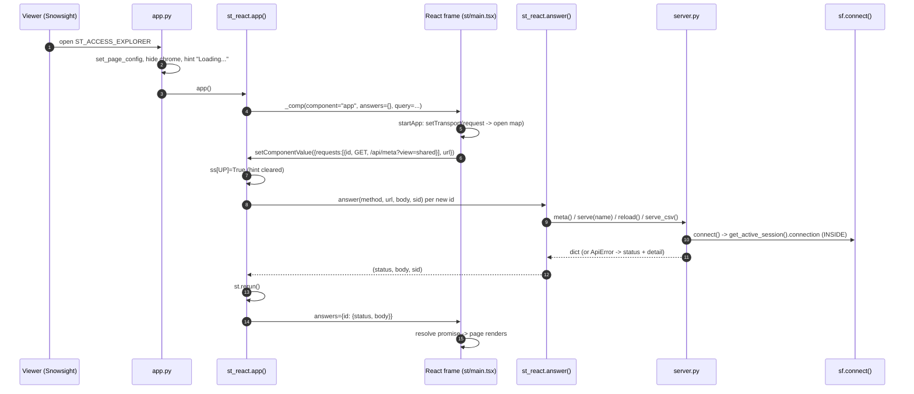

<!-- generated by darshan-singh-meel-knowledge-graph -->
# Flow: Streamlit in Snowflake (app.py -> st_react bridge -> server.py)

One-line summary: `app.py` only sets the page up and runs `st_react.app()`; the same React app (built into `web/dist-st`) sends its API calls as the component value, Python answers each with `server.py` functions and returns the answers in the next render; inside Snowflake the app uses its own session (owner's rights, never closed), keeps data in memory only and hides My access.

## Steps

1. Deploy: stage + PUT of `app.py access.py cache.py server.py sf.py st_react.py ui.py environment.yml web/dist-st sis/.env`, then `CREATE OR REPLACE STREAMLIT ... MAIN_FILE='app.py'` and grants to the app role — sql/4_streamlit.sql:19-80. Two options `SOURCE=objects` / `SOURCE=direct` — sql/4_streamlit.sql:1-10.
2. Settings inside: `INSIDE=1`, `SOURCE=objects` + `ACCESS_SNAPSHOT=<DB>.<SCHEMA>` (or direct) — sis.env.example:3-15.
3. INSIDE detection at import: `FAKE=1` -> False; `INSIDE=0|1` decides; else an active Snowpark session — never "no `SNOWFLAKE_ACCOUNT`" — access.py:29-43.
4. `app.py`: page config, CSS hides Streamlit chrome, hint until the frame talks back (`st_react.UP`), `st_react.app()`, then clears the hint — app.py:9-20.
5. Component declared from `web/dist-st` — st_react.py:12-14.
6. `app()`: passes kept `answers` and the URL query; on a value sets `UP`, answers each request id not yet answered, forgets answered ids the frame no longer sends, mirrors the frame URL into `st.query_params`, reruns when something new was answered — st_react.py:51-75.
7. Frame side: `startApp` installs a transport that queues `{id, method, url, body}`; `flush` sends the full open list; `answer` resolves/rejects by id (`ApiFail`) — web/src/st/main.tsx:17-41; `draw` renders `<App>` once — web/src/st/main.tsx:45-49; client switches from `fetch` to the transport — web/src/api/client.ts:23-26, web/src/api/client.ts:39, web/src/api/client.ts:47.
8. `answer()` maps the URL to server functions: `meta`, `mine`, `reload`, `mine/load` (new random sid, drops the previous MINE entry), `*.csv` -> `serve_csv`, `ROUTES` -> `serve`, else 404 `not_found` — st_react.py:22-44.
9. Errors as in the web version: `ApiError` -> its status, other exceptions -> 500 `{detail:"error"}` — st_react.py:45-48; `_js` escapes `</` — st_react.py:17-19.
10. Connection: `sf.connect()` returns the app's own session when `INSIDE` — sf.py:19-22; `sf.owned()` is False inside, so `with_query` never closes it — sf.py:45-47, server.py:83-84.
11. No disk inside: `cache.local()` False -> memory only; no DuckDB copy — cache.py:51-53, cache.py:193-198.
12. My access hidden: `mine_off()` returns the "not available inside Snowflake" reason first — server.py:136-138; `meta.mine_available=False` hides the button — server.py:2148, web/src/App.tsx:317.
13. What changed has no previous snapshot inside (memory only) — server.py:1722-1726.
14. Direct inside: `live()` with the owner role; `USE SECONDARY ROLES` and `CURRENT_DATABASE` may be refused — access.py:654-662.
15. Tests: `test_streamlit_bridge` (same answers as HTTP) — test_server.py:267; `test_pages` (every page key handed to the component) — test_access.py:657.

## Example (FAKE=1, local, no Snowflake)

- `st_react.answer("GET", "/api/home?view=shared", None, None)` -> status `200` (same body as `GET /api/home`).
- `st_react.answer("GET", "/api/nope", None, None)` -> `(404, {"detail": "not_found", "message": "No such endpoint."}, None)`.
- Inside Snowflake, `GET /api/meta` answers `inside: true`, `mine_available: false`, `cache_hours: 0` (inferred from server.py:2148-2149 and cache.py:51-53; not run here).
