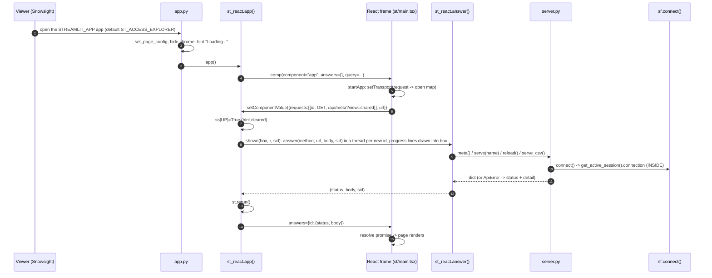

<!-- generated by darshan-singh-meel-knowledge-graph -->
# Flow: Streamlit in Snowflake (app.py -> st_react bridge -> server.py)

One-line summary: `app.py` only sets the page up and runs `st_react.app()`; the same React app (built into `web/dist-st`) sends its API calls as the component value, Python answers each with `server.py` functions and returns the answers in the next render; inside Snowflake the app uses its own session (owner's rights, never closed), keeps data in memory only and hides My access.

## Steps

1. Deploy: stage + PUT of `app.py access.py cache.py server.py sf.py st_react.py ui.py environment.yml web/dist-st sis/.env`, then `CREATE OR REPLACE STREAMLIT ... MAIN_FILE='app.py'` and grants to the app role — sql/4_streamlit.sql:19-83. Two options `SOURCE=objects` / `SOURCE=direct` — sql/4_streamlit.sql:1-10.
2. Settings inside: `INSIDE=1`, `SOURCE=objects` + `ACCESS_SNAPSHOT=<DB>.<SCHEMA>` (or direct) — sis.env.example:3-15.
3. INSIDE detection at import: `FAKE=1` -> False; `INSIDE=0|1` decides; else an active Snowpark session — never "no `SNOWFLAKE_ACCOUNT`" — access.py:36-50.
4. `app.py`: page config, CSS hides Streamlit chrome, hint until the frame talks back (`st_react.UP`), `st_react.app()`, then clears the hint — app.py:13-24.
5. Component declared from `web/dist-st` — st_react.py:13-15.
6. `app()`: passes kept `answers` and the URL query; on a value sets `UP`, answers each request id not yet answered, forgets answered ids the frame no longer sends, mirrors the frame URL into `st.query_params`, reruns when something new was answered — st_react.py:81-106.
7. Frame side: `startApp` installs a transport that queues `{id, method, url, body}`; `flush` sends the full open list; `answer` resolves/rejects by id (`ApiFail`) — web/src/st/main.tsx:17-41; `draw` renders `<App>` once — web/src/st/main.tsx:45-49; client switches from `fetch` to the transport — web/src/api/client.ts:23-26, web/src/api/client.ts:39, web/src/api/client.ts:53.
8. `answer()` maps the URL to server functions: `meta`, `mine`, `reload`, `mine/load` (new random sid, drops the previous MINE entry), `*.csv` -> `serve_csv` (403 `csv_off` when `CSV=0` in `sis/.env`, server.py:2514-2519), `ROUTES` -> `serve`, else 404 `not_found` — st_react.py:23-47.
9. Errors as in the web version: `ApiError` -> its status, other exceptions -> 500 `{detail:"error"}` — st_react.py:48-51; `_js` escapes `</` — st_react.py:18-20.
10. Connection: `sf.connect()` returns the app's own session when `INSIDE` — sf.py:19-22; `sf.owned()` is False inside, so `with_query` never closes it — sf.py:46-48, server.py:104-105.
11. No disk inside: `cache.local()` False -> memory only; no DuckDB copy — cache.py:66-68, cache.py:213-218.
12. My access hidden: `mine_off()` returns the "not available inside Snowflake" reason first — server.py:228-230; `meta.mine_available=False` hides the button — server.py:2298, web/src/App.tsx:371.
13. What changed has no previous snapshot inside (memory only) — server.py:1871-1875.
14. Direct inside: `live()` with the owner role; `USE SECONDARY ROLES` and `CURRENT_DATABASE` may be refused — access.py:904-912.
15. Long loads: `shown()` runs `answer()` in a thread kept in `st.session_state["_ae_running"]` (a rerun waits for it instead of reading again) and, about once a second, writes `server.progress()` lines into the `st.empty()` box above the app, cleared at the end; `answer()` also serves `progress` — st_react.py:54-78, st_react.py:87, st_react.py:96, st_react.py:34-35 ([flows/load-progress.md](load-progress.md)). `WORKERS` reads share the app's session from `each()`'s threads (marked "to verify" in st_react.py:58, access.py:543).
16. Settings in `sis/.env`: `STATEMENT_TIMEOUT`, `WORKERS`, `ACTIVITY=0`, `HIERARCHY=0` as locally — sis.env.example:24-33.
17. Tests: `test_streamlit_bridge` (same answers as HTTP) — test_server.py:268; `test_pages` (every page key handed to the component) — test_access.py:908.

## Example (FAKE=1, local, no Snowflake)

- `st_react.answer("GET", "/api/home?view=shared", None, None)` -> status `200` (same body as `GET /api/home`).
- `st_react.answer("GET", "/api/nope", None, None)` -> `(404, {"detail": "not_found", "message": "No such endpoint."}, None)`.
- Inside Snowflake, `GET /api/meta` answers `inside: true`, `mine_available: false`, `cache_hours: 0` (inferred from server.py:2298-2299 and cache.py:66-68; not run here).
