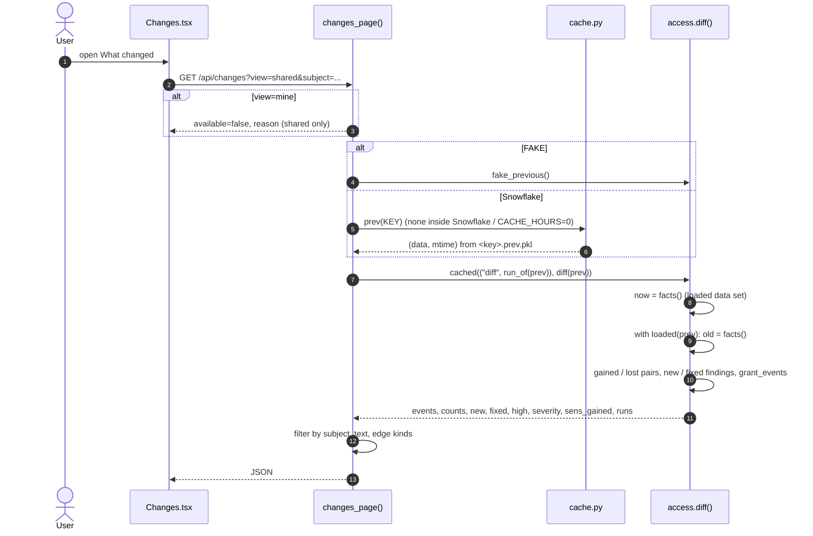

<!-- generated by darshan-singh-meel-knowledge-graph -->
# Flow: What changed (previous snapshot -> diff)

One-line summary: when a new read replaces the local `.cache/<key>.pkl` of another run, `cache.keep_prev` keeps the old one as `<key>.prev.pkl`; the What changed page loads it with `cache.prev(KEY)` (fake: `a.fake_previous()`), and `a.diff(prev)` compares per-user table access, grants, user roles, findings and user status of both data sets.

## Steps

1. Keeping the previous one: on a fresh read `cache.get` calls `keep_prev(f, new)` before writing — cache.py:122-131; `keep_prev` moves the current file (or the `.old.pkl` set aside by `drop`) to `.prev.pkl` only if its run differs (`run_of` = RUN_ID + FINISHED_AT) — cache.py:67-81; `drop` -> `.old.pkl` — cache.py:146-154.
2. `cache.prev(key)`: `(data, mtime)` of `.prev.pkl`, or None when memory only / inside Snowflake / none yet — cache.py:84-90.
3. UI fetch: `useApi("changes", {view, subject})` — web/src/pages/Changes.tsx:32.
4. `changes_page`: mine view -> reason; fake -> `a.fake_previous()`; else `cache.prev(KEY)` (skipped inside); no previous -> reason text (inside / none yet / CACHE_HOURS=0) — server.py:1719-1736.
5. Diff cached per previous run: `a.cached(("diff", cache.run_of(prev)), lambda: a.diff(prev))` — server.py:1737; `cached` clears on rebuild — access.py:1109-1113.
6. `facts()` per data set: per-user table/view access merged from each granted role's `table_reach` (no path listing), grants (admin role links left out), user_roles, findings, status, sensitive set, run — access.py:4833-4859.
7. `loaded(prev)`: saves `state()`, builds prev, restores after — access.py:4801-4828.
8. `diff(prev)`: gained/lost (user, object) pairs by level rank; new/fixed findings matched on (rule, grantee, user); `grant_events` for removed/added grants and user roles — access.py:4961-4984, access.py:4921.
9. Events: gain/lose with edge, impact, sensitive, finding chips, link; user status changes (new, gone, dormant, disabled); remaining new/fixed findings as risk/fixed; sorted risk, gain, lose, user, fixed; ids assigned — access.py:4986-5037.
10. Return: events, `event_counts`, new, fixed, severity per side, high, gained, lost, `sens_gained`, `runs.before/now` — access.py:5038-5043, access.py:4947-4951.
11. Page filters events by `subject` (a node id), builds the summary text, normalises edge kinds — server.py:1738-1750.
12. Demo previous: a week before `fake()`, `GRP_ANALYSTS` without `F_ANALYST`, the READ role without INSERT, `F_MARKETING` still with SALES.CORE write, `F_ANALYST` with an OWNER role, `ANALYST_02` not dormant — access.py:450-461.
13. SQL copy keeps the read before as `TBL_ACCESS_<name>_PREV` in DuckDB (separate from the `.prev.pkl` the app uses) — cache.py:235-243.

## Example (FAKE=1, `GET /api/changes?view=shared`)

- `text`: "Since the snapshot of 2026-10-26 07:00: 11 changes, 4 new high findings, 3 people gained sensitive access."
- `before=2026-10-26 07:00`, `now=2026-11-02 07:00`, `counts={all:11, gain:2, lose:2, risk:6, sensitive:7}`, `new=9`, `fixed=2`, `high=4`.
- First events: `risk` "New high finding · #7 Dormant or disabled person can read sensitive data: ANALYST_02"; `risk` "#3 READ held directly and through another role: ANALYST_02"; `risk` "#16 Dormant user (no login for 90 days) still holds roles: ANALYST_02"; `risk` "#17 Read-only role can write: F_MARKETING".
- `view=mine`: `reason = "What changed compares two shared snapshots: open it on the shared snapshot."`
