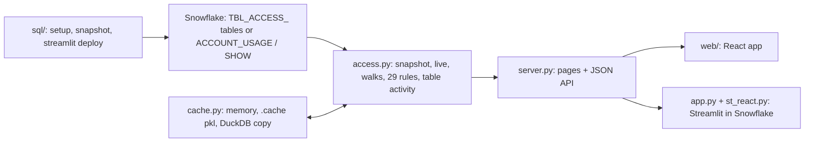

<!-- generated by darshan-singh-meel-knowledge-graph -->
# Snowflake access explorer: knowledge graph index

Read-only app that explains who has what in Snowflake and through which path; this graph maps its code, data, flows, rules and processes (updated 2026-11-13, commit 19a7da3; counts in `meta.json`).

## Big picture

- Boxes: Snowflake side (`sql/1_setup.sql`), data and rules (`access.py:464` snapshot, `access.py:629` live, `access.py:5086` checks, `access.py:4289` activity), cache (`cache.py`), server (`server.py:2312` make_app), two front ends (`web/src/App.tsx:253` VIEWS, `app.py:18` st_react.app).
- Hard rule: the app never runs GRANT / REVOKE / DDL (`CLAUDE.md`, see `documents/claude-md.md`).

## Entry points

- `run.py`: `command()` (`run.py:19-42`) starts the local web app or Streamlit, both on `HOST` (default 127.0.0.1) (`processes/run-local.md`).
- `server.py:2312` `make_app()`: FastAPI app, 32 endpoints (`modules/server.md`).
- `app.py:18`: Streamlit in Snowflake page, runs the same React app (`flows/streamlit-in-snowflake.md`).
- `sql/1_setup.sql`: tables, `SP_ACCESS_SNAPSHOT`, table functions (`data/model.md`, `modules/sql.md`).
- `web/src/App.tsx`: React router and page map (`modules/web.md`).
- `access_queries/`: standalone SQL over ACCOUNT_USAGE, optional `AQ_*` table functions (`access_queries/functions.sql:16`), Snowflake Notebook built by `make_notebook.py`, Jupyter notebook (`modules/access-queries.md`, `flows/standalone-queries.md`).

## Where to look for what

| Question | Go to |
|---|---|
| How does a request / snapshot / My access / what-changed / a standalone query run, step by step? | `flows/` (snapshot-objects, direct-live, web-request, streamlit-in-snowflake, my-access, startup, what-changed, standalone-queries, activity-read, activity-tab, show-sql) |
| Table activity: where it is read (incrementally, app queries left out by QUERY_TAG, per UTC day with hours and Streamlit app), what the Activity tab shows per object type (object, app, database / schema scope, warehouse), business hours, rules 24-28 and Streamlit app exposure (rule 29)? | `flows/activity-read.md`, `flows/activity-tab.md`, `logic/activity.md`, `data/TBL_ACCESS_ACTIVITY.md` |
| What does rule N check? How are paths counted, depth, what-if, graph roll-up, caching? | `logic/` (rules, activity, page-sql, walks, rbac-model, what-if, graph-input, diff, caching) |
| What does file / module X do, what calls what? | `modules/` (access, server, cache, sf, app-and-st_react, ui, run-scripts, web, sql, tests, access-queries) |
| Plain SQL / table functions / notebooks over ACCOUNT_USAGE without the app (user roles, user or role access, role holders, object users)? | `modules/access-queries.md` (files, CTEs, functions, notebooks, test), `flows/standalone-queries.md` (worksheet / path A / path B, example rows) |
| Which SQL does a page show to run yourself (SQL button, right-click, per-section SQL on Activity), and where does it come from? | `flows/show-sql.md`, `logic/page-sql.md` (`access.page_sql`, `activity_section_sql`, `query_file` on `access_queries/`) |
| Which checks keep `access_queries/` equal to `access.py`? | `modules/access-queries.md` > Test; `processes/test.md` |
| Which tables, columns, joins, dict keys, DuckDB copy? | `data/` (model.md, one page per `TBL_ACCESS_*`, snapshot-dict, duckdb-copy, model.json) |
| How to set up, run, deploy, build the web bundles, test? | `processes/` |
| What do README / CLAUDE.md / review notes / env templates say? | `documents/` (start at `documents/README.md`) |
| Machine-readable graph (nodes, edges with path:line) | `graph/nodes.jsonl`, `graph/edges.jsonl`; script facts in `graph/parts/structure.*`, hand-written meaning in `_scripts/parts/` |

## Code vs docs

- Business hours: README.html calls `WORK_HOURS` local time shifted from UTC by the Activity tab's slider (`README.html:722`), and the tab does shift them (`web/src/pages/Activity.tsx:22-26`); the comments at `access.py:69`, `web/src/api/types.ts:1240` and the `offOf` doc line (`web/src/pages/Activity.tsx:24`) still say UTC hours.

## Known gaps

- `unclear` / `inferred` marks are kept on the nodes, edges and pages; each page ends with its own unclear list.
- TypeScript line ranges are approximate (tag `range-heuristic`); vitest cases are not extracted.
