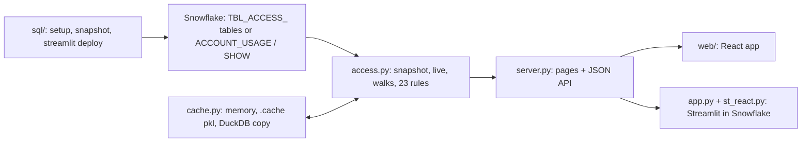

# Snowflake access explorer: knowledge graph index

Read-only app that explains who has what in Snowflake and through which path; this graph maps its code, data, flows, rules and processes (built 2026-11-10, commit fe263bc plus the uncommitted fixes of the 2026-11-10 review; 1787 nodes, 5166 edges, 185 files).

## Big picture

- Boxes: Snowflake side (`sql/1_setup.sql`), data and rules (`access.py:401` snapshot, `access.py:560` live, `access.py:4503` checks), cache (`cache.py`), server (`server.py:2238` make_app), two front ends (`web/src/App.tsx:253` VIEWS, `app.py:18` st_react.app).
- Hard rule: the app never runs GRANT / REVOKE / DDL (`CLAUDE.md`, see `documents/claude-md.md`).

## Entry points

- `run.py`: `command()` (`run.py:19-42`) starts the local web app or Streamlit, both on `HOST` (default 127.0.0.1) (`processes/run-local.md`).
- `server.py:2238` `make_app()`: FastAPI app, 30 endpoints (`modules/server.md`).
- `app.py:18`: Streamlit in Snowflake page, runs the same React app (`flows/streamlit-in-snowflake.md`).
- `sql/1_setup.sql`: tables, `SP_ACCESS_SNAPSHOT`, table functions (`data/model.md`, `modules/sql.md`).
- `web/src/App.tsx`: React router and page map (`modules/web.md`).
- `access_queries/`: standalone SQL over ACCOUNT_USAGE, optional `AQ_*` table functions (`access_queries/functions.sql:16`), Snowflake Notebook built by `make_notebook.py`, Jupyter notebook (`modules/access-queries.md`, `flows/standalone-queries.md`).

## Where to look for what

| Question | Go to |
|---|---|
| How does a request / snapshot / My access / what-changed / a standalone query run, step by step? | `flows/` (snapshot-objects, direct-live, web-request, streamlit-in-snowflake, my-access, startup, what-changed, standalone-queries) |
| What does rule N check? How are paths counted, depth, what-if, graph roll-up, caching? | `logic/` (rules, walks, rbac-model, what-if, graph-input, diff, caching) |
| What does file / module X do, what calls what? | `modules/` (access, server, cache, sf, app-and-st_react, ui, run-scripts, web, sql, tests, access-queries) |
| Plain SQL / table functions / notebooks over ACCOUNT_USAGE without the app (user roles, user or role access, role holders, object users)? | `modules/access-queries.md` (files, CTEs, functions, notebooks, test), `flows/standalone-queries.md` (worksheet / path A / path B, example rows) |
| Which checks keep `access_queries/` equal to `access.py`? | `modules/access-queries.md` > Test; `processes/test.md` |
| Which tables, columns, joins, dict keys, DuckDB copy? | `data/` (model.md, one page per `TBL_ACCESS_*`, snapshot-dict, duckdb-copy, model.json) |
| How to set up, run, deploy, build the web bundles, test? | `processes/` |
| What do README / CLAUDE.md / review notes / env templates say? | `documents/` (start at `documents/README.md`) |
| Machine-readable graph (nodes, edges with path:line) | `graph/nodes.jsonl`, `graph/edges.jsonl`; per-part sources in `graph/parts/` |

## Known gaps

- `unclear` / `inferred` marks are kept on the nodes, edges and pages; each page ends with its own unclear list.
- TypeScript line ranges are approximate (tag `range-heuristic`); vitest cases are not extracted.
