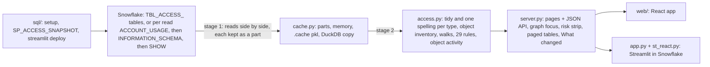

<!-- generated by darshan-singh-meel-knowledge-graph -->
# Snowflake access explorer: knowledge graph index

Read-only app that explains who has what in Snowflake and through which path; this graph maps its code, data, flows, rules, processes and tests (updated 2026-11-23, commit df69583; counts in `meta.json`).

## Big picture

- Boxes: Snowflake side (`sql/1_setup.sql`, procedure `spell()` `sql/1_setup.sql:313`), data and rules (`access.py:546` snapshot, `access.py:1222` live, `access.py:1952` tidy, `access.py:1946` spell, `access.py:4751` duck, `access.py:7155` checks, `access.py:6043` activity, `access.py:6618` object_activity), cache (`cache.py`, parts `cache.py:446` parted, `cache.py:167` swap), server (`server.py:4314` make_app, `server.py:1456` paged, `server.py:867` build_graph, `server.py:807` narrow, `server.py:1769` subject_risks, `server.py:4167` compared), two front ends (`web/src/App.tsx:375` VIEWS, `app.py:22` st_react.app).
- Login: `sf.connect()` (`sf.py:19-43`) uses the app session inside Snowflake, else a key pair or browser SSO from `.env`; PrivateLink keeps the plain `SNOWFLAKE_ACCOUNT` and adds `SNOWFLAKE_HOST` (the `<org>-<account>.privatelink` host, passed as `host=`) plus private DNS (`sf.py:28-29`, `README.md:192-207`; `processes/privatelink-login.md`).
- Reads: every snapshot read tries ACCOUNT_USAGE, then INFORMATION_SCHEMA, then SHOW, in the procedure and in Direct mode; the database list, schema list and object inventory too (`access.py:1105` database_list, `access.py:1188` schema_list, `access.py:1134` inventory_read). A timeout counts as readable; a lost session or error 606 (no warehouse) stops the load (`access.py:1222` live, `access.py:815` mine, `sql/1_setup.sql:553-559`; `logic/reads.md`).
- Object inventory: objects no grant names (Streamlit apps, notebooks, ...) become one OWNERSHIP row of their owner role; an object no role owns is kept with no holder; the object note lists only failures (`access.py:1134`, `test_access.py:762`, `test_sql.py:469`).
- Hard rule: the app never runs GRANT / REVOKE / DDL (`CLAUDE.md`, see `documents/claude-md.md`).

## Entry points

- `run.py`: `command()` (`run.py:26-67`) starts the local web app or Streamlit, both on `HOST` (default 127.0.0.1) (`processes/run-local.md`).
- `server.py:4314` `make_app()`: FastAPI app, 44 API paths: 29 pages (`server.py:4421-4424`), 10 CSVs (`server.py:4432-4434`), each GET and POST, plus meta, reload, progress, mine/load and mine (`server.py:4364-4390`); page map `ROUTES` `server.py:4228-4233` (`modules/server.md`).
- `app.py:22`: Streamlit in Snowflake page, runs the same React app (`flows/streamlit-in-snowflake.md`).
- `sql/1_setup.sql`: tables, `SP_ACCESS_SNAPSHOT`, table functions (`data/model.md`, `modules/sql.md`).
- `web/src/App.tsx`: React router and page map (`modules/web.md`).
- `access_queries/`: standalone SQL over ACCOUNT_USAGE, optional `AQ_*` table functions (`access_queries/functions.sql:18`), Snowflake Notebook built by `make_notebook.py`, Jupyter notebook (`modules/access-queries.md`, `flows/standalone-queries.md`).

## Where to look for what

| Question | Go to |
|---|---|
| How does a request / snapshot / My access / what-changed (compared at refresh) / a standalone query run, step by step? | `flows/` (snapshot-objects, direct-live, two-stage-load, background-refresh, load-progress, web-request, streamlit-in-snowflake, my-access, startup, what-changed, standalone-queries, activity-read, activity-tab, show-sql, paged-tables, lazy-graph-box, access-page, can-they, graph-focus, home, object-activity, object-inventory, read-levels) |
| Table activity: where it is read (incrementally, app queries left out by the QUERY_TAG / STREAMLIT_APP settings, per UTC day with hours and Streamlit app), what the Activity tab shows per object type (object, app, database / schema scope with `as=`, warehouse), business hours, rules 24-28 and Streamlit app exposure (rule 29)? | `flows/activity-read.md`, `flows/activity-tab.md`, `logic/activity.md`, `data/TBL_ACCESS_ACTIVITY.md` |
| Which objects are unused, read only or written only (Object activity page, Home card)? | `access.object_activity` (`access.py:6618`), `server.objuse_page` (`server.py:3073`), `web/src/pages/ObjectUse.tsx`; tests `test_access.py:2226`, `test_server.py:1209` |
| Can they? on a database or schema (each object inside, USAGE chips, the narrowest grant, ways to own it)? | `access.inside_access` (`access.py:4997`), `access.narrowest` (`access.py:5249`), `server.inside_page` (`server.py:2716`); tests `test_server.py:275`, `test_server.py:283` |
| How does a graph focus on one box, and what does the risk strip say? | `server.narrow` / `through` / `cut` / `focus_access` (`server.py:732-864`), `server.subject_risks` / `object_risks` (`server.py:1769`, `server.py:1818`), `RiskStrip` (`web/src/components/kit.tsx:172`); tests `test_server.py:249`, `test_server.py:927`, `test_server.py:1905` |
| What does rule N check? How are paths counted, depth, what-if, graph roll-up, caching? | `logic/` (rules, activity, page-sql, walks, rbac-model, what-if, graph-input, diff, caching, reads, graph-focus, object-activity, risks-home, scope-access) |
| What does file / module X do, what calls what? | `modules/` (access, server, cache, sf, app-and-st_react, ui, run-scripts, web, sql, tests, access-queries) |
| Which test shows what (input -> expected output)? | `modules/tests.md`; `test_case` nodes with `illustrates` edges in `graph/` (hand-written meaning in `_scripts/parts/tests.*` and `_scripts/parts/modules.*`) |
| Plain SQL / table functions / notebooks over ACCOUNT_USAGE without the app (user roles, user or role access, role holders, object users)? | `modules/access-queries.md` (files, CTEs, functions, notebooks, test), `flows/standalone-queries.md` (worksheet / path A / path B, example rows) |
| Which SQL does a page show to run yourself (the `</>` mark on every card, the top-bar button, right-click), and where does it come from? | `flows/show-sql.md`, `logic/page-sql.md` (`access.page_sql`, `activity_section_sql`, `query_file` on `access_queries/`) |
| Which checks keep `access_queries/` equal to `access.py`? | `modules/access-queries.md` > Test; `processes/test.md` |
| Which tables, columns, joins, dict keys, DuckDB copy? | `data/` (model.md, one page per `TBL_ACCESS_*`, snapshot-dict, duckdb-copy, model.json) |
| How to set up, run, deploy, build the web bundles, test? | `processes/` |
| How do I connect / log in (browser SSO, key pair, PrivateLink or Private Service Connect, SAML URLs, OCSP DNS)? | `processes/privatelink-login.md`, `modules/sf.md` (`connect()`), `processes/setup-local.md` > `.env`, `documents/readme-md.md` > Login |
| Can people export (CSV), how is it turned off, how do long tables page? | `flows/paged-tables.md` (server-side `offset` / `limit` / `q` / `sort`, `paged` / `window`, `/api/<name>.csv`), `logic/reads.md` > paging windows, `modules/server.md` (`csv_on` / `serve_csv`, `CSV=0` -> 403 `csv_off`), `modules/web.md` components (`CsvOn` / `useCsv`, `PagedTable`, `Pager`), `modules/tests.md` (test_csv_off, test_paged, test_review_csv_cap, pager.test.tsx) |
| How does a big graph stay small (folded lanes, combined boxes opened on demand, Map objects per database)? | `flows/lazy-graph-box.md`, `logic/graph-input.md` (lazy boxes over 300 members, crowded lanes folded over `MAX_LANE` in any graph, Map roll-up), `modules/server.md` > Graphs: lazy boxes |
| Which source is read first, what happens on a timeout, a lost session or no warehouse? | `logic/reads.md`, `flows/direct-live.md`, `flows/my-access.md`, `data/TBL_ACCESS_USAGE.md` |
| How fast are the reads, how long may a statement run, what does a load show while it runs, how are activity or path-walking rules turned off? | `logic/rules.md` (business rules `statement_timeout`, `parallel_reads`, `progress_lines`, `snapshot_same_run`, `shared_history_read`, `object_use_incremental`, `activity_off`, `hierarchy_off`; Switches section), `flows/load-progress.md`, `flows/direct-live.md`, settings `STATEMENT_TIMEOUT` / `WORKERS` / `ACTIVITY` / `HIERARCHY` (`config:*` nodes, `documents/env-example.md`, `documents/settings-sql.md`) |
| How does a load resume after it stopped, what do `run.py --export` / `--build` do, how does Read Snowflake again keep the old data until the new is built, why does a page answer 409 `shared_loading`? | `flows/two-stage-load.md`, `flows/background-refresh.md`, `logic/caching.md` > Parts, `modules/cache.md` (`parted`, `swap`) |
| What happens with missing, NULL or unreadable data (no snapshot run, refused SHOW, rows without names)? | `data/snapshot-dict.md` > Shape guaranteed by `tidy()`, business rules `missing_data_never_fails`, `no_run_empty` (`logic/rules.md`), `modules/server.md` (`note_info`) |
| Why are the rule checks fast on big accounts, and are rule results kept across restarts? | `logic/rules.md` > Speed on big accounts (`duck`, `lose_all`, `read_shares`, `kept_rules`), `logic/walks.md` > Counted walk in DuckDB |
| What do README / CLAUDE.md / review notes / env templates say? | `documents/` (start at `documents/README.md`) |
| Machine-readable graph (nodes, edges with path:line) | `graph/nodes.jsonl`, `graph/edges.jsonl`; script facts in `graph/parts/structure.*`, hand-written meaning in `_scripts/parts/` |

## Code vs docs

- Agree: README.html, web/API.md and the code comments on the checked points (business hours local, shifted from UTC by the Activity slider: `README.html:793`, `access.py:118`, `web/src/api/types.ts:1526`; reload / progress background refresh: `web/API.md:272-293`, `server.py:4092-4166`).
- Doc vs code: `web/API.md:713` still names `pair_rows` (the old Compare two roles table) as part of `GET /api/compare`; the function is gone from `server.py` (`compare_page` `server.py:3182` answers from `a.compare` only).
- Doc gaps: `web/API.md` has no section for `GET /api/objuse` / `objuse.csv` (`server.py:3073`, `server.py:3091`), the graph `focus=` parameter (`server.py:807`), Can they? `inside=` on a database or schema (`server.py:2716`) or the per-page `risks` strip (`server.py:1707`); details in `documents/web-api-md.md` > Code vs docs. The other unchanged hand-written files flagged by the update (`.streamlit/config.toml`, `THIRD_PARTY.md`, `access_queries/README.md`, `docs/redesign-notes.md`, `docs/review-2026-11-09.md`, `web/ST.md`, requirements, `environment.yml`, `web/package*.json`, `web/tsconfig.json`, the font licence) name nothing that was removed.
- Code comment vs code (possible, not verified): the `usage()` docstring says INFORMATION_SCHEMA.QUERY_HISTORY is "7 days, max 10000 queries" (`sql/1_setup.sql:531-532`), while the code reads 7 windows of up to 10,000 queries each (`sql/1_setup.sql:553-558`) and its note says "max 10000 queries a day" (`sql/1_setup.sql:559`).

## Known gaps

- `unclear` / `inferred` marks are kept on the nodes, edges and pages; each page ends with its own unclear list.
- TypeScript line ranges are approximate (tag `range-heuristic`); vitest cases are not extracted as nodes (listed per file in `modules/tests.md`).
