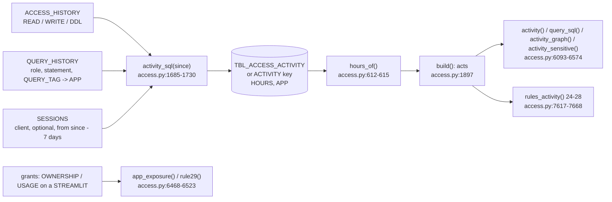

<!-- generated by darshan-singh-meel-knowledge-graph -->
# Activity (table use, rules 24-28, Streamlit app exposure 29)

What people did on tables, not what they may do: per UTC day, user, role, client, object, action, statement and Streamlit app, with the queries per UTC hour, from `ACCESS_HISTORY` + `QUERY_HISTORY` + `SESSIONS`. Feeds the Activity tab of the Object and Access pages and rules 24-28. Query metadata only, never query text or table data (`access.py:1686-1695`).

## Read window (incremental)
- Window: `ACTIVITY_DAYS` (env, default 60) back from now — `access.py:106`, `sql/1_setup.sql:209`.
- `activity_start(old, now)` -> (rows to keep, first day to read): `first = today - ACTIVITY_DAYS`; `last` = newest `DAY` of the earlier read; `since = max(first, last - 1 day)`; rows kept: `first <= DAY < since` — `access.py:1774-1782`. The last day is read again because ACCESS_HISTORY lags up to 3 hours (`access.py:1776`).
- SP_ACCESS_SNAPSHOT does the same in SQL: previous OK run (`MAX_BY(RUN_ID, FINISHED_AT)`), its `MAX(DAY)`, rows `DAY >= first AND DAY < since` copied under the new `RUN_ID` (all columns, `HOURS` and `APP` included, `sql/1_setup.sql:1082`), then `activity_sql(since)` inserted — `sql/1_setup.sql:1078-1088`.
- Example (`test_access.py:2367-2371`): earlier rows on 2026-08-01, 10-20, 10-30, 10-31, now 2026-11-02 -> keep only 10-20, read from 2026-10-30; no earlier read -> read from 2026-09-03; a read older than the window -> all again.
- Object use (Granted vs used) is read the same way by week: `use_start(old, now)` keeps an earlier read's ISO weeks but its last two, which are read again from that Monday (`use_sql(since)`); the SP's `object_use` step does the same in SQL — `access.py:1762-1771`, `sql/1_setup.sql:995-1019` ([business_rule:object_use_incremental](rules.md); `test_object_use_weeks`, `test_sql.py:646-704`).
- One ACCESS_HISTORY read for both: `history_sql(use_since, act_since, client)` scans ACCESS_HISTORY once (`A0`, from the earlier cut) and returns `PART = 'USE'` rows with `use_sql`'s columns and `PART = 'ACT'` rows with `activity_sql`'s; Direct mode splits them with `history_rows`, the SP fills both tables with one `INSERT ALL` (`history`). If the shared read fails each step reads alone; not after a timeout (same rows, same limit) — `access.py:1733-1759`, `access.py:1351-1364`, `sql/1_setup.sql:1119-1149` ([business_rule:shared_history_read](rules.md); `test_history_shared`, `test_sql.py:788-828`).
- `ACTIVITY=0` reads none of it: sources `SKIPPED`, note `skipped (ACTIVITY=0)`, rules 24-28 skipped, the tabs say so (`server.note_info`, `server.py:593-596`) — [business_rule:activity_off](rules.md).

## The SELECT (`activity_sql`)
- `A`: ACCESS_HISTORY rows with `QUERY_START_TIME >= since` (one scan), plus `L = CONVERT_TIMEZONE('UTC', QUERY_START_TIME)` — `access.py:1702-1705`.
- `H`: READ = `DIRECT_OBJECTS_ACCESSED`, WRITE = `OBJECTS_MODIFIED`, DDL = `OBJECT_MODIFIED_BY_DDL` — `access.py:1706-1714`.
- `Q`: QUERY_HISTORY role, statement type, session, `START_TIME >= since`, the app's own queries left out (`COALESCE(QUERY_TAG,'') <> '<QUERY_TAG>'` and `NOT LIKE '%.<APP_ST>%'`; both settings, defaults `access-explorer` / `ST_ACCESS_EXPLORER`, quotes and backslashes escaped at `access.py:1697`) — `access.py:1715-1721`.
- `APP`: the Streamlit app a query ran for, from its QUERY_TAG: JSON `StreamlitName`, else the older `streamlitName: ...` text; NULL otherwise — `access.py:1717-1718`.
- Client: `SESSIONS.CLIENT_APPLICATION_ID` with its version cut (`REGEXP_REPLACE(..., ' [0-9][0-9.]*$', '')`), only when SESSIONS is readable; else `CLIENT` is NULL and the note says "no client" — `access.py:1696`, `access.py:1699-1700`, `access.py:1620-1622`.
- SESSIONS rows only from 7 days before the first day read (`CREATED_ON >= DATEADD(DAY, -7, since)`): no year-long scan; a session opened earlier gives a NULL client, so rule 25 may miss it — `access.py:1698-1701`, same text in `sql/1_setup.sql:1035-1038` ([business_rule:sessions_week_bound](rules.md)).
- `G`: per UTC day (`L::DATE`), user, role, client, object, action, statement, app and UTC hour: `N = COUNT(DISTINCT QUERY_ID)`, `LAST_USED = MAX(T)`; the `TBL_ACCESS_` tables are left out — `access.py:1722-1727`.
- Final: one row per day .. app, `QUERIES = SUM(N)`, `HOURS = OBJECT_AGG(hour, N)` ({"13": 12, "22": 3}) — `access.py:1728-1730`.
- The same text sits in SP_ACCESS_SNAPSHOT (`sql/1_setup.sql:1022-1067`); `test_sql.test_activity` checks it is identical (`test_sql.py:354`).
- Query tag: `sf.connect` sets `session_parameters={"QUERY_TAG": access.QUERY_TAG}` — `sf.py:35`. `QUERY_TAG` is env `QUERY_TAG` (default `access-explorer`) and `APP_ST` env `STREAMLIT_APP` (default `ST_ACCESS_EXPLORER`) — `access.py:107-108`; SP_ACCESS_SNAPSHOT takes them from `&QUERY_TAG` / `&STREAMLIT_APP` (`sql/1_setup.sql:210-211`), so `.env`, `sis/.env` and settings.local.sql must agree (`settings.sql:16-19`, `sis.env.example:16-21`, `.env.example:33-35`). Example: `test_tag_settings` (`test_access.py:2444-2449`).
- `HOURS` comes back from Snowflake (and DuckDB `JSON`) as text: `hours_of(rows)` parses it to a dict on load, in `snapshot()` and `live()` — `access.py:612-615`, `access.py:609`, `access.py:1621`.

## Business hours and off-hours
- Stored in UTC; `WORK_HOURS` (env, default `7-19`, end exclusive) is the default business-hours window — `access.py:118-119`; `activity_page` sends it as `work` — `server.py:3018`.
- The Activity tab keeps `{start, end, tz}`; the "Business time" slider sets `tz` from UTC-12 to UTC+14, and a stored UTC hour `h` counts as local hour `(h + tz) mod 24` — `web/src/pages/Activity.tsx:22`, `web/src/pages/Activity.tsx:124`, `web/src/pages/Activity.tsx:474-481`.
- Business time: `activity()` also sends each row's `dh` = [day index, UTC hour, queries] (`access.py:6133-6138`); the tab moves every query to its local day and hour (UTC + the slider, `localize`), weekends by the local day, before any section draws, so per-day charts, day grids, active and busiest days, hours of use and off-hours all follow the slider — `web/src/pages/Activity.tsx:28-45` (`localize`), `web/src/pages/Activity.tsx:125-131` (the `useMemo` that applies it).
- Off-hours queries of a row (already in business time) = its weekend queries + weekday queries whose hour is outside `[start, end)` (`offOf`) — `web/src/pages/Activity.tsx:25-26`. The section SQL's `TZ_HOURS` shifts day and hour the same way; the card fills in the slider's value — `access.py:6226`, `web/src/pages/Activity.tsx:166-167`.
- Example (`test_access.py:2306-2308`): every row's `sum(hours) + weekend == queries`; ENGINEER_01's INSERT rows sit at UTC hours 13 and 22 (22:00 = off-hours at UTC+0).
- Rows from a snapshot without `HOURS` keep all-zero hours (`access.py:6114`), so only their weekend queries count as off-hours.

## Availability (`act_state`)
- OK when there are rows or the source is ACCOUNT_USAGE (`access.py:6081-6082`).
- `ACTIVITY` key `None` (snapshot tables older than TBL_ACCESS_ACTIVITY, `snapshot()` OPTIONAL read) -> "run sql/1_setup.sql again, then rebuild the snapshot" (`access.py:6083-6085`, `access.py:581-585`).
- Else the run note (e.g. ACCESS_HISTORY not readable) (`access.py:6086`). My access never reads ACCESS_HISTORY: `activity_page` says so (`server.py:3010-3011`). Health notes: `server.py:629-632`.

## Activity tab numbers (`activity(name, what, user)`)
- `what`: object (`OBJECT_NAME`), user (`USER_NAME`), role (`ROLE_NAME`), app (`APP`: the queries a Streamlit app ran for its viewers), scope (`OBJECT_NAME` starting with `name + "."`: every object in a database or schema); `user`: only that user's rows (Object page "Access for", `as=`) — `access.py:6105-6106`, `access.py:6111`.
- Days: `ACTIVITY_DAYS` ending at the snapshot day `ref_time()`; `daily[i]` = queries on day `first + i` — `access.py:6107-6116`.
- `by` user / role / client (label, `client_label`) / type / object: read, write, ddl totals, last, daily — `access.py:6117-6125`; empty role or type shows "–".
- `rows`: one per user + role + client + type + object + action with queries, distinct days, `first_day`, last, daily, `hours` (weekday queries per UTC hour), `weekend`, `weekend_hours`, `kind` (system for `SYSTEM`, service for `is_service`, else person), `interactive` (client in `INTERACTIVE`); most queries first; `ddl` = the DDL rows newest first — `access.py:6126-6146`.
- Counts are per action: a MERGE that reads and changes a table counts in both READ and WRITE (`access.py:6100-6104`).
- Example (`test_access.py:2319`): `activity("SALES.CORE", "scope")` -> the busiest object starts with `SALES.CORE.`.

## View by object type (`activity_page`)
| Object kind | `what` | Data | Code |
|---|---|---|---|
| STREAMLIT | app | `activity(name, "app")` + `app_use` (who can open, opened, never, saw); no grant-path graph | `server.py:3005-3006`, `server.py:3035` |
| DATABASE, SCHEMA | scope | every object under the name; no grant-path graph | `server.py:3006`, `server.py:3023` |
| WAREHOUSE | warehouse | no ACCESS_HISTORY rows: `warehouse_use(name)` from the usage read (QUERY_HISTORY `USAGE` rows, KIND WAREHOUSE), source and reason of `usage` | `server.py:3012-3016`, `access.py:6499-6505` |
| anything else | object | `activity(name, "object")`, graph, sensitive, mark text | `server.py:3023-3034` |

- Every view also gets `query_sql`, `objects` ({object: kind, sensitive}) and the rule >= 24 findings that name it — `server.py:3030-3038`.
- `warehouse_use(wh)`: used = users with queries on it, most first; unused = users reaching USAGE, OPERATE or OWNERSHIP on it with no queries — `access.py:6499-6505`. Example (`test_access.py:2335-2336`): WH_SALES_XS -> used sorted by queries, used and unused disjoint.

## Streamlit app exposure (`app_exposure`, `app_use`)
- A Streamlit app runs with its owner's rights, so whoever opens it sees what the owner role reads (`access.py:6468-6471`).
- `app_exposure(app)`: owner = roles holding OWNERSHIP on it; sensitive = objects the owner reads that are sensitive, with their sensitive columns; holders = roles holding USAGE on it -> users reaching them; exposed = per user the sensitive objects they cannot read through their own roles (`user_reads`, PUBLIC included); `None` without an owner — `access.py:6468-6481`, `access.py:6463-6465`.
- `app_use(app, rows)`: can (user -> role holding USAGE), opened (users with activity rows: queries, last), never, saw (opened and exposed) — `access.py:6484-6496`.
- Who has access page of an app carries `app = app_exposure(o)` — `server.py:2526`; the Object page shows it in `AppNote` — `web/src/pages/Object.tsx:90`, `web/src/pages/Object.tsx:114-131`.
- Example (`test_access.py:2351-2354`): ST_CUSTOMER_LOOKUP -> owner T_SALES_MART_OWNER, exposed `{SUPPORT_01: [SALES.MART.VW_CUSTOMER]}`, app view `by.user = [SUPPORT_01]`.

## Copy-only SQL (`query_sql`)
- `query_sql(name, what, first, last)`: read-only SELECT over ACCESS_HISTORY (all three object lists via `ARRAY_CAT`) x QUERY_HISTORY x SESSIONS, every query id, start time, user, role, statement, object and client in the window, newest first; no query text; filter per `what` (object name, user, role, app by `StreamlitName`, scope by `LIKE '<name>.%'`); single quotes doubled — `access.py:6149-6169`. The app never runs it; the tab offers it to copy (`web/src/pages/Activity.tsx:879-888`).
- Example (`test_access.py:2320-2321`): scope SALES.CORE -> `LIKE 'SALES.CORE.%'`; user `O'BRIEN` -> `O''BRIEN`.
- Per section: `activity_section_sql(name, what, first, last, key)` gives the SQL behind each Activity section (`ACT_SECTIONS`), sent as `section_sql` and shown on each section's SQL button — `access.py:6288-6298`, `server.py:3031`; details in [page-sql.md](page-sql.md).
- All sections from one read: `activity_once_sql(name, what, first, last, keys)` runs the base (`ACT_BASE`) once, pins its id (`SET BASE_ID = LAST_QUERY_ID()`) and each section reads `RESULT_SCAN($BASE_ID)` instead of the history views; it is the first entry of the Activity SQL list — `access.py:6301-6316`, `access.py:6344-6345`.
- `ACT_FILTER` puts the filter inside X's own WHERE on `H.` / `Q.` columns (`Q.ROLE_NAME`, `APP_OF` for an app), not `X.`; `APP_OF` = StreamlitName from `QUERY_TAG`; QUERY_HISTORY and SESSIONS get an upper date bound (`$TO_DAY` + 1 day) — `access.py:6215-6221`, `access.py:6235-6246`.

## Grant path behind a use (`used_path`, `activity_graph`)
- `used_path(u, r, o, action)`: `u` -> shortest `data_use` chain from a role the user holds (or PUBLIC) to the role used `r` -> shortest chain from `r` to a holder of a privilege on `o` that fits the action (READ: `READ_PRIVS`; WRITE/DDL: `WRITE_PRIVS` or OWNERSHIP) -> `o` — `access.py:6415-6433`. `None` when the role reaches no such grant now (an admin role, or the grant is gone).
- `activity_graph`: at most `MAX_OBJECTS` objects (most queries first), one path per (user, role, object, action); object page -> `object_graph`, person / role page -> `down_graph`; uses without a path go to `gone` (shown in the Paths section) — `access.py:6436-6460`. Not built for app and scope views (`server.py:3023`).
- Example (`test_access.py:2337-2342`): TBL_CUSTOMER -> users ANALYST_01, ENGINEER_01, SVC_DEPLOY, no gone rows; SYSADMIN role page -> no graph, gone = OPS_01 read of TBL_REVENUE.

## Sensitive view (`activity_sensitive`, `mark_sensitive`)
- Per data object used that is sensitive or has a masking / row policy: sensitive columns, masking per column, row policies; per user and role used: can read, sensitive columns in clear, masked columns, row state, from `data_view(role, obj)` — `access.py:6551-6574`.
- An untagged data object gets text to tag it (never run): `ALTER <kind> <obj> SET TAG <tag> = '<value>'`, Terraform `snowflake_tag_association`, a ticket; tag = first `SENSITIVE_TAGS` rule other than Snowflake's own categories, as tagged in the account — `access.py:6526-6548`, sent by `server.py:3034`.

## Rules 24-28 (`rules_activity`, `access.py:7617-7668`)
All per user and object unless noted; fix is a review ("Ask the user and the role's owner why ..."), no SQL (`access.py:7620`). Added to `findings()` through `cached("activity", rules_activity)` (`access.py:7676`).

| # | Sev. | Input -> output | Code | Fake-data finding |
|---|---|---|---|---|
| 24 | Medium | A person (in USER, not `is_service`) has WRITE or DDL rows on a known object with a role whose `data_use` reach lacks "own" on it -> statement counts, the most used role, last day | `access.py:7632-7642` | ENGINEER_01 as F_ENGINEER on SALES.CORE.TBL_CUSTOMER (`test_access.py:2302`) |
| 25 | High | A service user has rows from a client in `INTERACTIVE` (Snowflake UI, SnowSQL, Snowflake CLI; env INTERACTIVE_CLIENTS) -> queries per client, tables, last day; one per service user | `access.py:7627-7628`, `access.py:7656-7662` | SVC_DEPLOY from Snowsight (`test_access.py:2303`) |
| 26 | High | Rows with a role in `ADMIN` on a known object -> objects read and changed; one per user and admin role | `access.py:7629-7630`, `access.py:7663-7667` | OPS_01 as SYSADMIN (`test_access.py:2303`) |
| 27 | Low | First day on the object within the last `NEW_DAYS` (7) days and the user's first row more than `NEW_DAYS` days before that window (not a new user) -> first day, queries, "sensitive" if tagged | `access.py:7621`, `access.py:7643-7647` | ENGINEER_01 on HR.PEOPLE.TBL_EMPLOYEE (`test_access.py:2304`) |
| 28 | Medium | At least 5 active days; busiest day >= `SPIKE[1]` (50) and > `SPIKE[0]` (3) x the median day -> queries that day, how many times the usual day, the median | `access.py:7648-7655` | REPORT_01: 400 queries on VW_CUSTOMER, 19x the usual day (`test_access.py:2304`) |

- Titles and why: `access.py:168-176`; severity `access.py:180-183`; UI area "Activity", plain-word text and fix hint: `server.py:571-585`; short labels `server.py:1498-1499`.
- Owner role on the table -> no rule 24 (`test_access.py:2360-2364`).
- Activity tab findings: rows with number >= 24 whose grantee or path names the page (`server.py:3035-3038`), so rule 29 shows on the app's tab.

## Rule 29 (`rule29`, `access.py:6508-6523`)
Grant-based, from `app_exposure`: per Streamlit app with sensitive owner data, one finding per role holding USAGE on it whose users include someone who cannot read that data themselves; drawn on the USAGE edge, so the What-if fix is revoking that USAGE (`access.py:6522`). Details in [rules.md](rules.md).

## Object activity page
Last use per object (buckets, 30 / 90 / 180-day windows, read-only and write-only tables) is a separate page: [object-activity.md](object-activity.md).

## Fake data
`fake_activity(end)` plans 17 streams of rows over `ACTIVITY_DAYS` so each of rules 24-28 has one finding, and SUPPORT_01's reads of VW_CUSTOMER as T_SALES_MART_OWNER through the app ST_CUSTOMER_LOOKUP (`APP`); `HOURS` puts part of OPS_01's and the Snowsight queries at 22:00 UTC (`access.py:473-507`); `fake()` and `fake_previous()` attach it (`access.py:440`, `access.py:543`). The app itself: `SCHEMAS` SALES.MART (`access.py:205`), kind `ST` -> STREAMLIT (`access.py:221`), USAGE through T_SALES_MART_EXECUTE (`access.py:244-245`), held by F_SUPPORT (`access.py:286`).
