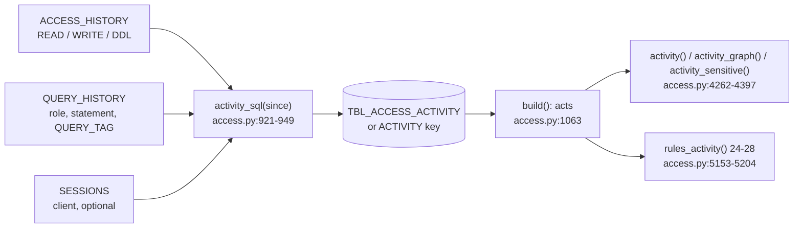

<!-- generated by darshan-singh-meel-knowledge-graph -->
# Activity (table use, rules 24-28)

What people did on tables, not what they may do: per day, user, role, client, object, action and statement, from `ACCESS_HISTORY` + `QUERY_HISTORY` + `SESSIONS`. Feeds the Activity tab of the Object and Access pages and rules 24-28. Query metadata only, never query text or table data (`access.py:922`).

## Read window (incremental)
- Window: `ACTIVITY_DAYS` (env, default 60) back from now — `access.py:63`, `sql/1_setup.sql:170`.
- `activity_start(old, now)` -> (rows to keep, first day to read): `first = today - ACTIVITY_DAYS`; `last` = newest `DAY` of the earlier read; `since = max(first, last - 1 day)`; rows kept: `first <= DAY < since` — `access.py:952-959`. The last day is read again because ACCESS_HISTORY lags up to 3 hours (`access.py:954`).
- SP_ACCESS_SNAPSHOT does the same in SQL: previous OK run (`MAX_BY(RUN_ID, FINISHED_AT)`), its `MAX(DAY)`, rows `DAY >= first AND DAY < since` copied under the new `RUN_ID`, then `activity_sql(since)` inserted — `sql/1_setup.sql:568-578`.
- Example (`test_access.py:1734-1738`): earlier rows on 2026-08-01, 10-20, 10-30, 10-31, now 2026-11-02 -> keep only 10-20, read from 2026-10-30; no earlier read -> read from 2026-09-03; a read older than the window -> all again.

## The SELECT (`activity_sql`)
- `A`: ACCESS_HISTORY rows with `QUERY_START_TIME >= since` (one scan) — `access.py:931-933`.
- `H`: READ = `DIRECT_OBJECTS_ACCESSED`, WRITE = `OBJECTS_MODIFIED`, DDL = `OBJECT_MODIFIED_BY_DDL` — `access.py:934-942`.
- `Q`: QUERY_HISTORY role, statement type, session, `START_TIME >= since`, the app's own queries left out (`COALESCE(QUERY_TAG,'') <> 'access-explorer'`) — `access.py:943-945`.
- Client: `SESSIONS.CLIENT_APPLICATION_ID` with its version cut (`REGEXP_REPLACE(..., ' [0-9][0-9.]*$', '')`), only when SESSIONS is readable; else `CLIENT` is NULL and the note says "no client" — `access.py:928-930`, `access.py:887-889`.
- Grouped per day, user, role, client, object, action, statement; `QUERIES = COUNT(DISTINCT QUERY_ID)`, `LAST_USED = MAX(T)` — `access.py:946-949`.
- The same text sits in SP_ACCESS_SNAPSHOT (`sql/1_setup.sql:528-556`); `test_sql.test_activity` checks it is identical (`test_sql.py:302`).
- Query tag: `sf.connect` sets `session_parameters={"QUERY_TAG": access.QUERY_TAG}` — `sf.py:34`, `access.py:64`.

## Availability (`act_state`)
- OK when there are rows or the source is ACCOUNT_USAGE (`access.py:4250-4251`).
- `ACTIVITY` key `None` (snapshot tables older than TBL_ACCESS_ACTIVITY, `snapshot()` OPTIONAL read) -> "run sql/1_setup.sql again, then rebuild the snapshot" (`access.py:4252-4254`, `access.py:464-468`).
- Else the run note (e.g. ACCESS_HISTORY not readable) (`access.py:4255`). My access never reads ACCESS_HISTORY: `activity_page` says so (`server.py:1659-1660`). Health notes: `server.py:400-403`.

## Activity tab numbers (`activity(name, what, user)`)
- `what`: object (`OBJECT_NAME`), user (`USER_NAME`), role (`ROLE_NAME`); `user`: only that user's rows (Object page "Access for", `as=`) — `access.py:4269`, `access.py:4274`.
- Days: `ACTIVITY_DAYS` ending at the snapshot day `ref_time()`; `daily[i]` = queries on day `first + i` — `access.py:4270-4278`.
- `by` user / role / client (label, `client_label`) / type / object: read, write, ddl totals, last, daily — `access.py:4279-4287`; empty role or type shows "–".
- `rows`: one per user + role + client + type + object + action with queries, distinct days, last, daily; most queries first; `ddl` = the DDL rows newest first — `access.py:4288-4298`.
- Counts are per action: a MERGE that reads and changes a table counts in both READ and WRITE (`access.py:4267-4268`).

## Grant path behind a use (`used_path`, `activity_graph`)
- `used_path(u, r, o, action)`: `u` -> shortest `data_use` chain from a role the user holds (or PUBLIC) to the role used `r` -> shortest chain from `r` to a holder of a privilege on `o` that fits the action (READ: `READ_PRIVS`; WRITE/DDL: `WRITE_PRIVS` or OWNERSHIP) -> `o` — `access.py:4301-4319`. `None` when the role reaches no such grant now (an admin role, or the grant is gone).
- `activity_graph`: at most `MAX_OBJECTS` objects (most queries first), one path per (user, role, object, action); object page -> `object_graph`, person / role page -> `down_graph`; uses without a path go to `gone` (shown in the Paths tab) — `access.py:4322-4346`.
- Example (`test_access.py:1713-1718`): TBL_CUSTOMER -> users ANALYST_01, ENGINEER_01, SVC_DEPLOY, no gone rows; SYSADMIN role page -> no graph, gone = OPS_01 read of TBL_REVENUE.

## Sensitive view (`activity_sensitive`, `mark_sensitive`)
- Per data object used that is sensitive or has a masking / row policy: sensitive columns, masking per column, row policies; per user and role used: can read, sensitive columns in clear, masked columns, row state, from `data_view(role, obj)` — `access.py:4374-4397`.
- An untagged data object gets text to tag it (never run): `ALTER <kind> <obj> SET TAG <tag> = '<value>'`, Terraform `snowflake_tag_association`, a ticket; tag = first `SENSITIVE_TAGS` rule other than Snowflake's own categories, as tagged in the account — `access.py:4349-4371`, sent by `server.py:1674`.

## Rules 24-28 (`rules_activity`, `access.py:5153-5204`)
All per user and object unless noted; fix is a review ("Ask the user and the role's owner why ..."), no SQL (`access.py:5156`). Added to `findings()` through `cached("activity", rules_activity)` (`access.py:5211`).

| # | Sev. | Input -> output | Code | Fake-data finding |
|---|---|---|---|---|
| 24 | Medium | A person (in USER, not `is_service`) has WRITE or DDL rows on a known object with a role whose `data_use` reach lacks "own" on it -> statement counts, the most used role, last day | `access.py:5168-5178` | ENGINEER_01 as F_ENGINEER on SALES.CORE.TBL_CUSTOMER (`test_access.py:1710`) |
| 25 | High | A service user has rows from a client in `INTERACTIVE` (Snowflake UI, SnowSQL, Snowflake CLI; env INTERACTIVE_CLIENTS) -> queries per client, tables, last day; one per service user | `access.py:5163-5164`, `access.py:5192-5198` | SVC_DEPLOY from Snowsight (`test_access.py:1711`) |
| 26 | High | Rows with a role in `ADMIN` on a known object -> objects read and changed; one per user and admin role | `access.py:5165-5166`, `access.py:5199-5203` | OPS_01 as SYSADMIN (`test_access.py:1711`) |
| 27 | Low | First day on the object within the last `NEW_DAYS` (7) days and the user's first row more than `NEW_DAYS` days before that window (not a new user) -> first day, queries, "sensitive" if tagged | `access.py:5157`, `access.py:5179-5183` | ENGINEER_01 on HR.PEOPLE.TBL_EMPLOYEE (`test_access.py:1712`) |
| 28 | Medium | At least 5 active days; busiest day >= `SPIKE[1]` (50) and > `SPIKE[0]` (3) x the median day -> queries that day and the usual day | `access.py:5184-5191` | REPORT_01: 400 queries on VW_CUSTOMER (`test_access.py:1712`) |

- Titles and why: `access.py:117-126`; severity `access.py:127-130`; UI area "Activity", plain-word text and fix hint: `server.py:357-366`; short labels `server.py:967-968`.
- Owner role on the table -> no rule 24 (`test_access.py:1727-1731`).
- Activity tab findings: rows with number >= 24 whose grantee or path names the page (`server.py:1675-1677`).

## Fake data
`fake_activity(end)` plans 16 streams of rows over `ACTIVITY_DAYS` so each rule has one finding (`access.py:395-424`); `fake()` and `fake_previous()` attach it (`access.py:366`, `access.py:451`).
