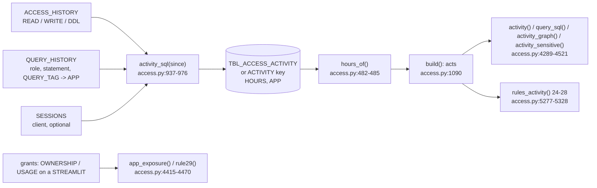

<!-- generated by darshan-singh-meel-knowledge-graph -->
# Activity (table use, rules 24-28, Streamlit app exposure 29)

What people did on tables, not what they may do: per UTC day, user, role, client, object, action, statement and Streamlit app, with the queries per UTC hour, from `ACCESS_HISTORY` + `QUERY_HISTORY` + `SESSIONS`. Feeds the Activity tab of the Object and Access pages and rules 24-28. Query metadata only, never query text or table data (`access.py:938-946`).

## Read window (incremental)
- Window: `ACTIVITY_DAYS` (env, default 60) back from now — `access.py:63`, `sql/1_setup.sql:178`.
- `activity_start(old, now)` -> (rows to keep, first day to read): `first = today - ACTIVITY_DAYS`; `last` = newest `DAY` of the earlier read; `since = max(first, last - 1 day)`; rows kept: `first <= DAY < since` — `access.py:979-986`. The last day is read again because ACCESS_HISTORY lags up to 3 hours (`access.py:981`).
- SP_ACCESS_SNAPSHOT does the same in SQL: previous OK run (`MAX_BY(RUN_ID, FINISHED_AT)`), its `MAX(DAY)`, rows `DAY >= first AND DAY < since` copied under the new `RUN_ID` (all columns, `HOURS` and `APP` included, `sql/1_setup.sql:590`), then `activity_sql(since)` inserted — `sql/1_setup.sql:586-596`.
- Example (`test_access.py:1755-1759`): earlier rows on 2026-08-01, 10-20, 10-30, 10-31, now 2026-11-02 -> keep only 10-20, read from 2026-10-30; no earlier read -> read from 2026-09-03; a read older than the window -> all again.

## The SELECT (`activity_sql`)
- `A`: ACCESS_HISTORY rows with `QUERY_START_TIME >= since` (one scan), plus `L = CONVERT_TIMEZONE('UTC', QUERY_START_TIME)` — `access.py:950-953`.
- `H`: READ = `DIRECT_OBJECTS_ACCESSED`, WRITE = `OBJECTS_MODIFIED`, DDL = `OBJECT_MODIFIED_BY_DDL` — `access.py:954-962`.
- `Q`: QUERY_HISTORY role, statement type, session, `START_TIME >= since`, the app's own queries left out (`COALESCE(QUERY_TAG,'') <> 'access-explorer'`) — `access.py:963-968`.
- `APP`: the Streamlit app a query ran for, from its QUERY_TAG: JSON `StreamlitName`, else the older `streamlitName: ...` text; NULL otherwise — `access.py:965-966`.
- Client: `SESSIONS.CLIENT_APPLICATION_ID` with its version cut (`REGEXP_REPLACE(..., ' [0-9][0-9.]*$', '')`), only when SESSIONS is readable; else `CLIENT` is NULL and the note says "no client" — `access.py:947-949`, `access.py:903-905`.
- `G`: per UTC day (`L::DATE`), user, role, client, object, action, statement, app and UTC hour: `N = COUNT(DISTINCT QUERY_ID)`, `LAST_USED = MAX(T)` — `access.py:969-973`.
- Final: one row per day .. app, `QUERIES = SUM(N)`, `HOURS = OBJECT_AGG(hour, N)` ({"13": 12, "22": 3}) — `access.py:974-976`.
- The same text sits in SP_ACCESS_SNAPSHOT (`sql/1_setup.sql:536-575`); `test_sql.test_activity` checks it is identical (`test_sql.py:302`).
- Query tag: `sf.connect` sets `session_parameters={"QUERY_TAG": access.QUERY_TAG}` — `sf.py:34`, `access.py:64`.
- `HOURS` comes back from Snowflake (and DuckDB `JSON`) as text: `hours_of(rows)` parses it to a dict on load, in `snapshot()` and `live()` — `access.py:482-485`, `access.py:479`, `access.py:904`.

## Business hours and off-hours
- Stored in UTC; `WORK_HOURS` (env, default `7-19`, end exclusive) is the default business-hours window — `access.py:69-70`; `activity_page` sends it as `work` — `server.py:1674`.
- The Activity tab keeps `{start, end, tz}`; the "Business time" slider sets `tz` from UTC-12 to UTC+14, and a stored UTC hour `h` counts as local hour `(h + tz) mod 24` — `web/src/pages/Activity.tsx:22`, `web/src/pages/Activity.tsx:83`, `web/src/pages/Activity.tsx:375-384`.
- Off-hours queries of a row = its weekend queries + weekday queries whose local hour is outside `[start, end)` (`offOf`) — `web/src/pages/Activity.tsx:25-26`. Weekend = Saturday or Sunday of the UTC day (`access.py:4327-4330`).
- Example (`test_access.py:1714-1716`): every row's `sum(hours) + weekend == queries`; ENGINEER_01's INSERT rows sit at UTC hours 13 and 22 (22:00 = off-hours at UTC+0).
- Rows from a snapshot without `HOURS` keep all-zero hours (`access.py:4309`), so only their weekend queries count as off-hours.

## Availability (`act_state`)
- OK when there are rows or the source is ACCOUNT_USAGE (`access.py:4277-4278`).
- `ACTIVITY` key `None` (snapshot tables older than TBL_ACCESS_ACTIVITY, `snapshot()` OPTIONAL read) -> "run sql/1_setup.sql again, then rebuild the snapshot" (`access.py:4279-4281`, `access.py:474-478`).
- Else the run note (e.g. ACCESS_HISTORY not readable) (`access.py:4282`). My access never reads ACCESS_HISTORY: `activity_page` says so (`server.py:1666-1667`). Health notes: `server.py:403-406`.

## Activity tab numbers (`activity(name, what, user)`)
- `what`: object (`OBJECT_NAME`), user (`USER_NAME`), role (`ROLE_NAME`), app (`APP`: the queries a Streamlit app ran for its viewers), scope (`OBJECT_NAME` starting with `name + "."`: every object in a database or schema); `user`: only that user's rows (Object page "Access for", `as=`) — `access.py:4300-4301`, `access.py:4306`.
- Days: `ACTIVITY_DAYS` ending at the snapshot day `ref_time()`; `daily[i]` = queries on day `first + i` — `access.py:4302-4311`.
- `by` user / role / client (label, `client_label`) / type / object: read, write, ddl totals, last, daily — `access.py:4312-4320`; empty role or type shows "–".
- `rows`: one per user + role + client + type + object + action with queries, distinct days, `first_day`, last, daily, `hours` (weekday queries per UTC hour), `weekend`, `weekend_hours`, `kind` (system for `SYSTEM`, service for `is_service`, else person), `interactive` (client in `INTERACTIVE`); most queries first; `ddl` = the DDL rows newest first — `access.py:4321-4339`.
- Counts are per action: a MERGE that reads and changes a table counts in both READ and WRITE (`access.py:4296-4299`).
- Example (`test_access.py:1720`): `activity("SALES.CORE", "scope")` -> the busiest object starts with `SALES.CORE.`.

## View by object type (`activity_page`)
| Object kind | `what` | Data | Code |
|---|---|---|---|
| STREAMLIT | app | `activity(name, "app")` + `app_use` (who can open, opened, never, saw); no grant-path graph | `server.py:1661-1662`, `server.py:1690` |
| DATABASE, SCHEMA | scope | every object under the name; no grant-path graph | `server.py:1662`, `server.py:1679` |
| WAREHOUSE | warehouse | no ACCESS_HISTORY rows: `warehouse_use(name)` from the usage read (QUERY_HISTORY `USAGE` rows, KIND WAREHOUSE), source and reason of `usage` | `server.py:1668-1672`, `access.py:4446-4452` |
| anything else | object | `activity(name, "object")`, graph, sensitive, mark text | `server.py:1679-1689` |

- Every view also gets `query_sql`, `objects` ({object: kind, sensitive}) and the rule >= 24 findings that name it — `server.py:1686-1693`.
- `warehouse_use(wh)`: used = users with queries on it, most first; unused = users reaching USAGE, OPERATE or OWNERSHIP on it with no queries — `access.py:4446-4452`. Example (`test_access.py:1723-1724`): WH_SALES_XS -> used sorted by queries, used and unused disjoint.

## Streamlit app exposure (`app_exposure`, `app_use`)
- A Streamlit app runs with its owner's rights, so whoever opens it sees what the owner role reads (`access.py:4415-4418`).
- `app_exposure(app)`: owner = roles holding OWNERSHIP on it; sensitive = objects the owner reads that are sensitive, with their sensitive columns; holders = roles holding USAGE on it -> users reaching them; exposed = per user the sensitive objects they cannot read through their own roles (`user_reads`, PUBLIC included); `None` without an owner — `access.py:4415-4428`, `access.py:4410-4412`.
- `app_use(app, rows)`: can (user -> role holding USAGE), opened (users with activity rows: queries, last), never, saw (opened and exposed) — `access.py:4431-4443`.
- Who has access page of an app carries `app = app_exposure(o)` — `server.py:1394`; the Object page shows it in `AppNote` — `web/src/pages/Object.tsx:68`, `web/src/pages/Object.tsx:83-98`.
- Example (`test_access.py:1739-1742`): ST_CUSTOMER_LOOKUP -> owner T_SALES_MART_OWNER, exposed `{SUPPORT_01: [SALES.MART.VW_CUSTOMER]}`, app view `by.user = [SUPPORT_01]`.

## Copy-only SQL (`query_sql`)
- `query_sql(name, what, first, last)`: read-only SELECT over ACCESS_HISTORY (all three object lists via `ARRAY_CAT`) x QUERY_HISTORY x SESSIONS, every query id, start time, user, role, statement, object and client in the window, newest first; no query text; filter per `what` (object name, user, role, app by `StreamlitName`, scope by `LIKE '<name>.%'`); single quotes doubled — `access.py:4342-4359`. The app never runs it; the tab offers it to copy (`web/src/pages/Activity.tsx:778-787`).
- Example (`test_access.py:1721-1722`): scope SALES.CORE -> `LIKE 'SALES.CORE.%'`; user `O'BRIEN` -> `O''BRIEN`.

## Grant path behind a use (`used_path`, `activity_graph`)
- `used_path(u, r, o, action)`: `u` -> shortest `data_use` chain from a role the user holds (or PUBLIC) to the role used `r` -> shortest chain from `r` to a holder of a privilege on `o` that fits the action (READ: `READ_PRIVS`; WRITE/DDL: `WRITE_PRIVS` or OWNERSHIP) -> `o` — `access.py:4362-4380`. `None` when the role reaches no such grant now (an admin role, or the grant is gone).
- `activity_graph`: at most `MAX_OBJECTS` objects (most queries first), one path per (user, role, object, action); object page -> `object_graph`, person / role page -> `down_graph`; uses without a path go to `gone` (shown in the Paths section) — `access.py:4383-4407`. Not built for app and scope views (`server.py:1679`).
- Example (`test_access.py:1725-1730`): TBL_CUSTOMER -> users ANALYST_01, ENGINEER_01, SVC_DEPLOY, no gone rows; SYSADMIN role page -> no graph, gone = OPS_01 read of TBL_REVENUE.

## Sensitive view (`activity_sensitive`, `mark_sensitive`)
- Per data object used that is sensitive or has a masking / row policy: sensitive columns, masking per column, row policies; per user and role used: can read, sensitive columns in clear, masked columns, row state, from `data_view(role, obj)` — `access.py:4498-4521`.
- An untagged data object gets text to tag it (never run): `ALTER <kind> <obj> SET TAG <tag> = '<value>'`, Terraform `snowflake_tag_association`, a ticket; tag = first `SENSITIVE_TAGS` rule other than Snowflake's own categories, as tagged in the account — `access.py:4473-4495`, sent by `server.py:1689`.

## Rules 24-28 (`rules_activity`, `access.py:5277-5328`)
All per user and object unless noted; fix is a review ("Ask the user and the role's owner why ..."), no SQL (`access.py:5280`). Added to `findings()` through `cached("activity", rules_activity)` (`access.py:5335`).

| # | Sev. | Input -> output | Code | Fake-data finding |
|---|---|---|---|---|
| 24 | Medium | A person (in USER, not `is_service`) has WRITE or DDL rows on a known object with a role whose `data_use` reach lacks "own" on it -> statement counts, the most used role, last day | `access.py:5292-5302` | ENGINEER_01 as F_ENGINEER on SALES.CORE.TBL_CUSTOMER (`test_access.py:1710`) |
| 25 | High | A service user has rows from a client in `INTERACTIVE` (Snowflake UI, SnowSQL, Snowflake CLI; env INTERACTIVE_CLIENTS) -> queries per client, tables, last day; one per service user | `access.py:5287-5288`, `access.py:5316-5322` | SVC_DEPLOY from Snowsight (`test_access.py:1711`) |
| 26 | High | Rows with a role in `ADMIN` on a known object -> objects read and changed; one per user and admin role | `access.py:5289-5290`, `access.py:5323-5327` | OPS_01 as SYSADMIN (`test_access.py:1711`) |
| 27 | Low | First day on the object within the last `NEW_DAYS` (7) days and the user's first row more than `NEW_DAYS` days before that window (not a new user) -> first day, queries, "sensitive" if tagged | `access.py:5281`, `access.py:5303-5307` | ENGINEER_01 on HR.PEOPLE.TBL_EMPLOYEE (`test_access.py:1712`) |
| 28 | Medium | At least 5 active days; busiest day >= `SPIKE[1]` (50) and > `SPIKE[0]` (3) x the median day -> queries that day, how many times the usual day, the median | `access.py:5308-5315` | REPORT_01: 400 queries on VW_CUSTOMER, 19x the usual day (`test_access.py:1712`) |

- Titles and why: `access.py:119-127`; severity `access.py:131-134`; UI area "Activity", plain-word text and fix hint: `server.py:357-371`; short labels `server.py:970-971`.
- Owner role on the table -> no rule 24 (`test_access.py:1748-1752`).
- Activity tab findings: rows with number >= 24 whose grantee or path names the page (`server.py:1690-1693`), so rule 29 shows on the app's tab.

## Rule 29 (`rule29`, `access.py:4455-4470`)
Grant-based, from `app_exposure`: per Streamlit app with sensitive owner data, one finding per role holding USAGE on it whose users include someone who cannot read that data themselves; drawn on the USAGE edge, so the What-if fix is revoking that USAGE (`access.py:4469`). Details in [rules.md](rules.md).

## Fake data
`fake_activity(end)` plans 17 streams of rows over `ACTIVITY_DAYS` so each of rules 24-28 has one finding, and SUPPORT_01's reads of VW_CUSTOMER as T_SALES_MART_OWNER through the app ST_CUSTOMER_LOOKUP (`APP`); `HOURS` puts part of OPS_01's and the Snowsight queries at 22:00 UTC (`access.py:400-434`); `fake()` and `fake_previous()` attach it (`access.py:371`, `access.py:461`). The app itself: `SCHEMAS` SALES.MART (`access.py:141`), kind `ST` -> STREAMLIT (`access.py:157`), USAGE through T_SALES_MART_EXECUTE (`access.py:180-181`), held by F_SUPPORT (`access.py:219`).
