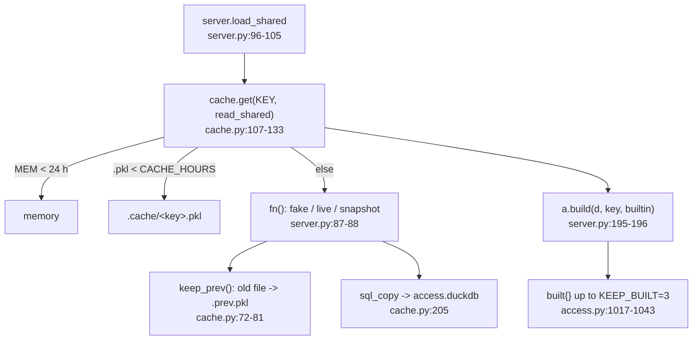

<!-- generated by darshan-singh-meel-knowledge-graph -->
# Caching

Data is read once and kept: `cache.get` (memory 24 h + `.cache/*.pkl` for `CACHE_HOURS`), `.prev.pkl` for What changed, and `access.build` keeps `KEEP_BUILT` built data sets.

## Cache key (`cache.name`, `cache.py:43-48`)
- `SNOWFLAKE_ACCOUNT` (or `local`) + what (source / `mine`) + snapshot location + user + role; another location, user or role never shares a copy.
- Shared key: `KEY = cache.name(SOURCE, where=WHERE)` (`server.py:23`); My access: `cache.name("mine", user or sid, WHERE)` (`server.py:162`).
- `config()` picks mode/source/where: `FAKE=1`, `SOURCE=direct|objects`, `ACCESS_SNAPSHOT` (`cache.py:27-40`).

## Lifetimes
- `HOURS = CACHE_HOURS` (default 24) for the file; `TTL = 24*3600` for memory (`cache.py:21-22`).
- `local()`: file only when `CACHE_HOURS > 0` and not inside Snowflake (`cache.py:51-53`).
- `get()`: memory checked first without the lock, so a page whose data is in memory never waits for another key's read (`cache.py:109-111`); then under one `RLock` memory again (another thread may have read it), file, `fn()`, stores both (`cache.py:24`, `98-119`); fake mode passes `disk=False` (`server.py:103`).
- `ready()`: answers without reading the source (`cache.py:136-143`); used to require a click before a direct read (`server.py:99-100`).
- `drop()`: under `LOCK`, out of memory, file set aside as `.old.pkl` (`cache.py:146-154`); the lock stops a read still running from storing its older data after the drop (`cache.py:149`); called on refresh (`server.py:2222`, `2149`) and fresh My access (`server.py:163-164`).

## Previous snapshot (`.prev.pkl`)
- `keep_prev(f, new)`: the replaced file (or `.old.pkl`) becomes `<key>.prev.pkl` unless it is the same run (`run_of`: RUN_ID, FINISHED_AT) (`cache.py:67-81`).
- `prev(key)`: returns it with its mtime, or None (`cache.py:84-90`); used by What changed (`server.py:1728`).

## Built data sets (`access.py`)
- `memo`: results per data set, cleared by `build()`; `cached(name, fn)` (`access.py:1014`, `974-978`).
- `build(d, key, builtin)`: same `(key, builtin)` as loaded -> no work; the loaded one is saved to `built`, at most `KEEP_BUILT` (3) kept (oldest dropped); a key in `built` is restored instead of rebuilt (`access.py:1017-1043`).
- Shared build key: `("shared", RUN_ID, FINISHED_AT)` (`server.py:189`); My access gets a random key per load (`server.py:173-175`).
- Test: `test_built` (`test_access.py:933`), `test_cache` (`test_access.py:1396`).

## SQL copy (DuckDB)
- `DUCKDB` env (`0` off, `1` also fake) (`cache.py:158`); `sql_copy(key, d, at)` writes TBL_ACCESS_ tables after each read (`cache.py:124-125`, `183`). Details not opened beyond signatures (`cache.py:158-265`): see CLAUDE.md.
