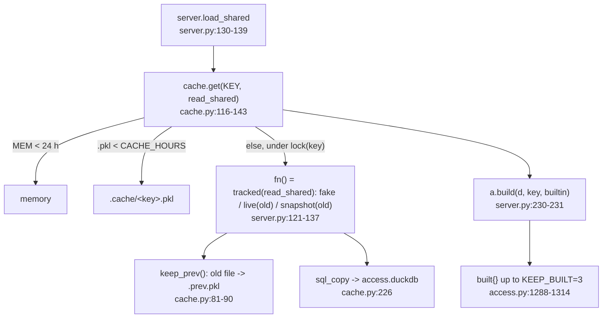

<!-- generated by darshan-singh-meel-knowledge-graph -->
# Caching

Data is read once and kept: `cache.get` (memory 24 h + `.cache/*.pkl` for `CACHE_HOURS`), `.prev.pkl` for What changed, and `access.build` keeps `KEEP_BUILT` built data sets.

## Cache key (`cache.name`, `cache.py:51-57`)
- `SNOWFLAKE_ACCOUNT` (or `local`) + what (source / `mine`) + snapshot location + user + role, + `_noactivity` under `ACTIVITY=0` (`cache.py:57`); another location, user, role or ACTIVITY setting never shares a copy.
- Shared key: `KEY = cache.name(SOURCE, where=WHERE)` (`server.py:23`); My access: `cache.name("mine", user or sid, WHERE)` (`server.py:196`).
- `config()` picks mode/source/where: `FAKE=1`, `SOURCE=direct|objects`, `ACCESS_SNAPSHOT` (`cache.py:35-48`).

## Lifetimes
- `HOURS = CACHE_HOURS` (default 24) for the file; `TTL = 24*3600` for memory (`cache.py:21-22`).
- `local()`: file only when `CACHE_HOURS > 0` and not inside Snowflake (`cache.py:60-62`).
- `get()`: memory checked first without a lock, so a page whose data is in memory never waits (`cache.py:118-120`); then under the key's own `RLock` (`lock(key)`: `LOCKS` guarded by `LOCK`, `cache.py:24-32`) memory again, file, `fn()`, stores both (`cache.py:121-143`). A read of one key never waits on another (shared and My access load side by side).
- `ready()`: answers without reading the source (`cache.py:146-153`); used to require a click before a direct read (`server.py:133-134`).
- `drop()`: under the key's lock, out of memory (the copy kept in `OLD`, so `last()` still finds it where there is no file, inside Snowflake), file set aside as `.old.pkl` (`cache.py:156-166`); the lock stops a read still running from storing its older data after the drop; called on refresh and fresh My access loads.

## Reads that reuse what is held
- `last(key)`: newest data kept (memory, `OLD`, `.pkl`, `.old.pkl`, `.prev.pkl`) — `cache.py:102-113`.
- Objects mode: `snapshot(q, WHERE, old=cache.last(KEY))` returns `old` after one `TBL_ACCESS_RUN` query when the last OK run is the one held (`access.py:487-492`, [business_rule:snapshot_same_run](rules.md)); a refresh with no new run costs one small query (test_server.test_same_run, `test_server.py:376-398`).
- Direct mode: `live(q, old ACTIVITY, old OBJECT_USE)` reads only the days / weeks they lack (`server.py:124-126`).

## Previous snapshot (`.prev.pkl`)
- `keep_prev(f, new)`: the replaced file (or `.old.pkl`) becomes `<key>.prev.pkl` unless it is the same run (`run_of`: RUN_ID, FINISHED_AT) (`cache.py:76-90`).
- `prev(key)`: returns it with its mtime, or None (`cache.py:93-99`); used by What changed (`server.py:1769`).

## Built data sets (`access.py`)
- `memo`: results per data set, cleared by `build()`; `cached(name, fn)` (`access.py:1285`, `974-978`).
- `build(d, key, builtin)`: same `(key, builtin)` as loaded -> no work; the loaded one is saved to `built`, at most `KEEP_BUILT` (3) kept (oldest dropped); a key in `built` is restored instead of rebuilt (`access.py:1288-1314`).
- Shared build key: `("shared", RUN_ID, FINISHED_AT)` (`server.py:224`); My access gets a random key per load (`server.py:208-210`).
- Test: `test_built` (`test_access.py:1058`), `test_cache` (`test_access.py:1521`).

## SQL copy (DuckDB)
- `DUCKDB` env (`0` off, `1` also fake); `sql_copy(key, d, at)` writes the TBL_ACCESS_ tables after each read (`cache.py:133-134`, `cache.py:226-280`): one schema per key, the read before as `_PREV`, one bulk `INSERT ... SELECT TRY_CAST(UNNEST(?::VARCHAR[]) AS <type>)` per table from text lists (`text()`: dicts / lists as compact JSON, booleans as true/false, `cache.py:217-223`), all under `SQL_LOCK` because every key writes the one `.cache/access.duckdb` (`cache.py:249-271`).
