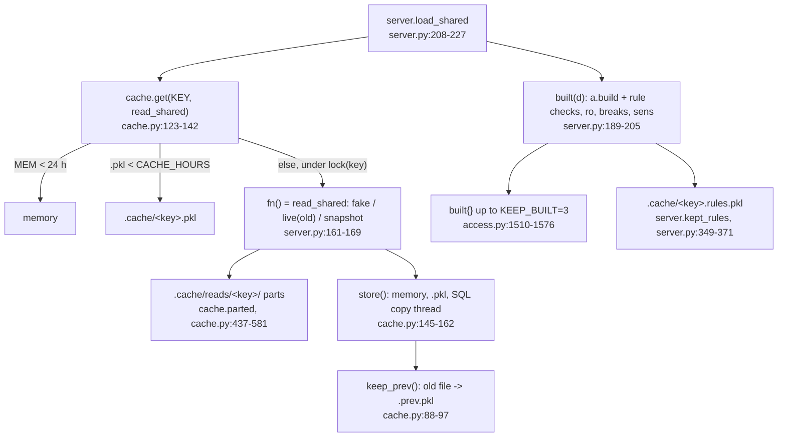

<!-- generated by darshan-singh-meel-knowledge-graph -->
# Caching

Data is read once and kept: `cache.get` (memory 24 h + `.cache/*.pkl` for `CACHE_HOURS`), `.prev.pkl` for What changed, and `access.build` keeps `KEEP_BUILT` built data sets.

## Cache key (`cache.name`, `cache.py:58-64`)
- `SNOWFLAKE_ACCOUNT` (or `local`) + what (source / `mine`) + snapshot location + user + role, + `_noactivity` under `ACTIVITY=0` (`cache.py:64`); another location, user, role or ACTIVITY setting never shares a copy.
- Shared key: `KEY = cache.name(SOURCE, where=WHERE)` (`server.py:27`); My access: `cache.name("mine", user or sid, WHERE)` (`server.py:291`).
- `config()` picks mode/source/where: `FAKE=1`, `SOURCE=direct|objects`, `ACCESS_SNAPSHOT` (`cache.py:42-55`).

## Lifetimes
- `HOURS = CACHE_HOURS` (default 24) for the file; `TTL = 24*3600` for memory (`cache.py:28-29`).
- `local()`: file only when `CACHE_HOURS > 0` and not inside Snowflake (`cache.py:67-69`).
- `get()`: memory checked first without a lock, so a page whose data is in memory never waits (`cache.py:125-127`); then under the key's own `RLock` (`lock(key)`: `LOCKS` guarded by `LOCK`, `cache.py:31-39`) memory again, file, else `store(key, fn())` (`cache.py:128-142`). A read of one key never waits on another (shared and My access load side by side).
- `store()`: memory, `.pkl` and the SQL copy; a read with no OK run (`run_of` RUN_ID None) stays in memory only, so an empty read never replaces a snapshot on disk (`cache.py:145-162`, [business_rule:no_run_empty](rules.md)).
- `ready()`: answers without reading the source (`cache.py:179-186`); used to require a click before a direct read and to answer pages without a progress entry (`server.py:212-215`).
- `drop()`: under the key's lock, out of memory (the copy kept in `OLD`, so `last()` still finds it where there is no file, inside Snowflake), file set aside as `.old.pkl` (`cache.py:189-199`); the lock stops a read still running from storing its older data after the drop; called on refresh and fresh My access loads.

## Parts (stage 1)
- Every Snowflake read is kept as `.cache/reads/<key>/<label>-<hash>.parquet`, listed in `parts.json`; the next load reads only the missing or timed-out parts; parts have no age and are read again only on a manual refresh (`clear_parts`, `swap`), a fresh My access load or `run.py --export --fresh` (`cache.py:319-581`; [flows/two-stage-load.md](../flows/two-stage-load.md), [business_rule:read_parts](rules.md)).
- Engine: `engine()` picks `pyarrow` (with `pyarrow.parquet`), else `duckdb`, else none: then no parts are kept and the next load reads everything (`cache.py:368-376`, `cache.py:475-479`). `write_part()` writes `<name>.parquet.tmp` and renames it when complete; the DuckDB path types each column (`duck_type`, a column of mixed Python types is not kept) (`cache.py:379-414`).
- `parted(query, key)` (`cache.py:437-581`): `take(name)` answers from a kept part (a `failed` part only when asked for its timed-out statements); `put(name, results)` keeps rows and per-statement errors (`timeout` or `error`), status `failed` when any statement timed out, never after a lost session (`cache.py:445-504`); `save()` rewrites `parts.json` through a temp file (`cache.py:466-469`); `prune()` drops the parts a whole load did not ask for (an older run's tables, older activity days) (`cache.py:506-514`); a wave reads again only its timed-out statements (`cache.py:563-570`); `q.fresh` is always asked and kept (the last OK run) (`cache.py:578-579`).
- A refresh reads under `KEY + ".new"` and `swap()`s it in once built, so the pages keep the old data until then (`server.py:3194-3219`, `cache.py:165-176`; [flows/background-refresh.md](../flows/background-refresh.md)).

## Reads that reuse what is held
- `last(key)`: newest data kept (memory, `OLD`, `.pkl`, `.old.pkl`, `.prev.pkl`) — `cache.py:109-120`.
- Objects mode: `snapshot(q, WHERE, old=cache.last(KEY))` asks the last OK run on every load (`query.fresh`: always asked, never answered from a part; the answer is kept for `--build`, `cache.py:527-536`, `cache.py:578-579`) and returns `old` after that one `TBL_ACCESS_RUN` query when it is the run held (`access.py:522-544`, [business_rule:snapshot_same_run](rules.md)); a refresh with no new run reads no table again (test_server.test_same_run, test_newer_run, `test_server.py:494-557`).
- Direct mode: `live(q, old ACTIVITY, old OBJECT_USE)` from `cache.old(key, KEY)` reads only the days / weeks they lack; `old` is kept with the parts so a resumed load asks for the same days (`server.py:165-167`, `cache.py:349-364`).

## Previous snapshot (`.prev.pkl`)
- `keep_prev(f, new)`: the replaced file (or `.old.pkl`) becomes `<key>.prev.pkl` unless it is the same run (`run_of`: RUN_ID, FINISHED_AT) (`cache.py:83-97`).
- `prev(key)`: returns it with its mtime, or None (`cache.py:100-106`); used by What changed (`server.py:2424`).

## Built data sets (`access.py`)
- `memo`: results per data set, cleared by `build()`; `cached(name, fn)` (`access.py:1494`, `access.py:1685-1689`).
- `build(d, key, builtin)`: same `(key, builtin)` as loaded -> no work; the loaded one is saved to `built`, at most `KEEP_BUILT` (3) kept (oldest dropped); a key in `built` is restored instead of rebuilt (`access.py:1497-1523`).
- Shared build key: `("shared", RUN_ID, FINISHED_AT, _read)` (`_read`: when it was read, so a re-read of the same run gets a new key and rule check; `shared_key`, `server.py:174-176`, `_read` set at `server.py:170`, used at `server.py:323`); My access gets a random key per load (`server.py:307-309`).
- Test: `test_built` (`test_access.py:1260`), `test_cache` (`test_access.py:1724`).

## Rule results across restarts
- `server.kept_rules(view, key, builtin, save)`: shared data in Snowflake mode, disk allowed: `findings`, `rows`, `ro`, `breaks` of `a.memo` in `.cache/<key>.rules.pkl` with the stamp `(build key, builtin, a.rules_stamp(), SERVER_STAMP)`; restored while the stamp matches (`server.py:345-371`); `built()` works out and saves all four in the load (`server.py:195-203`). `rules_stamp()` hashes `access.py` and every `environ.get` setting it names with its value (`access.py:4161-4165`); `SERVER_STAMP` hashes `server.py` (`server.py:346`).

## SQL copy (DuckDB)
- `DUCKDB` env (unset: after each Snowflake read; `1` also fake); `store()` starts `sql_copy(key, d, at)` in a `COPYING` thread (`cache.py:150-153`, `cache.py:239-305`): one schema per key, the read before as `_PREV`, per table one INSERT from an Arrow table of text columns (pyarrow) or UNNESTed text lists (`text()`: dicts / lists as compact JSON, booleans as true/false, `cache.py:230-236`), all under `SQL_LOCK` because every key writes the one `.cache/access.duckdb` (`cache.py:266-296`). Details: [data/duckdb-copy.md](../data/duckdb-copy.md).
