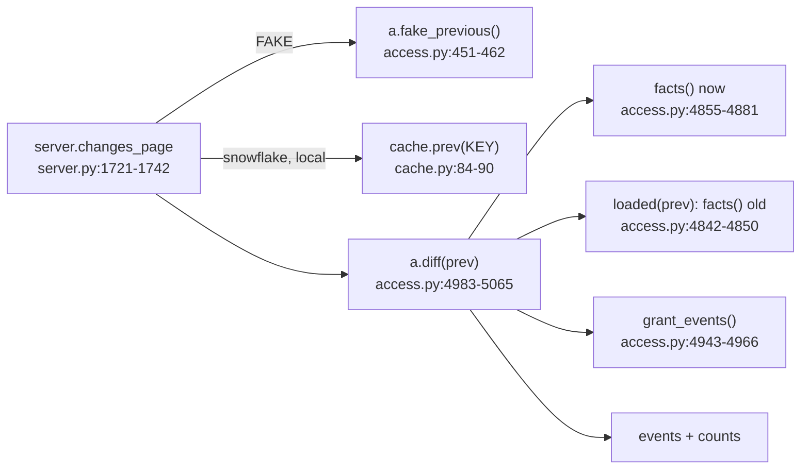

<!-- generated by darshan-singh-meel-knowledge-graph -->
# What changed (facts, diff)

What changed compares the loaded snapshot with the previous one: `facts()` per data set, `diff(prev)` turns differences into events.

## facts() (`access.py:4855-4881`)
- `access {(user, object): (level, privileges)}` on tables/views, merging per granted role `table_reach()`; users with the same granted roles share the work (`access.py:4861-4873`).
- `table_reach(r)` / `own_tables(h)` cached per role (`access.py:4884-4906`); `table_level()` gives the ladder level (`access.py:4914-4921`).
- `grants` keyed `(grantee, privilege, granted on, object)` -> `GRANTED_BY`; admin role links and hidden built-ins left out (`access.py:4875-4876`).
- `user_roles`, `findings` (keyed num, grantee, user, detail), `status`, `sens`, `run` (`access.py:4877-4880`).

## diff(prev) (`access.py:4983-5065`)
- Old side built with `loaded(prev)` (save, build, restore) (`access.py:4992`, `4203-4211`).
- Gained / lost = new pair or higher level on `LEVELS` (`access.py:4994-4997`, `LEVELS` `access.py:1215`).
- Findings: same (rule, grantee, user) counts as the same finding (`access.py:4998-5000`).
- Grant events for removed and added grants and user-role links (`access.py:5001-5006`), each with impact text (`impact_text`, `access.py:4932-4940`).
- User status changes (new, gone, dormant, disabled) (`access.py:5030-5040`); new/fixed findings not tied to a grant event (`access.py:5041-5055`).
- Sort `risk, gain, lose, user, fixed` (`access.py:5056-5057`); counts per filter `event_counts()` (`access.py:4969-4973`); severity strips (`access.py:5060-5062`).
- Server caches per previous run: `a.cached(("diff", cache.run_of(prev)), ...)` (`server.py:1739`).
- Not available on My access view, inside Snowflake, or with `CACHE_HOURS=0` (`server.py:1725-1737`).

## Example (fake data, verified)
- `fake_previous()`: a week earlier, GRP_ANALYSTS without F_ANALYST, READ role without INSERT, F_MARKETING with SALES.CORE write, F_ANALYST with an OWNER role, ANALYST_02 not dormant (`access.py:451-462`).
- `diff(fake_previous())` -> counts `all 11, gain 2, lose 2, risk 6, sensitive 7`; new 9, fixed 2; runs `2026-10-26 07:00` -> `2026-11-02 07:00`.
- First event: `risk` - `New high finding · #7 Dormant or disabled person can read sensitive data: ANALYST_02`.
