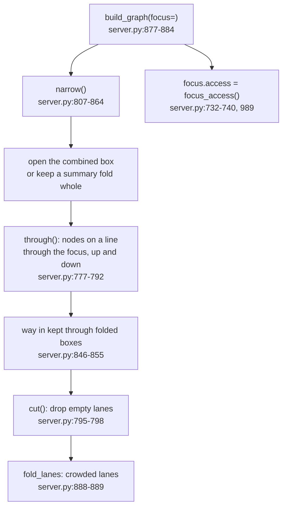

<!-- generated by darshan-singh-meel-knowledge-graph -->
# Graph focus (only the lines through one box)

`focus=<box>` on any graph endpoint (Map, User, Role, Object, ...) keeps only the lines through that box, before anything is folded, so a big account sends only those; Show all drops the parameter. The focused box also carries who has access to it.

## narrow (`server.py:807-864`)
- The box drawn: the focus itself, or the combined box that holds it; a box not in the graph gives the whole graph and the note "<focus> is not in this graph: all of it is shown." (`server.py:813-818`).
- A combined box opens into its members; a member picked inside an opened box opens it with only that member on; a summary fold whose own lines do not reach its members stays one box (`server.py:820-823`, `828-832`).
- A folded lane of the big graph (`lane:<i>`) is made first by `fold_lanes`, once per graph (cached), and its members are drawn (`server.py:879-881`, `826-827`).
- The walk takes each combined box's member lines in place of the box's own, so a box keeps a member only when a line through the focus reaches it; a narrowed box is relabelled with its new count (`server.py:833-845`).
- **Way in through folded boxes:** a kept node with incoming lines but none from a kept node (a holder fed only through a summary fold's own line) gets its upstream back from the drawn lines, so the person stays linked (`server.py:846-855`). Test: `test_focus_keeps_way_in` (`test_server.py:249-256`).
- Over `MAX_BOX` objects from more than one schema, the objects box again per `DB.SCHEMA` (`scope_key`, `server.py:801-804`, `859-863`).
- Returns the label of the focus (the box name without its count) or None (`server.py:824-827`, `864`).

## Who has access to the focus (`focus_access`, `server.py:729-740`)
- For a database, schema or object: people per access level as the Object page's Who tab counts them (`a.who_has`, cached per object), most powerful level first (`OBJ_LEVELS` reversed), words from `LEVEL_WORD`, plus the role count; None for a role or a box.
- Sent as `focus = {id, label, access}` in the graph answer (`server.py:989`).

## Crowded lanes fold in any graph
- `fold_lanes` runs in a big (lazy) graph and in any graph with a lane over `MAX_LANE` (24) members; the start, the selected box and the focus never fold (`server.py:888-889`, `743-774`). Test: `test_crowded_lane` (`test_server.py:259-264`): 30 people and one role draw fewer than 5 boxes.
- Lazy boxes, summary folding and the Map roll-up: [graph-input.md](graph-input.md).

## Tests
- `test_graph_focus` (`test_server.py:936`): Map focus on a functional role keeps the demo user and its technical role, drops other roles; a database box opens into its objects; an unknown focus gives the whole graph and the note; the same parameter on the User, Role and Object graphs.
