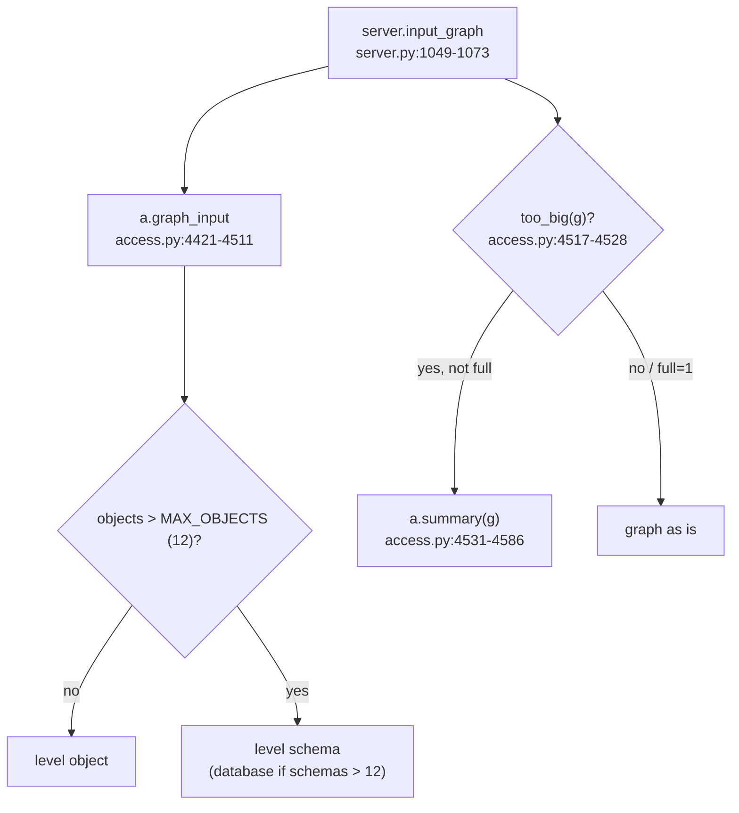

<!-- generated by darshan-singh-meel-knowledge-graph -->
# Graph input (rollup and summary)

`graph_input()` turns a user's or role's grants into lanes and edges for the React graph, rolling objects up over `MAX_OBJECTS`; `summary()` folds big role graphs; on the server, `build_graph()` sends a big graph's combined boxes empty (lazy) and folds crowded lanes, and the Map rolls objects up per database.

## graph_input (`access.py:4421-4511`)
- Rows = `grants(start)` minus USAGE on DATABASE/SCHEMA (unless `cat`) (`access.py:4436-4439`).
- Level: `object` if <= `max_objects` or `otype`; with `schema` a database -> its schemas, a schema -> object types; else `schema` if schemas <= max, else `database` (`access.py:4444-4451`).
- `MAX_OBJECTS = 12`, matches `graphs.ts` `MAX_BOXES` (`access.py:4418`, `web/src/components/graphs.ts:4`).
- Object level paths per object; grouped levels list paths once per holder (`access.py:4463-4466`); roles leading to no object still shown (`access.py:4467-4468`).
- Lanes: start, one lane per shortest depth (`by_depth`, `Depth {}`), then objects/groups (`access.py:4470-4478`).
- Group edges carry object count `(holder, group, cls, privilege, n)` (`access.py:4487`).
- Built-in fold box under PUBLIC (`access.py:4488-4491`, `builtin_info` `access.py:2015-2023`).
- Returns lanes, edges, notes, info, kinds, header, level, shown, total, groups, types (`access.py:4508-4511`).
- Example (fake, verified): `graph_input("ANALYST_01", user=True)` -> header `6 objects`, level `object`, lanes User 1, Depth 1-3 (2 each), Objects 7 (incl. built-in box), `too_big` False.

## summary (`access.py:4514-4586`)
- `SUMMARY_ROLES, SUMMARY_LANES = 30, 6` (`access.py:4514`).
- `too_big(g)`: role boxes > 30 or role lanes > 6, a run of 3+ single-role lanes counted as one (`access.py:4517-4528`).
- Layout: start -> granted roles -> one `⋯ N roles ⋯` fold box per granted role -> grant holders -> objects/groups (`access.py:4531-4535`, `4017-4018`).
- Ranked by objects reached; fold boxes only for the first 12 granted roles (`access.py:4557-4559`, `4002`).
- Holders picked round-robin so every object/group keeps a line (`access.py:4564-4566`).
- Returns `kinds[fold] = "fold"`, `folded` = hidden role count (`access.py:4585-4586`).
- Server: `full=1` skips the summary with note "Full chain of a big graph." (`server.py:1064-1072`).
- No fake user triggers the summary (checked all users: `too_big` False) - example only via `test_summary` (`test_access.py:1824`), not opened.
- Tests: `test_graph_inputs` (`test_access.py:1805`), `test_summary` (`test_access.py:1824`).

## Lazy boxes and folded lanes (server, `server.py:743-993`)
- `LAZY = 300`: when a graph has a `src` (the graph endpoint params that draw it again, `gsrc()` `server.py:1341-1343`) and its combined boxes plus lane boxes hold more than 300 members, it is big (`server.py:59`, `server.py:886`).
- Big graph: `fold_lanes()` folds every lane with more than `MAX_LANE` (24) roles into one box `lane:<i>`, and more than 24 people into `lane:<i>:people` (a box of stacked people counts its people); the start and the selected box are never folded; lines to members point at the box with a member count (`server.py:62`, `server.py:743-774`, `server.py:888-889`).
- Any graph, big or not, folds a lane over `MAX_LANE` the same way (a crowded lane of 276 people), and the focus never folds (`server.py:888-889`). Focusing one box and keeping only its lines: [graph-focus.md](graph-focus.md).
- Lazy: every combined box goes out without members or lines (`lazy=True`, a folded lane keeps its role names in `ids`), and the graph carries `src` (`server.py:968-981`, `server.py:991`).
- `graph?of=<page>&group=<box>` (`only=`) answers that one box with its members (up to `MAX_MEMBERS` 1000, the rest through its drill action) (`server.py:56`, `server.py:964-965`, `server.py:982-984`, `graph_page` `server.py:3959-3970`).
- Example: a big user's graph was 27k member nodes (19 MB) before (`server.py:59-60`).

## Map: objects per database (`server.py:1076-1124`, `server.py:2796-2895`)
- `map_graph()` rolls the objects lane of `a.access_graph` up with `combine_tab(at=last lane)`: over `MAX_BOX` (= `MAX_OBJECTS`, 12) objects, one box per database (`DB · N objects`, drill into the database); account-level objects and a database with one object stay single (`server.py:58`, `server.py:1077-1097`, `server.py:2816-2818`), once per data set (`map_combined`).
- Its params carry `of="map"`, so a lazy box opens through `graph?of=map&group=` (`server.py:2819`, `server.py:3969-3970`); people stacks count as people when lanes fold (`sizes`, `server.py:2830-2831`).
- `map?node=<id>` answers the detail (people, leads, level, risk) of one box opened later; the first answer has details only for drawn boxes (`server.py:2879-2881`, `server.py:2889-2895`).

