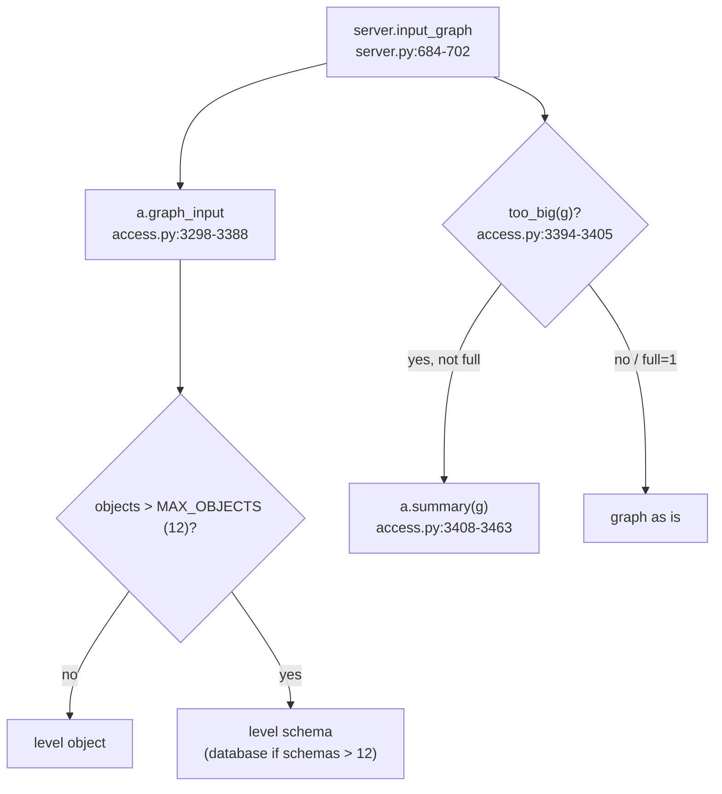

<!-- generated by darshan-singh-meel-knowledge-graph -->
# Graph input (rollup and summary)

`graph_input()` turns a user's or role's grants into lanes and edges for the React graph, rolling objects up over `MAX_OBJECTS`; `summary()` folds big role graphs.

## graph_input (`access.py:3298-3388`)
- Rows = `grants(start)` minus USAGE on DATABASE/SCHEMA (unless `cat`) (`access.py:3313-3316`).
- Level: `object` if <= `max_objects` or `otype`; with `schema` a database -> its schemas, a schema -> object types; else `schema` if schemas <= max, else `database` (`access.py:3321-3328`).
- `MAX_OBJECTS = 12`, matches `graphs.ts` `MAX_BOXES` (`access.py:3295`, `web/src/components/graphs.ts:4`).
- Object level paths per object; grouped levels list paths once per holder (`access.py:3339-3342`); roles leading to no object still shown (`access.py:3343-3344`).
- Lanes: start, one lane per shortest depth (`by_depth`, `Depth {}`), then objects/groups (`access.py:3346-3354`).
- Group edges carry object count `(holder, group, cls, privilege, n)` (`access.py:3364`).
- Built-in fold box under PUBLIC (`access.py:3365-3368`, `2968-2972`).
- Returns lanes, edges, notes, info, kinds, header, level, shown, total, groups, types (`access.py:3385-3388`).
- Example (fake, verified): `graph_input("ANALYST_01", user=True)` -> header `6 objects`, level `object`, lanes User 1, Depth 1-3 (2 each), Objects 7 (incl. built-in box), `too_big` False.

## summary (`access.py:3391-3463`)
- `SUMMARY_ROLES, SUMMARY_LANES = 30, 6` (`access.py:3391`).
- `too_big(g)`: role boxes > 30 or role lanes > 6, a run of 3+ single-role lanes counted as one (`access.py:3394-3405`).
- Layout: start -> granted roles -> one `⋯ N roles ⋯` fold box per granted role -> grant holders -> objects/groups (`access.py:3408-3412`, `3048-3049`).
- Ranked by objects reached; fold boxes only for the first 12 granted roles (`access.py:3434-3436`, `3033`).
- Holders picked round-robin so every object/group keeps a line (`access.py:3441-3443`).
- Returns `kinds[fold] = "fold"`, `folded` = hidden role count (`access.py:3462-3463`).
- Server: `full=1` skips the summary with note "Full chain of a big graph." (`server.py:693-701`).
- No fake user triggers the summary (checked all users: `too_big` False) - example only via `test_summary` (`test_access.py:1506`), not opened.
- Tests: `test_graph_inputs` (`test_access.py:1487`), `test_summary` (`test_access.py:1506`).
