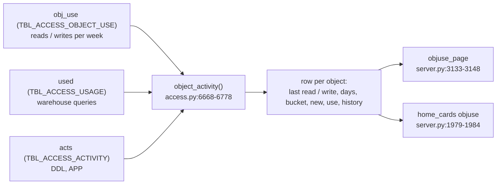

<!-- generated by darshan-singh-meel-knowledge-graph -->
# Object activity (last use per object)

`object_activity()` sorts every table, view, warehouse and Streamlit app by when it was last used, and counts which tables are only read or only written; the Object activity page and the Home card read it. Built once per data set (`cached`, `access.py:6668-6778`).

## Which objects, which history
- Objects: data kinds (`is_data`), `WAREHOUSE`, `STREAMLIT`, and `PROCEDURE` / `FUNCTION` / `TASK` (`NO_USE`) (`access.py:6680`, `6660`).
- History per type, in days (`access.py:6751-6752`):

| Type | Use counted | History |
|---|---|---|
| Table, view (any flavour) | `OBJECT_USE` reads and writes; BASE objects count as read (read through a view) | `USE_DAYS` (180) when object use is readable, else 0 |
| Warehouse | its queries in the usage read (`KIND = 'WAREHOUSE'`) | `DAYS_USAGE` (30) when usage was read, else 0 |
| Streamlit app | queries it ran for its viewers (`APP` on activity rows) | `ACTIVITY_DAYS` (60) when activity is readable, else 0 |
| Procedure, function, task | none in the snapshot | 0 ("no activity data", never "not used") |

- Sources: `access.py:6704-6726` (object use), `6677-6681` (warehouses), `6683-6688` (apps and DDL), constants `access.py:105`, `6174`.

## Bucket of the last use
- `bucket(d)` on days since the newest read or write: `<= 30` -> `30`, `<= 90` -> `90`, `<= USE_DAYS` -> `180`, else `none` (`access.py:6664-6665`).
- No use at all: `none` when the type's history reaches `USE_DAYS`, else `nodata` (older use unknown) (`access.py:6756-6761`); any use with history 0 is `nodata` too (`access.py:6764`).
- `new`: the object had DDL in the activity window, so a fresh object does not look dead (`access.py:6733-6735`).

## Windows and patterns
- `PERIODS = (30, 90, 180)` days (`access.py:6066`). Per window: read queries, write queries, distinct readers, distinct writers, cumulative (a 90-day window holds the 30-day one) (`cum`, `access.py:6742-6748`, `6765`). Windows count by `LAST_USED` days, like the bucket, so a row never contradicts itself (`access.py:6675-6676`).
- `pattern(window)`: `both` / `read_only` / `write_only` / `none` (`access.py:6787-6789`); only kinds DML writes (no views, no external tables: `writable`, `access.py:6782-6784`) with history; objects with no use at all count as `none` in every window (`access.py:6768-6773`).
- Notes: one line each when object use, activity or the usage read is not readable (`access.py:6774-6775`).

## Page (`objuse`, shared data only)
- `days=` 30 / 90 / 180 (default 90; anything else answers 400 `bad_param`); `scope=` keeps one database or schema and everything under it (`server.py:3095-3100`).
- Tabs `unused` (history at least `days`, and no use or last use older than `days`; never used included), `read_only`, `write_only`, `all`; filter `type=` and `q=`; sort by object, type, days, read / write queries, readers, writers (`OBJUSE_TABS`, `OBJUSE_SORT`, `OBJUSE_USE`, `server.py:3080-3122`). Paged by `paged()` (`server.py:3141`).
- My access answers "My access reads no ACCESS_HISTORY" (`server.py:3136-3138`); the page is in `SHARED_ONLY` (`server.py:45`).
- Home card: unused tables (90 days), unused among new ones, types with data, types with no data, read-only and write-only counts (`server.py:1979-1984`).

## Tests
- `test_object_activity` (`test_access.py:2226`): buckets, patterns, new, no-data types.
- `test_objuse` (`test_server.py:1223`): counts per type and age, tabs, paging, filters, CSV, the Home card.
