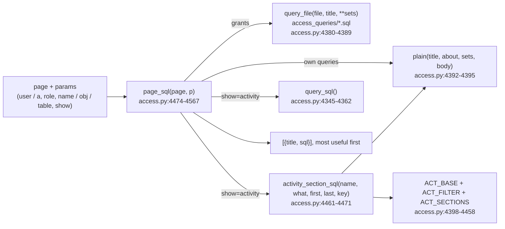

<!-- generated by darshan-singh-meel-knowledge-graph -->
# SQL to run yourself (`page_sql`, `activity_section_sql`)

Every page can show the read-only SQL behind it, over `SNOWFLAKE.ACCOUNT_USAGE`, with SET lines filled in for the user, role, object, app, schema or warehouse the page shows. The app never runs it; the reader copies it into a worksheet and runs it with their own role (`access.py:4365-4567`, `web/src/pages/common.tsx:109-127`).

## Building blocks
- `lit(v)`: SQL literal for a SET line: `None` -> `NULL`, bool -> `TRUE` / `FALSE`, int as is, anything else quoted with single quotes doubled — `access.py:4374-4377`. Example (`test_server.py:665`): user `O'BRIEN` -> `SET USER_NAME = 'O''BRIEN';`.
- `query_file(file, title, **sets)`: reads `access_queries/<file>` (`QUERIES`, next to `access.py`) and rewrites each `SET <k> = ...;` line to `SET <k> = lit(v);`; returns `None` when the file is missing (an old Streamlit deploy without `PUT_QUERIES`) — `access.py:4368`, `access.py:4380-4389`, `sql/4_streamlit.sql:45-46`. The files keep their own SET defaults for the rest (`MAX_DEPTH = 50`, `SHOW_BUILTIN = FALSE`, `access_queries/2_user_access.sql:19-21`).
- `plain(title, about, sets, body)`: `-- ` comment lines, then `NEEDS` (read-only; needs IMPORTED PRIVILEGES on SNOWFLAKE or the SECURITY_VIEWER / GOVERNANCE_VIEWER database roles; ACCOUNT_USAGE lags up to 3 hours), then the SET lines, then the SELECT using `$NAME` — `access.py:4369-4371`, `access.py:4392-4395`.
- Every query starts with a comment line, reads `SNOWFLAKE.ACCOUNT_USAGE`, has no INSERT, UPDATE, DELETE, MERGE, CREATE, DROP, ALTER, GRANT, REVOKE or CALL outside comments, and balanced brackets (checked by `test_sql_page`, `test_server.py:674-677`).

## What each page gets (`page_sql`, in this order)

Names come from `user` (or `a`), `role`, `name` (or `obj`, `table`) — `access.py:4477`. Window for activity: the last `ACTIVITY_DAYS` (60) UTC days up to the data's reference day — `access.py:4484-4485`, `access.py:63`.

| Case | Queries | path:line |
|---|---|---|
| `show=activity` on a warehouse (kind WAREHOUSE) | "Who ran queries on <wh>": QUERY_HISTORY per user and role, last `DAYS_USAGE` (30) days, cloud-services credits; then `5_object_users.sql` for who can use it. Returns only these two | access.py:4487-4494, access.py:4367 |
| `show=activity` on a user, role or object | One query per Activity section (`activity_section_sql`), then "Every query, one by one" (`query_sql`). Returns only these. `what` = user / role, or by object kind: STREAMLIT -> app, DATABASE / SCHEMA -> scope, else object. Object and app: tiles, client, kinds, matrix, type_day, by_day, who, ddl; user, role, scope add off, touched, hours, objects | access.py:4495-4501 |
| user | `2_user_access.sql` (everything they reach, through which roles), `1_user_roles.sql` (every role held) | access.py:4502-4504 |
| role | `3_role_access.sql`, `4_role_holders.sql` | access.py:4505-4507 |
| object | `5_object_users.sql`, then "Tags and policies on <obj>": TAG_REFERENCES on the object, its columns, its schema and database, plus MASKING / ROW_ACCESS policies from POLICY_REFERENCES | access.py:4508-4529 |
| page `usage` with a user or role | put first: "Objects used by ...": `use_sql` (ACCESS_HISTORY per ISO week) filtered to `$USER_NAME`; for a role a comment says to run it per holder (no role filter) | access.py:4530-4536 |
| page `sensitive`, `flow`, `review`, or `home` with nothing else | "Sensitive tags": every tag on databases, schemas, tables and columns; the comment names `SENSITIVE_TAGS` | access.py:4537-4546 |
| page `rules`, `home`, `whatif`, `review`, or nothing matched so far | "Grants to PUBLIC" (rule 9), "Admin roles held by users" directly (rule 5, roles from `ADMIN`), "Dormant and disabled users with roles" (`DORMANT_DAYS`, rules 8, 16) | access.py:4547-4566 |
| always | `None` entries (missing query files) dropped | access.py:4567, server.py:1699 |

Examples (fake data, `test_server.py:657-679`):

| Request | Contains |
|---|---|
| `page=access&user=ENGINEER_01` | `SET USER_NAME = 'ENGINEER_01';` |
| `page=object&name=SALES.CORE.TBL_CUSTOMER&show=activity` | `SET FROM_DAY = ` |
| `page=object&name=SALES.MART.ST_CUSTOMER_LOOKUP&show=activity` | `SET APP_NAME = 'SALES.MART.ST_CUSTOMER_LOOKUP';` |
| `page=object&name=SALES.CORE&show=activity` | `SET IN_SCOPE = 'SALES.CORE';` |
| `page=object&name=WH_SALES_XS&show=activity` | `SET WAREHOUSE_NAME = 'WH_SALES_XS';` |
| `page=usage&user=ENGINEER_01` | `USER_NAME = $USER_NAME` |
| `page=rules` | `GRANTEE_NAME = 'PUBLIC'` |

## Activity section queries (`activity_section_sql`)
- `ACT_BASE`: CTE `A` (ACCESS_HISTORY rows in `$FROM_DAY`..`$TO_DAY`, UTC days), `H` (one row per object read / written / changed by DDL), `X` (joined to QUERY_HISTORY for role, statement type and `StreamlitName` from the JSON QUERY_TAG, and to SESSIONS for the client with its version cut off), filtered by `{where}` — `access.py:4401-4420`.
- `ACT_FILTER[what]`: SET variable and filter: object `OBJECT_NAME`, user `USER_NAME`, role `ROLE_NAME`, app `APP_NAME` (on `X.APP`), scope `IN_SCOPE` (`OBJECT_NAME LIKE $IN_SCOPE || '.%'`) — `access.py:4398-4400`.
- `OFF`: off-hours = ISO weekday > 5, or local hour (UTC + `$TZ_HOURS`) before `$WORK_START` or from `$WORK_END` — `access.py:4421-4421`.
- `ACT_SECTIONS[key]` = (title, what it shows, final SELECT on `X`) for tiles, client, kinds, matrix, type_day, by_day, hours, off, touched, objects, who, ddl — `access.py:4422-4458`. Some comments say which column to swap for the tab's other views (e.g. ROLE_NAME for CLIENT).
- `activity_section_sql`: SETs `<var>`, `FROM_DAY`, `TO_DAY`; for hours and off also `WORK_START`, `WORK_END` from `WORK_HOURS` (7-19) and `TZ_HOURS = 0` with a comment on shifting it — `access.py:4461-4471`, `access.py:70`.
- The Activity tab gets the SQL of every key as `section_sql`, and each section card shows its own inline from the `</>` mark in its corner — `server.py:1687`, `web/src/pages/Activity.tsx:89-94`. Example (`test_server.py:678-679`): `section_sql` of TBL_CUSTOMER has client ... ddl, and `hours` holds `$TZ_HOURS`.

## Notes
- unclear: `ACT_BASE` does not leave out the app's own queries by `QUERY_TAG`, and reads the app name from JSON only, while `activity_sql` does both (`access.py:968`, `access.py:965-966`); section counts may differ from the tab's (not verified on a live account).
- The section SQL uses the default business hours (`WORK_HOURS`), not the hours set on the tab's slider (`access.py:4461`, `server.py:1687`).

## Which names a page's SQL is for

`page_sql` reads every parameter value of the page (not page, view, show, part, by, sev, days) and keeps those that name a user (`profile` / `roles_of`, or `user=`), a role (`roles`, or `role=`) or an object (`kinds`), up to two of each: Can they? (`name=` a user, `obj=` an object), Compare (`a=`, `b=`), Request access (`for_role=`), Access graph (`table=`) all get the queries for what they show — `access.py:4474-4486`. Example (`test_server.py`, `test_sql_page`): `page=compare&a=F_ANALYST&b=F_MARKETING` gives `3_role_access` and `4_role_holders` for both roles.
