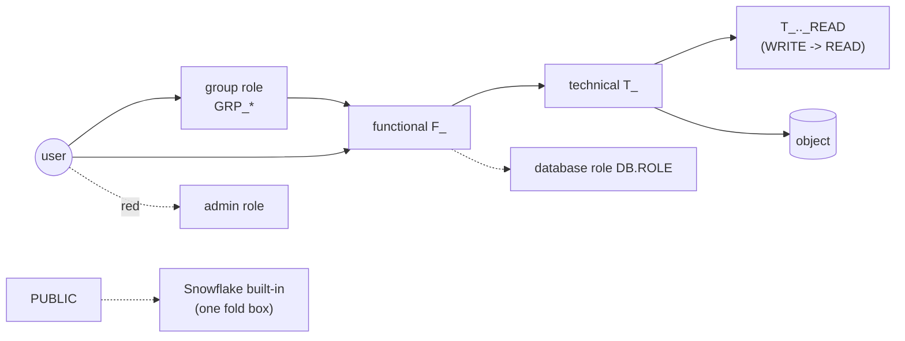

<!-- generated by darshan-singh-meel-knowledge-graph -->
# RBAC model

How the app classifies roles (functional, technical, group, database, admin), which links it keeps, and what it hides or shows in red.

## Prefixes
- `FUNC, TECH` from `ROLE_PREFIXES` (default `F_,T_`) (`access.py:56-57`).
- `role_kind(name)`: admin -> database -> `FUNC` prefix = functional -> `TECH` prefix = technical -> object -> else group (PUBLIC included) (`access.py:1138-1150`); `kind_of()` adds user (`access.py:1125-1130`).
- Tests rerun with `ROLE_PREFIXES=ZF_,ZT_` (CLAUDE.md; not re-verified here).

## Role links
- A GRANT row with `GRANTED_ON` in `ROLE_ON` = (`ROLE`, `DATABASE_ROLE`) and `PRIVILEGE = USAGE` is a role link (`access.py:1022`, `920-924`).
- OWNERSHIP on a role is a privilege, not a link; the role stays a role, not an object (`access.py:1063`, `928-929`).
- Links granted to admin roles are dropped ("every custom role is also granted to SYSADMIN") (`access.py:1064-1067`); same in `facts()` (`access.py:4875-4876`).

## Database roles
- Named `DB.ROLE`; added to `db_roles` when granted on (`GRANTED_ON = DATABASE_ROLE`) or when a grantee has a dot (`access.py:1073-1076`).
- `role_db()` reads the DB from `db_roles` membership, not name parsing of account roles (`access.py:1133-1135`).
- SQL uses `DATABASE ROLE db.r` (`role_sql`, `access.py:1250-1252`); `can()` sets `use_role=None` for a database role (USE ROLE can't take one) (`access.py:3443`).
- Fake data holds database roles, e.g. `DW.SC_C_CORE` (verified run).

## Default links / technical roles
- Schema roles `<TECH><DB>_<SCHEMA>_OWNER|READ|WRITE|EXECUTE`, DB `<TECH><DB>_OWNER`; default links OWNER -> DB OWNER, READ -> WRITE (CLAUDE.md; fake schemas `access.py:140-148`). The link logic itself is data, not code: unclear where fake() builds the default links (not opened: `access.py:155-374`).
- Rule 18 maps the capability suffix to standard privileges `CAP_PRIVS` (`access.py:86-90`).
- Never parse names for DB/schema: rule 3 uses grant data only (`access.py:5221-5222`).

## Admin roles and account privileges (red)
- `ADMIN = {ACCOUNTADMIN, SECURITYADMIN, SYSADMIN, USERADMIN, ORGADMIN}` (`access.py:45`).
- Admin kind has its own node style key in `ui.KINDS` / `SHAPE` (`ui.py:5-7`), colours from `ui.TOKENS` (`ui.py:16-19`); red per CLAUDE.md (inferred, exact hex not checked).
- Account privileges: `priv_class` returns `admin` for `ACCOUNT` grants (`access.py:1174-1180`); `ui.PCLASS["admin"] = "Account"` (`ui.py:22`).
- `admin_paths()`: per admin role at most `MAX_PATHS` paths, shortest first, via `shortest()` + `listed()` + `capped_paths()` (`access.py:2046-2052`), `account_privs()` (`access.py:2055-2060`), `admin_holders()` (`access.py:2063-2071`), `admin_ways()` (`access.py:2082-2089`).
  Example: `admin_holders()` -> `ADMIN_01 > SECURITYADMIN`, `F_SECURITY > SYSADMIN`, `OPS_01 > SYSADMIN`; `account_privs("F_SECURITY")` -> `MANAGE GRANTS`.

## Built-ins (hidden)
- `BUILTIN` fnmatch patterns `SNOWFLAKE.*,SYSTEM_COMPUTE_POOL_*,SYSTEM$*,SNOWFLAKE_LEARNING_*` (`access.py:49-54`).
- `builtin_grant(g)`: held by a built-in role, or PUBLIC's grant on a built-in (`access.py:1034-1036`); `build(builtin=False)` moves them to `hidden` (`access.py:1059-1062`).
- `builtin_info()`: label, grants, roles, objects for the fold box (`access.py:1107-1115`). Fake: 367 hidden grants, 353 objects (verified).
- Graph: one `BUILTIN_NODE` fold box under PUBLIC (`access.py:3103-3106`, `2968-2972`).
- Default PUBLIC account privileges `DEFAULT_PUBLIC` are not rule 9 (`access.py:46-48`, `4631`).
- `builtin=1` shows them: `session(view, sid, builtin)` -> `a.build(d, key, builtin)` (`server.py:182-198`).
- Test: `test_builtin` (`test_access.py:978`).
