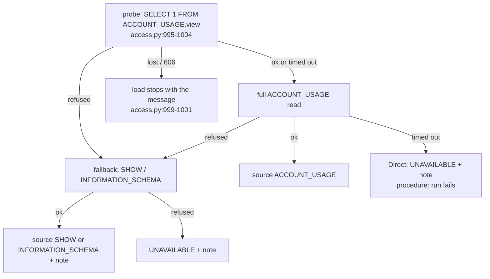

<!-- generated by darshan-singh-meel-knowledge-graph -->
# Snowflake reads: fallback order, timeouts, paging

Every source is read from ACCOUNT_USAGE first, then INFORMATION_SCHEMA or SHOW when ACCOUNT_USAGE is refused; a timeout means a busy warehouse, not an unreadable view; a lost session or no warehouse stops the load. Long tables come a page at a time.

## Fallback order per source (Direct mode `live()`, `access.py:943`)
- One wave probes every view (`GRANTS_TO_ROLES`, `GRANTS_TO_USERS`, `USERS`, `QUERY_HISTORY`, `TAG_REFERENCES`, `POLICY_REFERENCES`, plus `ACCESS_HISTORY`, `SESSIONS` with `ACTIVITY=1`); a refused probe's reason goes to the load log (`access.py:995-1006`).
- Grants and user roles: ACCOUNT_USAGE, else `SHOW ROLES` + `SHOW GRANTS TO ROLE` / `SHOW GRANTS OF ROLE` per role (`access.py:1090-1104`).
- Users: ACCOUNT_USAGE, else `SHOW USERS` (`access.py:1178-1201`).
- Query history (usage): ACCOUNT_USAGE (30 days), else `INFORMATION_SCHEMA.QUERY_HISTORY` on the current database or any visible one (`info_schema`, first 5 tried), else UNAVAILABLE (`access.py:1203-1216`). The INFORMATION_SCHEMA read is `week()`: 7 windows of one statement over its whole reach, 167 h back (a 7-day start is refused), each call capped at 10,000 queries (`access.py:766-772`).
- Tags and policies: ACCOUNT_USAGE, else INFORMATION_SCHEMA table functions per table / view, up to `TAG_FALLBACK_MAX` (300) objects, the rest named in the note (`access.py:940`, `1221-1228`, `1236-1314`).
- Server notes: INFORMATION_SCHEMA usage is "Query history: 7 days only"; grants UNAVAILABLE is "Grants unread", shown empty (`server.py:563-571`).

## My access (`mine()`, `access.py:786-930`)
- ACCOUNT_USAGE grants of the user's roles, roles granted to the user, and the user row in one wave (`access.py:812-826`); SHOW GRANTS TO ROLE per role only when `GRANTS_TO_ROLES` fails (`access.py:830`, `848-849`, `873`).
- Usage: ACCOUNT_USAGE `QUERY_HISTORY` (30 days), else `INFORMATION_SCHEMA.QUERY_HISTORY_BY_USER` through `week()`, else UNAVAILABLE with both reasons (`access.py:911-922`).

## Snapshot procedure (`SP_ACCESS_SNAPSHOT`, `P_SOURCE = AUTO`)
- `fallback(session, view, mode)`: SHOW forced by `P_SOURCE = SHOW`; a refused probe gives the reason, `ACCOUNT_USAGE` mode raises (`sql/1_setup.sql:340-353`).
- `grants()`, `users()`, `usage()` follow the same order as `live()`; usage uses the same 7 windows (`sql/1_setup.sql:365-395`, `486-509`, `513-544`, hours list `sql/1_setup.sql:536`).

## Timeouts: busy, not unreadable
- `slow(e)` = `TimeoutError` or `timed_out(e)` (error 000630, "reached its statement or warehouse timeout") (`access.py:605-613`).
- A probe that timed out counts as readable: the full read is tried, not the fallback (`access.py:1002-1004`; procedure `sql/1_setup.sql:350-351`).
- A full ACCOUNT_USAGE read that timed out: Direct mode notes the source UNAVAILABLE, since SHOW would be slower still (`access.py:1098-1099`, `1186-1187`); the procedure fails the run (`sql/1_setup.sql:387-389`, `497-498`).
- A timed-out statement is kept in its part as `timeout` with status `failed`; the next load reads only those statements again (`cache.py:483`, `501-503`, `563-570`). A refresh with failed parts keeps the old data and says to click again within the hour (`server.py:3209-3212`).
- Message: `timeout_hint()` says how long it ran and whether the app's `STATEMENT_TIMEOUT` or a warehouse / account limit stopped it (`access.py:616-626`; [business_rule:statement_timeout](rules.md)).

## Lost session or no warehouse
- `lost(e)`: connection errors, `OperationalError` / `InterfaceError`, errno 606 (no warehouse: every SELECT fails, SHOW still works) or 390111 / 390112 / 390114 (marked "to verify" in the code) (`access.py:597-602`).
- `live()` and `mine()` raise it after the probe wave instead of minutes of SHOW fallbacks (`access.py:999-1001`, `827-829`); a part is never kept for it (`cache.py:473-474`).
- The server answers 503 `shared_unreadable` / `mine_unreadable` with `load_error()`, which adds "Set SNOWFLAKE_WAREHOUSE in .env ..." for 000606 (`server.py:225`, `224-227`, `295`). Test: `test_lost_session` (`test_server.py:561-579`).

## Paging (server)
- `window(p, key, n)`: `slice(offset, offset + limit)` from `key=` and `limit=` (`PAGE` by default, `0` = every row, as a CSV export asks); an offset past the end starts at 0 (`server.py:2514-2520`). Used for an object's users (`m_offset`), Sensitive objects and readers (`o_offset`, `r_offset`) and What changed events (`offset`) (`server.py:1930`, `2569-2570`, `2441`).
- `paged(p, rows)`: `offset=` / `limit=` (`PAGE`, at most 1000) for Privileges (`privs`), Access, Held by and Grantees (`server.py:1284-1288`, used at `1288`, `1453`, `1669`, `1897-1900`).
- `PAGE = 50` (`server.py:74`): the default page size of both `paged()` and `window()`.
- Risks & fixes: `FINDINGS_PAGE` 100 per answer (`limit=` up to 500); counts and groups cover every finding; one finding's detail and fix through `/api/finding?id=` (`server.py:2621`, `2703`, `2729`).
- Review: `REVIEW_PAGE` 50 (`limit=` up to 1000) (`server.py:2799`, `2859`).
- Tests: `test_paged` (`test_server.py:101-148`), `test_rules_paged` (`test_server.py:774-803`), `test_big_lanes` (`test_server.py:181-221`).
