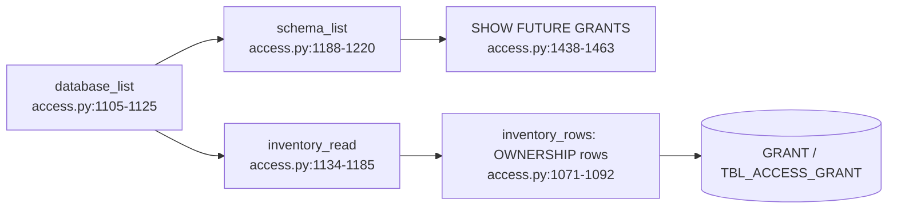

<!-- generated by darshan-singh-meel-knowledge-graph -->
# Snowflake reads: fallback order, timeouts, paging

Every source is read from ACCOUNT_USAGE first, then INFORMATION_SCHEMA or SHOW when ACCOUNT_USAGE is refused; a timeout means a busy warehouse, not an unreadable view; a lost session or no warehouse stops the load. Long tables come a page at a time.

## Fallback order per source (Direct mode `live()`, `access.py:1222-1656`)
- One wave probes every view (`GRANTS_TO_ROLES`, `GRANTS_TO_USERS`, `USERS`, `QUERY_HISTORY`, `TAG_REFERENCES`, `POLICY_REFERENCES`, `DATABASES`, plus `ACCESS_HISTORY`, `SESSIONS` with `ACTIVITY=1`); a refused probe's reason goes to the load log (`access.py:1274-1289`).
- Grants and user roles: ACCOUNT_USAGE, else `SHOW ROLES` + `SHOW GRANTS TO ROLE` / `SHOW GRANTS OF ROLE` per role (`access.py:1381-1435`).
- Users: ACCOUNT_USAGE, else `SHOW USERS` (`access.py:1466-1488`).
- Query history (usage): ACCOUNT_USAGE (30 days), else `INFORMATION_SCHEMA.QUERY_HISTORY` on the current database or any visible one (`info_schema`, first 5 tried), else UNAVAILABLE (`access.py:1490-1503`). The INFORMATION_SCHEMA read is `week()`: 7 windows of one statement over its whole reach, 167 h back (a 7-day start is refused), each call capped at 10,000 queries (`access.py:795-812`).
- Tags and policies: ACCOUNT_USAGE, else INFORMATION_SCHEMA table functions per table / view, up to `TAG_FALLBACK_MAX` (300) objects, the rest named in the note (`access.py:984`, `access.py:1505-1559`).
- Streams: `ACCOUNT_USAGE.STREAMS` when the grants came from ACCOUNT_USAGE, else `SHOW STREAMS IN ACCOUNT` with a note that SHOW lists only what this role sees (`access.py:987-988`, `access.py:1627-1640`; procedure `sql/1_setup.sql:695-715`).
- Server notes: INFORMATION_SCHEMA usage is "Query history: 7 days only"; grants UNAVAILABLE is "Grants unread", shown empty (`server.py:597-605`).

## Database list, schema list, object inventory
Every list tries ACCOUNT_USAGE, then INFORMATION_SCHEMA, then SHOW; Direct mode and `SP_ACCESS_SNAPSHOT` share the same functions (`sql/1_setup.sql:832-947`), the procedure keeps the database list once per run (`DBS`, `sql/1_setup.sql:224`, `374-377`), `P_SOURCE = SHOW` skips ACCOUNT_USAGE (`au_of`, `sql/1_setup.sql:370-371`).

- `database_list`: `ACCOUNT_USAGE.DATABASES` (lags up to 3 h), else `INFORMATION_SCHEMA.DATABASES` from the first of up to 5 home databases that answers (current, granted, `SNOWFLAKE`), else `SHOW DATABASES`, else UNAVAILABLE with each reason (`access.py:1105-1125`, home list `access.py:1366-1374`).
- `schema_list`: standard databases only (no shares, no applications: `standard()`, `access.py:1101-1102`); `ACCOUNT_USAGE.SCHEMATA` (lags up to 2 h), else `INFORMATION_SCHEMA.SCHEMATA` per database (skipped when the database list came from SHOW), else `SHOW SCHEMAS IN DATABASE`; a database this role cannot see is left out without a note (`unseen()`, `access.py:1095-1098`, `1188-1220`).
- `inventory_sql`: 20 kinds, each with its ACCOUNT_USAGE view (`DELETED IS NULL`), INFORMATION_SCHEMA view and `SHOW ... IN ACCOUNT` where one exists; Streamlit apps, notebooks, alerts and warehouses only by SHOW (`access.py:991-1057`).
- `inventory_read`: per kind the first level that answers; INFORMATION_SCHEMA once per standard database (a refused database skips only itself, one this role cannot see silently); SHOW drops temporary tables and names Iceberg, hybrid and materialized kinds (`show_kind`, `access.py:1128-1131`). The note lists the kinds no level read and those read with a fallback, first 20 each; nothing else (`access.py:1134-1185`).
- `inventory_rows`: one `OWNERSHIP` row per object whose ownership the grant read lacks (named `DB.SCHEMA.NAME`, unquoted; an already granted object keeps its kind; owner a role, a database role as `DB.ROLE`, or none) (`access.py:1060-1092`). Direct mode appends them (`access.py:1644-1654`); the procedure writes them to `TBL_ACCESS_GRANT` (`objects()`, `sql/1_setup.sql:949-966`). An object with no owner role is listed with no holder (`tidy` `access.py:1991-1992`, `build` `access.py:1872-1874`).
- My access reads only the kinds with no ACCOUNT_USAGE view, by SHOW, and keeps what one of the user's roles owns (`access.py:903-916`).
- One type spelling: `spell()` turns `EXTERNAL_TABLE` into `EXTERNAL TABLE`, role links keep theirs; `tidy()` respells every grant row, the procedure writes the inventory rows spelled (`access.py:1946-1949`, `1983-1984`; `sql/1_setup.sql:313-314`, `963`).

## My access (`mine()`, `access.py:815-974`)
- ACCOUNT_USAGE grants of the user's roles, roles granted to the user, and the user row in one wave (`access.py:841-855`); SHOW GRANTS TO ROLE per role only when `GRANTS_TO_ROLES` fails (`access.py:859`, `877-878`, `902`).
- Usage: ACCOUNT_USAGE `QUERY_HISTORY` (30 days), else `INFORMATION_SCHEMA.QUERY_HISTORY_BY_USER` through `week()`, else UNAVAILABLE with both reasons (`access.py:955-966`).

## Snapshot procedure (`SP_ACCESS_SNAPSHOT`, `P_SOURCE = AUTO`)
- `fallback(session, view, mode)`: SHOW forced by `P_SOURCE = SHOW`; a refused probe gives the reason, `ACCOUNT_USAGE` mode raises (`sql/1_setup.sql:345-357`).
- `grants()`, `future()`, `users()`, `usage()`, `streams()`, `objects()` follow the same order as `live()`; usage uses the same 7 windows (`sql/1_setup.sql:380-455`, `456-502`, `503-528`, `530-561`, `695-711`, `949-966`).

## Timeouts: busy, not unreadable
- `slow(e)` = `TimeoutError` or `timed_out(e)` (error 000630, "reached its statement or warehouse timeout") (`access.py:634-642`).
- A probe that timed out counts as readable: the full read is tried, not the fallback (`access.py:1282-1284`; procedure `sql/1_setup.sql:355-356`).
- A full ACCOUNT_USAGE read that timed out: Direct mode notes the source UNAVAILABLE, since SHOW would be slower still (`access.py:1389-1390`, `1473-1474`); the procedure fails the run (`sql/1_setup.sql:402-404`, `514-515`).
- A timed-out statement is kept in its part as `timeout` with status `failed`; the next load reads only those statements again (`cache.py:492`, `510-512`, `572-579`). A refresh with failed parts keeps the old data and says to click again within the hour (`server.py:4215-4218`).
- Message: `timeout_hint()` says how long it ran and whether the app's `STATEMENT_TIMEOUT` or a warehouse / account limit stopped it (`access.py:645-655`; [business_rule:statement_timeout](rules.md)).

## Lost session or no warehouse
- `lost(e)`: connection errors, `OperationalError` / `InterfaceError`, errno 606 (no warehouse: every SELECT fails, SHOW still works) or 390111 / 390112 / 390114 (marked "to verify" in the code) (`access.py:626-631`).
- `live()` and `mine()` raise it after the probe wave instead of minutes of SHOW fallbacks (`access.py:1279-1281`, `856-858`); a part is never kept for it (`cache.py:482-483`).
- The server answers 503 `shared_unreadable` / `mine_unreadable` with `load_error()`, which adds "Set SNOWFLAKE_WAREHOUSE in .env ..." for 000606 (`server.py:239`, `238-241`, `304`). Test: `test_lost_session` (`test_server.py:715-733`).

## Paging (server)
- `window(p, key, n)`: `slice(offset, offset + limit)` from `key=` and `limit=` (`PAGE` by default, `0` = every row, as a CSV export asks); an offset past the end starts at 0 (`server.py:3284-3290`). Used for an object's users (`m_offset`), Sensitive objects and readers (`o_offset`, `r_offset`) and What changed events (`offset`) (`server.py:2422`, `3348-3348`, `3192`).
- `paged(p, rows)`: `offset=` / `limit=` (`PAGE`, at most 1000) for Privileges (`privs`), Access, Held by and Grantees (`server.py:1456-1460`, used at `1288`, `1453`, `1669`, `1897-1900`).
- `PAGE = 50` (`server.py:77`): the default page size of both `paged()` and `window()`.
- Risks & fixes: `FINDINGS_PAGE` 100 per answer (`limit=` up to 500); counts and groups cover every finding; one finding's detail and fix through `/api/finding?id=` (`server.py:3395`, `3506`, `3544`).
- Review: `REVIEW_PAGE` 50 (`limit=` up to 1000) (`server.py:3706`, `3770`).
- Tests: `test_paged` (`test_server.py:103-150`), `test_rules_paged` (`test_server.py:1032-1061`), `test_big_lanes` (`test_server.py:206-246`).
