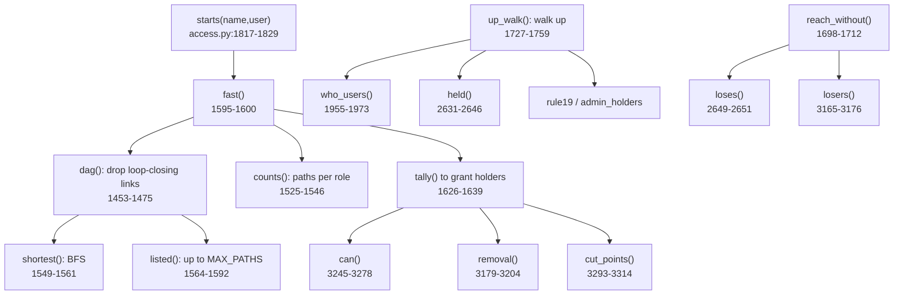

<!-- generated by darshan-singh-meel-knowledge-graph -->
# Walks (paths, depth, counting)

How `access.py` finds every route from a user or role to a grant: counted exactly, shortest by BFS, listed lazily up to `MAX_PATHS`.

## Graph model
- Lookups filled by `build()`: `holds` (role -> child roles), `held_by` (child -> parents), `users_of`, `roles_of`, `granted` (role -> grants), `on` (object -> holders) (`access.py:1340-1348`).
- Walk down = parent -> roles it holds; walk up = holder -> grantees.

## Depth
- Depth = roles from the start to the grant holder, holder included; a user is not a role (`depth()`, `access.py:1838-1842`).
- Example (verified on fake data): `ANALYST_01 > GRP_ANALYSTS > F_ANALYST > T_SALES_CORE_READ` -> depth 3; a holder alone = 1.
- Same definition on every page (docstring `access.py:1840-1841`); `held()` rows: user direct = 1, role direct = 2 (`access.py:3044-3045`).

## Start paths
- Role: `[[role]]`; user: `[user, r]` per granted role, plus `[user, PUBLIC]` (every user holds PUBLIC) (`access.py:1817-1829`).
- `default_only`: one start, shortest path to `DEFAULT_ROLE` (only that role is in session) (`access.py:1824-1827`).

## Counting vs listing
- `counts()`: path count per role layer by layer, no enumeration (`access.py:1931-1952`).
- `tally()`: total paths to holders = sum(count(holder) x grant rows); `down[r]` = paths from r to a holder (`access.py:2035-2048`).
- `via_role` / `via_link`: paths through a role / a link, counted (`access.py:2051-2063`); a link used by every path = choke point.
- `listed()`: chains in `down()` order, pruned to roles that lead to a target, at most `cap` = `MAX_PATHS` (`access.py:1973-2001`). A chain only refuses roles already on it after the start's first element (`go(p, i)`, `r not in p[i:]`, `access.py:1994-1995`): for a user start `[user, role, ...]` `i = 1`, so a role named like the user is not taken for the user (`access.py:1998-2000`).
- `MAX_PATHS` default 200, "counts are always exact" (`access.py:94`); note text "first 200 of N" from `paths_note()` (`access.py:2019-2021`).
- `capped_paths()`: shortest first; the shortest path always kept when cut (`access.py:2012-2016`).
- Full listings `access_of()` / `who_can()` (via `walk`/`down`/`up`) remain as reference for TF_ACCESS_OF / TF_WHO_CAN parity (`access.py:2303-2305`, `1981-1985`) - inferred from commit 6330f29 message; code is verified.

## Shortest (BFS)
- `bfs(path)`: shortest path to every role held (`access.py:1777-1788`); `shortest()` same over `dag` links with hop cap (`access.py:1955-1970`); starts are sorted by length and a longer start (a default role's route) joins the BFS only at its own hop, so a shorter route found meanwhile wins (`access.py:1958-1962`); `paths_from()` BFS without hop cap (`access.py:4322-4332`).
- `first_short()`: first of the shortest paths in `down()` order (`access.py:2066-2087`).

## Cycle guard
- `down()` / `up()` skip roles already on the path (`access.py:1758`, `1362`).
- `dag()`: DFS, drops back edges (links closing a loop) (`access.py:1859-1881`).
- `loops()`: Tarjan SCC, lists role loops so the app can warn (`access.py:1884-1924`); `paths_to()` lists over every link when loops exist (`access.py:2096-2097`). Fake data: no loops (verified).
- `MAX_HOPS` (50) caps any walk; capped starts recorded in `capped` (`access.py:59`, `1335-1342`, `1543-1544`).

## Users vs roles namespaces
- A user named like a role gets graph id `name + " (user)"` (`UTAG`, `uid()`, `access.py:1415-1420`); `node_kind` / `node_name` resolve it (`access.py:1423-1432`).
- `down(..., user=True)` lets a role with the user's name appear on the path (`access.py:1758`); `up()` ends a path with `uid(u, True)` (`access.py:1774`).

## Walk up
- `up_walk(srcs, hops, user_hops)`: rows `{(name, is_user): (count, shortest up path)}`, `paths(key)` lazily (`access.py:2136-2168`). PUBLIC is held by every user (`users_on`, `access.py:2131-2133`).
- `up_only_via()`: every up path passes through a role (reach without it) (`access.py:2171-2184`).
- `up_rows(r)`: cached `up_walk([r])["rows"]` (`access.py:2354-2356`); `ups(role)`: reach only (roles, users) (`access.py:1796-1809`).
- `who_users(obj)`: `{(user, privilege): path, firsts, count}` counted, not listed (`access.py:2367-2385`). Example: `('ENGINEER_01','SELECT')` on SALES.CORE.TBL_CUSTOMER -> count 3, shortest `ENGINEER_01 > F_ANALYST > T_SALES_CORE_READ`, firsts `F_ANALYST, F_ENGINEER`.
- `held(role)`: grantees with depth, count, `only_via` (`access.py:3043-3058`).

## Page walks
- `can(user, priv, obj)`: paths (<= MAX_PATHS), exact `count`, `shortest`, `choke` (roles on every path), `owner` paths, `options` = `removal()`, `ask` / `closest` when no path (`access.py:3673-3706`).
  Example: `can("ANALYST_01","SELECT","SALES.CORE.TBL_CUSTOMER")` -> count 1, shortest 3, choke `[GRP_ANALYSTS, F_ANALYST, T_SALES_CORE_READ]`.
- `removal()`: one option per choke grant edge, fewest users losing it first (`access.py:3607-3632`). Example first option: `REVOKE ROLE GRP_ANALYSTS FROM USER ANALYST_01;` affects 1.
- `cut_points()`: per link on every path: `people` who lose it, `lost` other privileges (`access.py:3721-3742`). Example: revoking `GRP_ANALYSTS` from ANALYST_01 -> people `[ANALYST_01]`, lost 9.
- `loses(user, grantee, role)`: `(privilege, object)` lost when role is revoked from grantee (`access.py:3061-3063`). Example `loses("ANALYST_01","GRP_ANALYSTS","F_ANALYST")` starts `('SELECT','SALES.CORE.<TABLE>'), ('SELECT','SALES.CORE.TBL_CUSTOMER'), ...`.
- `lose(e)` / `losing(e)`: users who lose access when one edge goes, cached per edge (`access.py:3573-3590`); `losers()` for several edges (`access.py:3593-3604`).
- Tests: `test_counted` (`test_access.py:1005`), `test_perf` (`test_access.py:1251`).
