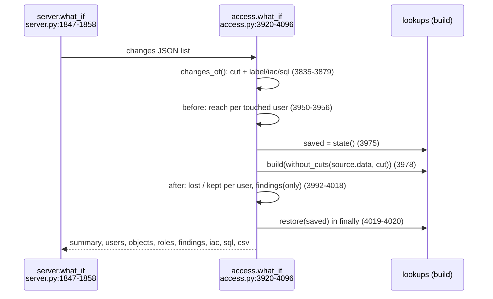

# What if (simulation)

`a.what_if(changes)` removes grants in memory, rebuilds, compares before/after, then restores every lookup; it only prints REVOKE / IaC text, never runs it.

## Ops (`WHAT_IF_OPS`, `access.py:3828`)
- `revoke_role_from_user` (role, user), `revoke_role_from_role` (role, grantee): if held further down, cut where it is granted on the user's paths too (`access.py:3842-3857`).
- `revoke_priv` (role, privilege, object) (`access.py:3858-3864`).
- `drop_role` (role): refused for PUBLIC and admin roles (`access.py:3865-3870`).
- `empty_public`: every grant to PUBLIC (`access.py:3871-3875`).
- Unknown op or missing grant -> `ValueError` (`access.py:3849`, `3862`, `3867`, `3877`); server answers 400 `bad_change` (`server.py:1855-1858`).

## Simulation and restore
- `without_cuts(d, cut)`: data set minus removed GRANT / USER_ROLE rows (`access.py:3882-3890`).
- `state()` copies every name in `STATE` (`access.py:3829-3832`, `4184-4187`); `restore()` puts them back in place; `REBOUND` names are rebound (`access.py:4190-4200`).
- Rebuild in `try`, `restore(saved)` in `finally` (`access.py:3976-4020`), so the loaded data set and its cached results (`memo`) come back.
- Rules recheck only scoped names: `only` built from `SCOPED`/`GROW` and touched grantees (`access.py:3960-3967`, `4018`).

## Output
- Per user: lost / kept rows, `kept_roles` (roles under a cut still reached) (`access.py:4039-4047`).
- Objects nobody reaches or without owner; roles left orphan or unreached (`access.py:4056-4059`).
- Findings `fixed` / `new` / `changed` (`access.py:4048-4055`); summary text (`access.py:4071-4078`); CSV rows (`access.py:4079-4094`).
- IaC + SQL text from `fix_text()` / `revoke()` (`access.py:3111-3142`); OWNERSHIP gives a transfer text, not REVOKE (`access.py:3128-3130`).

## Example (fake data, verified)
- Input: `[{"op":"revoke_role_from_user","role":"GRP_ANALYSTS","user":"ANALYST_01"}]`
- Summary: `1 user loses access to 9 objects; 1 keeps access through another path (most via PUBLIC); 1 finding fixed, 0 new`
- SQL: `REVOKE ROLE GRP_ANALYSTS FROM USER ANALYST_01;`
- IaC: `Remove in the infrastructure-as-code repo: role GRP_ANALYSTS granted to user ANALYST_01`
- Finding fixes feed What if via `fix_changes(edges)` (`access.py:4433-4442`).
- Tests: `test_access.py:967-1003` (what_if calls).
