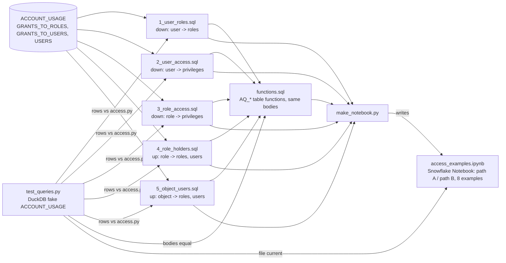

# access_queries/

Standalone SQL that answers "who has what, through which roles" straight from `SNOWFLAKE.ACCOUNT_USAGE`: no app, no snapshot tables, no procedure; nothing is created unless the optional table functions are (access_queries/README.md:1-4). Step by step: `flows/standalone-queries.md`.

## Files

| File | Answers | Mirrors in the app | path:line |
|---|---|---|---|
| `1_user_roles.sql` | Every role a user holds, shortest PATH, WAYS | `access.walk()` (access.py:1426) | access_queries/1_user_roles.sql:1-74 |
| `2_user_access.sql` | Every privilege a user reaches, via which role | `access.access_of(user=True)` (access.py:1894) | access_queries/2_user_access.sql:1-83 |
| `3_role_access.sql` | Every privilege a role reaches, downwards | `access.access_of()` (access.py:1894) | access_queries/3_role_access.sql:1-70 |
| `4_role_holders.sql` | Every role and user above a role | `access.up()` (access.py:1358) | access_queries/4_role_holders.sql:1-76 |
| `5_object_users.sql` | Who reaches one exact object (and privilege) | `access.on` + `up()` | access_queries/5_object_users.sql:1-88 |
| `functions.sql` | The five as table functions `AQ_USER_ROLES` ... `AQ_OBJECT_USERS` in `AQ_DB.AQ_SCHEMA` | | access_queries/functions.sql:1-333 |
| `access_examples.ipynb` | Snowflake Notebook: inputs cell, 5 `create_N` cells, 8 examples twice (`a_*` call the functions, `b_*` plain queries) | | access_queries/access_examples.ipynb:1-1290 |
| `make_notebook.py` | Builds `access_examples.ipynb` from the files and `functions.sql` | | access_queries/make_notebook.py:1-121 |
| `test_queries.py` | Files vs `access.py` on DuckDB; function bodies vs files; notebook current | | access_queries/test_queries.py:1-275 |
| `README.md` | How to run, privileges, rules, limits, example output, test | | access_queries/README.md:1-160 |

Graph ids: each query file is `task:access_queries/<file>:<stem>` (the query from the first `SET` line to the end), each function `function:sql:AQ_*`, each notebook code cell `task:access_queries/<notebook>:<cell>`, each check in test_queries.py a `test_case`.

## How a query is built (same CTEs in every file)

- `ARGS`: the `SET` values; `MAX_DEPTH` NULL = 50, the app's `MAX_HOPS` (access.py:53) (access_queries/2_user_access.sql:24-25).
- `G`: active `GRANTS_TO_ROLES` rows; a database role is named `DB.ROLE` from `NAME` / `TABLE_CATALOG` (access_queries/2_user_access.sql:26-35).
- `GR`: hides Snowflake built-ins via PUBLIC unless `SHOW_BUILTIN`, the `BUILTIN` patterns of access.py:50 (access_queries/2_user_access.sql:36-42).
- `EDGE`: role links = USAGE on ROLE / DATABASE_ROLE; links granted to `ADMIN` roles (access.py:43) left out (access_queries/2_user_access.sql:43-47).
- `PRIV` (2, 3, 5): every other grant, OWNERSHIP of a role too (access_queries/2_user_access.sql:48-51).
- `UR`, `ALL_USERS`, `ME`, `STARTS` (1, 2) or `MEMBER` (4, 5): every user holds PUBLIC, granted or not, never twice (access_queries/2_user_access.sql:52-65, access_queries/4_role_holders.sql:49-59).
- `WALK` (down) / `UP` (up): recursive, every simple path; `SEEN` stops cycles, `MAX_DEPTH` stops depth (access_queries/2_user_access.sql:66-74, access_queries/4_role_holders.sql:60-68).
- `ROLES` (2, 3): one row per role (shortest DEPTH / PATH, `ROLE_WAYS`) before the join to `PRIV`, so rows never grow as paths x privileges; per object `WAYS = SUM(ROLE_WAYS)` (access_queries/2_user_access.sql:75-82).
- `H` (4, 5): holder roles above (depth > 1) plus users through `MEMBER` (access_queries/4_role_holders.sql:69-72, access_queries/5_object_users.sql:78-82).
- Last step: `QUALIFY ROW_NUMBER() ... ORDER BY DEPTH, PATH = 1` keeps the shortest path; `WAYS` counts the paths (access_queries/1_user_roles.sql:70-74).

Example (test data of test_queries.py): `1_user_roles.sql` for `ANALYST_01` gives 6 rows, among them `F_ANALYST`, depth 2, `ANALYST_01 > GRP_ANALYSTS > F_ANALYST`, WAYS 2 (the second way runs through PUBLIC -> T_SALES_MART_READ -> F_ANALYST, a link added at access_queries/test_queries.py:220-223).

## functions.sql

- Each body = its file's query with `$NAME` -> `NAME`, without the last `ORDER BY` (a function keeps no row order); arguments = the file's `SET` names; checked by `functions()` (access_queries/functions.sql:12-13, access_queries/test_queries.py:168-192).
- Optional arguments: `PRIVILEGE DEFAULT ''`, `MAX_DEPTH DEFAULT 50`, `SHOW_BUILTIN DEFAULT FALSE` (access_queries/functions.sql:16, access_queries/functions.sql:258).
- Owner's rights read of ACCOUNT_USAGE: grant USAGE only to roles that may see every grant (access_queries/functions.sql:10-11). `DROP FUNCTION` lines to remove them (access_queries/functions.sql:328-333).

## Snowflake Notebook (access_examples.ipynb, built by make_notebook.py)

- `EXAMPLES`: 8 (cell name, title, function call, plain query); B queries are the file bodies, or wrapped with a `WHERE` / `GROUP BY` (access_queries/make_notebook.py:26-53, `wrap` access_queries/make_notebook.py:21-22).
- Cells: intro, `inputs` (`SET USER_NAME`, `ROLE_NAME`, `OBJECT_NAME`, `PRIVILEGE`, `MAX_DEPTH`, `MIN_DEPTH`, `SHOW_BUILTIN`), `create_1`..`create_5` cut from functions.sql, `a_*`, then `b_*` (access_queries/make_notebook.py:100-112; cells access_queries/access_examples.ipynb:25-44, 59-421, 432-610, 634-1280).
- Rewrite it after changing a file: `python access_queries/make_notebook.py` (access_queries/make_notebook.py:119-121); `notebook()` fails when the file on disk differs (access_queries/test_queries.py:195-216).

## Test (test_queries.py)

- `account_usage()` builds the three ACCOUNT_USAGE views as DuckDB tables from `access.fake()` plus deleted rows; its `writes` edges are to these fakes, never Snowflake (access_queries/test_queries.py:23-61).
- Extra cases: a role cycle, OWNERSHIP on a role, PUBLIC holding a custom role, a user named like a role, users with no grants (one disabled), an explicit PUBLIC grant (access_queries/test_queries.py:219-228).
- Checks (test_case nodes): `user_roles`, `access`, `holders`, `object_users` compare rows with `access.py` (access_queries/test_queries.py:117-165); runs for many users, roles, objects, `MAX_DEPTH` 0, 1, 3, 9 and `SHOW_BUILTIN` on (access_queries/test_queries.py:233-267); `functions` and `notebook` (access_queries/test_queries.py:168-216).
- Exit 1 with the differences, else one `ok:` line (access_queries/test_queries.py:272-275).

## Relation to the app's table functions

- `sql/1_setup.sql` has the same walks as `TF_ACCESS_OF` (sql/1_setup.sql:558) and `TF_WHO_CAN` (sql/1_setup.sql:619), but over the `TBL_ACCESS_` snapshot tables (edges marked inferred).
- `access_queries/` reads ACCOUNT_USAGE directly: no future grants, up to about 2 hours behind (access_queries/README.md:85-91, 124-131).

## Unclear

- Snowflake acceptance of a recursive CTE inside a SQL table function is not tested (DuckDB only); functions.sql says to fall back to the files (access_queries/functions.sql:6-7).
