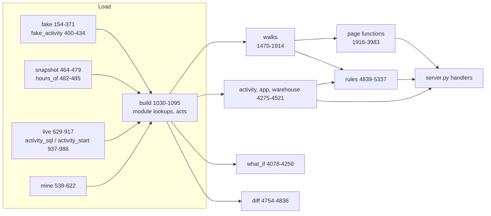
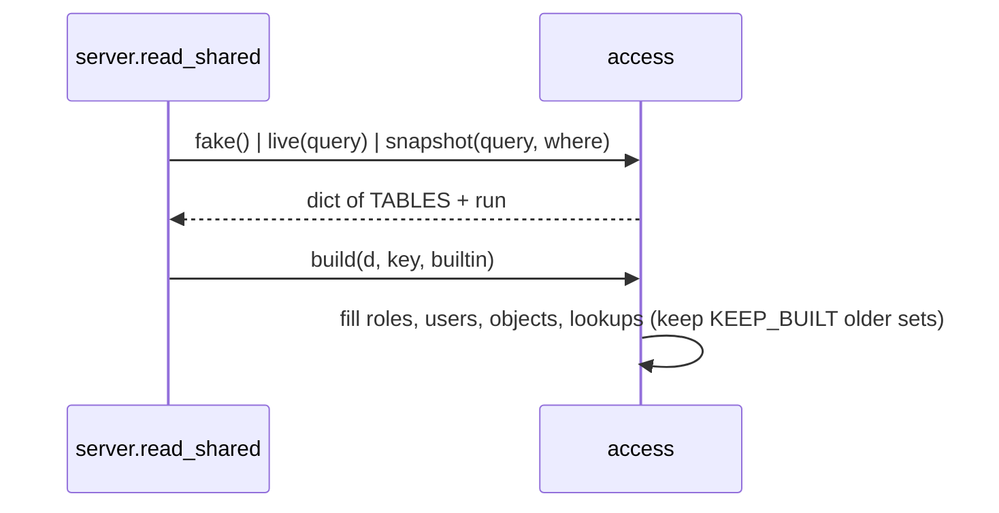

<!-- generated by darshan-singh-meel-knowledge-graph -->
# access.py

All data, walks and rules of the app (5,337 lines). Both versions call it; it imports no Streamlit or FastAPI (CLAUDE.md "Code style").

## Sections by area

| Area | Lines | What is there |
|---|---|---|
| Settings and constants | access.py:1-136 | `.env` load (access.py:21), `in_snowflake` / `INSIDE` (access.py:29-43), `ADMIN` (access.py:45), `BUILTIN` patterns (access.py:52-54), `MAX_HOPS`, `FUNC`/`TECH`/`BUILD`, `TABLES` (access.py:55-61), sensitive tags, dormancy, `MAX_PATHS` (access.py:74-84), `RULES` titles (access.py:90-130), `SEVERITY` (access.py:131); activity settings `OPTIONAL`, `ACTIVITY_DAYS`, `QUERY_TAG`, `INTERACTIVE`, `CLIENTS`, `SPIKE`, `NEW_DAYS` (access.py:61-72), `WORK_HOURS` default business hours 7-19 (access.py:69-70) |
| Fake data | access.py:137-461 | `SCHEMAS`, `CHAIN`, `FIN_USERS` (access.py:139-151), `fake()` (access.py:154-371), `fake_use()` (access.py:374-397), `fake_activity()` one finding per rule 24-28, HOURS per row, SUPPORT_01's use of the Streamlit app (access.py:400-434); the demo app SALES.MART.ST_CUSTOMER_LOOKUP (access.py:141, access.py:157, access.py:180-181, access.py:219), `fake_previous()` for What changed (access.py:450-461) |
| Snapshot loader | access.py:464-479 | `snapshot(query, where)`: last OK run of `TBL_ACCESS_RUN`, then each `TBL_ACCESS_<t>` of that run; `OBJECT_USE`, `ACTIVITY` optional; `hours_of` parses ACTIVITY `HOURS` JSON (access.py:479-485) |
| SHOW helpers | access.py:488-538 | `ident`, `line`, `qualify`, `each` (SHOW_THREADS at once, access.py:506-520), `held_db_roles`, `info_schema` |
| My access | access.py:539-622 | `mine(query, db)`: the logged-in user's own access, read with their rights, writes nothing |
| Live (SOURCE=direct) | access.py:625-998 | `live(query, old)` (access.py:629-917): same dict as `snapshot()`, ACCOUNT_USAGE else SHOW, ACTIVITY read only for the days `old` lacks (access.py:899-908); `use_sql` ACCESS_HISTORY (access.py:920-934); `activity_sql` / `activity_start` (access.py:937-986); `only()` demo slice (access.py:989-998) |
| Lookups / build | access.py:1001-1143 | `ROLE_ON` (access.py:1013), `KEEP_BUILT` (access.py:1017), `acts` ACTIVITY rows (access.py:1010), `build()` (access.py:1030-1095), `cached()` (access.py:1109-1113), `kind_of`, `role_db`, `role_kind` (access.py:1116-1141) |
| Names, classes, ladder | access.py:1144-1469 | `uid` / `UTAG` users vs roles (access.py:1144-1150), `priv_class`, `priv_cat`, `category`, `LEVELS` ladder (access.py:1165-1236), `access_objects`, `ladder*`, `reach_counts` (access.py:1240-1338), `who_has` (access.py:1375-1388), `split_name` (access.py:1450) |
| Full walks | access.py:1470-1585 | `down`, `up`, `bfs`, `ups`, `best_paths`, `starts`, `walk`, `depth`, `chains` |
| Fast walks (counted) | access.py:1586-1751 | `dag`, `loops`, `counts`, `shortest`, `listed`, `fast`, `capped_paths` |
| Counted walks to holders | access.py:1753-1856 | `holding`, `tally`, `via_role`, `via_link`, `paths_to`, `reach_without` |
| Walk up | access.py:1858-1914 | `users_on`, `up_walk` (access.py:1865-1897), `up_only_via` |
| Graph inputs | access.py:1916-2136 | `down_graph`, `object_graph`, `role_graph`; `access_of`, `admin_paths`, `account_privs`, `admin_holders`, `who_users`, `who_can` (access.py:2032-2126) |
| Users | access.py:2137-2207 | `login_days`, `is_service`, `is_disabled`, `is_dormant`, `status`, `split_users`, `used_roles` |
| Sensitive data | access.py:2209-2703 | tags (`tag_rules`..`sensitive_cols`, access.py:2211-2253), policies and masking (`clear_for`..`col_view`, access.py:2262-2445), `data_view` (access.py:2447-2466), `governance_kpis` (access.py:2507-2514), `catalog` (access.py:2576-2589), `sens_flow` (access.py:2601-2642), `review_grid` (access.py:2655-2701) |
| Page aggregations | access.py:2704-2951 | `grants`, `grant_rows`, `reach`, `held`, `loses`, `role_stats`, `grantees`, `valid_privs`, `admin_*`, `matrix`, `object_stats`, `has_lacks`, `privs_on` |
| Big accounts | access.py:2952-3220 | `finding_index`, `group_objects`, `MAX_OBJECTS` 12 (access.py:3024), `graph_input` (access.py:3027-3117), `too_big`, `summary` (access.py:3137-3192), `graph_info` |
| Removal and requests | access.py:3221-3631 | `revoke` / `fix_text` text only (access.py:3252-3283), `with_sql` (access.py:3286-3299), `losers`, `removal`, `ask_for`, `can` (access.py:3402-3435), `cut_points`, `nearest`, `suggest`, `approver` |
| Access graph (screen 4) | access.py:3632-3837 | `access_graph` (access.py:3687-3835) |
| What they see (screen 7) | access.py:3838-3862 | `seen` |
| Compare / review / search | access.py:3863-3983 | `compare` (access.py:3879-3933; `match` / `extras` pass through `with_sql`, access.py:3932-3933), `review` (access.py:3936-3969), `search` (access.py:3972-3981) |
| What if | access.py:3984-4258 | `WHAT_IF_OPS` (access.py:3986), `changes_of`, `without_cuts`, `what_if` (access.py:4078-4256) |
| Granted vs used and Activity | access.py:4259-4591 | `use_state`; Activity tab: `act_state`, `client_label`, `activity`, `used_path`, `query_sql`, `activity_graph`, `user_reads`, `app_exposure`, `app_use`, `warehouse_use`, `rule29`, `mark_sensitive`, `activity_sensitive` (access.py:4275-4521); `used_on`, `granted_used` (access.py:4546-4589) |
| What changed | access.py:4592-4838 | `state` / `restore` / `loaded` (access.py:4594-4621), `facts` (access.py:4626-4652), `diff` (access.py:4754-4836) |
| Rules | access.py:4839-5337 | `rule_rows`, `checks`, `find`, `rules_model` ... `rule23`, `rules_activity` 24-28 (access.py:5277-5328), `rule29` (access.py:4455-4470), `findings` (access.py:5331-5337) |

## Load and build

- `snapshot()` reads only `WHERE STATUS = 'OK'` latest run, so a half run is never shown (access.py:466-469).
- `live()` must stay in step with `SP_ACCESS_SNAPSHOT` (docstring access.py:630-632; CLAUDE.md "Direct mode").
- `build()` skips work when `key` matches the last build; keeps older sets in `built` up to `KEEP_BUILT` (access.py:1030-1039).
- Example: the server calls `a.build(d, key, builtin)` under its lock (server.py:196).

## Rules -> functions

| Rules | Function | Lines |
|---|---|---|
| 1, 2, 3, 4, 13, 14 | `rules_model` | access.py:4979-5029 |
| 5, 9, 12 | `rules_admin` | access.py:5032-5054 |
| 6, 7, 10, 11, 15 | `rules_sensitive` | access.py:5057-5112 |
| 8, 16 | `rules_users` | access.py:5115-5127 |
| 17 | `rule17` (+ `readonly_writes` access.py:4936-4967) | access.py:5130-5146 |
| 18 | `rule18` (+ `unusual` access.py:5149-5175) | access.py:5178-5191 |
| 19 | `rule19` | access.py:5194-5208 |
| 20, 21 | `rules_operate` | access.py:5216-5227 |
| 22 | `rule22` | access.py:5230-5247 |
| 23 | `rule23` | access.py:5250-5274 |
| 24, 25, 26, 27, 28 | `rules_activity` (table activity, [logic/activity.md](../logic/activity.md)) | access.py:5277-5328 |
| 29 | `rule29` (Streamlit app exposure, via `app_exposure`) | access.py:4455-4470 |

- `findings()` concatenates all (rules 24-28 through `cached("activity", rules_activity)`, access.py:5335; then `rule29()`, access.py:5336) and sorts by rule number (access.py:5331-5337); `checks()` gives `(num, title, grantee, detail, path)` rows (access.py:4887-4889).
- `SCOPED` rules check only names passed in `only` (what_if rechecks only what a change touches) (access.py:4970-4971).

## Key functions

| Name | Does | path:line |
|---|---|---|
| `in_snowflake` | Active Snowpark session or `INSIDE=1` | access.py:29-40 |
| `fake` | Demo data set (at least one finding per rule) | access.py:154-371 |
| `fake_previous` | Earlier demo snapshot for What changed | access.py:450-461 |
| `snapshot` | Last OK run of the `TBL_ACCESS_` tables | access.py:464-479 |
| `mine` | Logged-in user's own access, live | access.py:539-622 |
| `live` | Whole account read now (SOURCE=direct); `old` ACTIVITY rows -> incremental activity read | access.py:629-917 |
| `activity_sql` / `activity_start` | Activity SELECT per UTC day with HOURS and APP (same text as the procedure) and its incremental window | access.py:937-976, access.py:979-986 |
| `use_sql` | ACCESS_HISTORY usage SQL (metadata only) | access.py:920-934 |
| `only` | One user's slice (demo My access) | access.py:989-998 |
| `build` | Fill module lookups; memo by key | access.py:1030-1095 |
| `cached` | `fn()` once per data set | access.py:1109-1113 |
| `kind_of` / `role_kind` | user / admin / database / functional / technical / group / object | access.py:1116-1141 |
| `who_has` | Screen 2 entries per user / role | access.py:1375-1388 |
| `down` / `up` / `bfs` | Full path walks down / up, shortest by BFS | access.py:1480-1517 |
| `dag` / `loops` | Role links minus loop back edges; role loops | access.py:1588-1653 |
| `counts` / `shortest` / `listed` / `fast` | Exact path counts, shortest paths, capped listing | access.py:1660-1738 |
| `up_walk` | Counted walk up to holders | access.py:1865-1897 |
| `access_of` / `who_can` | Reference listings (TF parity) | access.py:2032-2034, access.py:2122-2126 |
| `who_users` | Users of an object, counted | access.py:2096-2114 |
| `admin_holders` | Users / roles holding an admin role | access.py:2054-2062 |
| `status` / `is_dormant` | disabled / never / dormant / active | access.py:2172-2186 |
| `sensitive` / `masked` / `data_view` | Sensitive tags, masking, what a role sees | access.py:2244-2247, access.py:2302-2308, access.py:2447-2466 |
| `catalog` / `sens_flow` / `review_grid` | Screens 8, 16, 6 | access.py:2576-2589, access.py:2601-2642, access.py:2655-2701 |
| `grants` / `reach` / `held` / `grantees` / `matrix` | Page rows (cached per walk) | access.py:2706-2900 |
| `has_lacks` | Privileges held vs missing on one object | access.py:2925-2938 |
| `graph_input` / `summary` | Big-account roll-up and fold | access.py:3027-3117, access.py:3137-3192 |
| `revoke` / `fix_text` | IaC + SQL text for a grant edge (never run) | access.py:3252-3283 |
| `with_sql` | A Compare / Request change dict (op grant / revoke, role or privilege + objectType + object, to, toUser) plus its `sql` (revoke via `revoke()`, grant written here with a `-- undo:` line for a role) and `roleDb` / `toDb` from `role_kind()`: the server is the only SQL writer, the web pages never write SQL or guess a role's kind from a dot (never run) | access.py:3286-3299 |
| `can` | Can they? (count, shortest, choke, options) | access.py:3402-3435 |
| `cut_points` / `removal` / `nearest` / `suggest` / `ask_for` | Where to cut, ways to remove, ways in, request roles | access.py:3336-3629 |
| `access_graph` | Screen 4 graph | access.py:3687-3835 |
| `seen` / `compare` / `review` / `search` | Screens 7, 9, review export, search ranking | access.py:3840-3981 |
| `what_if` | Simulated revokes; restores lookups | access.py:4078-4256 |
| `act_state` / `activity` | Activity tab: available or why not; per-day, by-key and per-use numbers for an object, user, role, app or scope, with UTC hours, weekend, kind | access.py:4275-4282, access.py:4289-4339 |
| `query_sql` | Copy-only SQL listing every query behind the tab (never run) | access.py:4342-4359 |
| `used_path` / `activity_graph` | Grant path behind each use; the Paths diagram | access.py:4362-4380, access.py:4383-4407 |
| `user_reads` / `app_exposure` / `app_use` | Objects a user reads; what a Streamlit app shows its viewers with its owner's rights; who can open it, who did, who saw data they can't read | access.py:4410-4412, access.py:4415-4428, access.py:4431-4443 |
| `warehouse_use` | Who ran queries on a warehouse (usage read) and who can but did not | access.py:4446-4452 |
| `activity_sensitive` / `mark_sensitive` | Sensitive columns each user + role used sees; tag text for an untagged table (never run) | access.py:4498-4521, access.py:4473-4495 |
| `granted_used` | Screen 13; also `sql`: the trim of unused grants joined from `changes_of(changes)`, as What if writes it (access.py:4589) | access.py:4546-4589 |
| `facts` / `diff` | Screen 14 | access.py:4626-4652, access.py:4754-4836 |
| `rule_rows` / `checks` / `findings` | Rule output for pages and tests | access.py:4863-4889, access.py:5331-5337 |
| `rules_activity` | Rules 24-28 on table activity | access.py:5277-5328 |
| `rule29` | Rule 29: Streamlit app shows its owner's sensitive data | access.py:4455-4470 |

- Graph fragment: `function:access.py:<name>` nodes, `implements` edges to `business_rule:rule_N` (_scripts/parts/modules.*.jsonl).
- unclear: `fake()` has no docstring; its content was not inspected line by line here.
