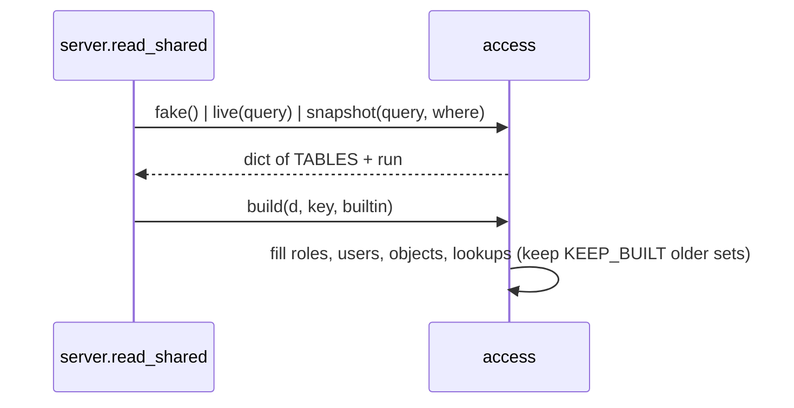

# access.py

All data, walks and rules of the app (4,871 lines). Both versions call it; it imports no Streamlit or FastAPI (CLAUDE.md "Code style").

## Sections by area

| Area | Lines | What is there |
|---|---|---|
| Settings and constants | access.py:1-112 | `.env` load (access.py:19), `in_snowflake` / `INSIDE` (access.py:27-41), `ADMIN` (access.py:43), `BUILTIN` patterns (access.py:50-52), `MAX_HOPS`, `FUNC`/`TECH`/`BUILD`, `TABLES` (access.py:53-59), sensitive tags, dormancy, `MAX_PATHS` (access.py:62-72), `RULES` titles (access.py:78-107), `SEVERITY` (access.py:108) |
| Fake data | access.py:113-398 | `SCHEMAS`, `CHAIN`, `FIN_USERS` (access.py:115-127), `fake()` (access.py:130-345), `fake_use()` (access.py:348-371), `fake_previous()` for What changed (access.py:387-398) |
| Snapshot loader | access.py:401-416 | `snapshot(query, where)`: last OK run of `TBL_ACCESS_RUN`, then each `TBL_ACCESS_<t>` of that run; `OBJECT_USE` optional |
| SHOW helpers | access.py:419-469 | `ident`, `line`, `qualify`, `each` (SHOW_THREADS at once, access.py:437-451), `held_db_roles`, `info_schema` |
| My access | access.py:470-553 | `mine(query, db)`: the logged-in user's own access, read with their rights, writes nothing |
| Live (SOURCE=direct) | access.py:556-865 | `live(query)` (access.py:560-836): same dict as `snapshot()`, ACCOUNT_USAGE else SHOW; `use_sql` ACCESS_HISTORY (access.py:839-853); `only()` demo slice (access.py:856-865) |
| Lookups / build | access.py:868-1008 | `ROLE_ON` (access.py:879), `KEEP_BUILT` (access.py:883), `build()` (access.py:896-960), `cached()` (access.py:974-978), `kind_of`, `role_db`, `role_kind` (access.py:981-1006) |
| Names, classes, ladder | access.py:1009-1334 | `uid` / `UTAG` users vs roles (access.py:1009-1015), `priv_class`, `priv_cat`, `category`, `LEVELS` ladder (access.py:1030-1101), `access_objects`, `ladder*`, `reach_counts` (access.py:1105-1203), `who_has` (access.py:1240-1253), `split_name` (access.py:1315) |
| Full walks | access.py:1335-1450 | `down`, `up`, `bfs`, `ups`, `best_paths`, `starts`, `walk`, `depth`, `chains` |
| Fast walks (counted) | access.py:1451-1613 | `dag`, `loops`, `counts`, `shortest`, `listed`, `fast`, `capped_paths` |
| Counted walks to holders | access.py:1615-1718 | `holding`, `tally`, `via_role`, `via_link`, `paths_to`, `reach_without` |
| Walk up | access.py:1720-1776 | `users_on`, `up_walk` (access.py:1727-1759), `up_only_via` |
| Graph inputs | access.py:1778-1995 | `down_graph`, `object_graph`, `role_graph`; `access_of`, `admin_paths`, `account_privs`, `admin_holders`, `who_users`, `who_can` (access.py:1894-1985) |
| Users | access.py:1996-2066 | `login_days`, `is_service`, `is_disabled`, `is_dormant`, `status`, `split_users`, `used_roles` |
| Sensitive data | access.py:2068-2562 | tags (`tag_rules`..`sensitive_cols`, access.py:2070-2112), policies and masking (`clear_for`..`col_view`, access.py:2121-2304), `data_view` (access.py:2306-2325), `governance_kpis` (access.py:2366-2373), `catalog` (access.py:2435-2448), `sens_flow` (access.py:2460-2501), `review_grid` (access.py:2514-2560) |
| Page aggregations | access.py:2563-2810 | `grants`, `grant_rows`, `reach`, `held`, `loses`, `role_stats`, `grantees`, `valid_privs`, `admin_*`, `matrix`, `object_stats`, `has_lacks`, `privs_on` |
| Big accounts | access.py:2811-3079 | `finding_index`, `group_objects`, `MAX_OBJECTS` 12 (access.py:2883), `graph_input` (access.py:2886-2976), `too_big`, `summary` (access.py:2996-3051), `graph_info` |
| Removal and requests | access.py:3080-3474 | `revoke` / `fix_text` text only (access.py:3111-3142), `losers`, `removal`, `ask_for`, `can` (access.py:3245-3278), `cut_points`, `nearest`, `suggest`, `approver` |
| Access graph (screen 4) | access.py:3475-3680 | `access_graph` (access.py:3530-3678) |
| What they see (screen 7) | access.py:3681-3705 | `seen` |
| Compare / review / search | access.py:3706-3825 | `compare` (access.py:3722-3775), `review` (access.py:3778-3811), `search` (access.py:3814-3823) |
| What if | access.py:3826-4098 | `WHAT_IF_OPS` (access.py:3828), `changes_of`, `without_cuts`, `what_if` (access.py:3920-4096) |
| Granted vs used | access.py:4099-4181 | `use_state`, `used_on`, `granted_used` (access.py:4137-4179) |
| What changed | access.py:4182-4426 | `state` / `restore` / `loaded` (access.py:4184-4211), `facts` (access.py:4214-4240), `diff` (access.py:4342-4424) |
| Rules | access.py:4427-4871 | `rule_rows`, `checks`, `find`, `rules_model` ... `rule23`, `findings` (access.py:4865-4871) |

## Load and build

- `snapshot()` reads only `WHERE STATUS = 'OK'` latest run, so a half run is never shown (access.py:403-406).
- `live()` must stay in step with `SP_ACCESS_SNAPSHOT` (docstring access.py:561-563; CLAUDE.md "Direct mode").
- `build()` skips work when `key` matches the last build; keeps older sets in `built` up to `KEEP_BUILT` (access.py:896-905).
- Example: the server calls `a.build(d, key, builtin)` under its lock (server.py:189).

## Rules -> functions

| Rules | Function | Lines |
|---|---|---|
| 1, 2, 3, 4, 13, 14 | `rules_model` | access.py:4567-4617 |
| 5, 9, 12 | `rules_admin` | access.py:4620-4642 |
| 6, 7, 10, 11, 15 | `rules_sensitive` | access.py:4645-4700 |
| 8, 16 | `rules_users` | access.py:4703-4715 |
| 17 | `rule17` (+ `readonly_writes` access.py:4524-4555) | access.py:4718-4734 |
| 18 | `rule18` (+ `unusual` access.py:4737-4763) | access.py:4766-4779 |
| 19 | `rule19` | access.py:4782-4796 |
| 20, 21 | `rules_operate` | access.py:4804-4815 |
| 22 | `rule22` | access.py:4818-4835 |
| 23 | `rule23` | access.py:4838-4862 |

- `findings()` concatenates all and sorts by rule number (access.py:4865-4871); `checks()` gives `(num, title, grantee, detail, path)` rows (access.py:4475-4477).
- `SCOPED` rules check only names passed in `only` (what_if rechecks only what a change touches) (access.py:4558-4559).

## Key functions

| Name | Does | path:line |
|---|---|---|
| `in_snowflake` | Active Snowpark session or `INSIDE=1` | access.py:27-38 |
| `fake` | Demo data set (at least one finding per rule) | access.py:130-345 |
| `fake_previous` | Earlier demo snapshot for What changed | access.py:387-398 |
| `snapshot` | Last OK run of the `TBL_ACCESS_` tables | access.py:401-416 |
| `mine` | Logged-in user's own access, live | access.py:470-553 |
| `live` | Whole account read now (SOURCE=direct) | access.py:560-836 |
| `use_sql` | ACCESS_HISTORY usage SQL (metadata only) | access.py:839-853 |
| `only` | One user's slice (demo My access) | access.py:856-865 |
| `build` | Fill module lookups; memo by key | access.py:896-960 |
| `cached` | `fn()` once per data set | access.py:974-978 |
| `kind_of` / `role_kind` | user / admin / database / functional / technical / group / object | access.py:981-1006 |
| `who_has` | Screen 2 entries per user / role | access.py:1240-1253 |
| `down` / `up` / `bfs` | Full path walks down / up, shortest by BFS | access.py:1345-1382 |
| `dag` / `loops` | Role links minus loop back edges; role loops | access.py:1453-1518 |
| `counts` / `shortest` / `listed` / `fast` | Exact path counts, shortest paths, capped listing | access.py:1525-1600 |
| `up_walk` | Counted walk up to holders | access.py:1727-1759 |
| `access_of` / `who_can` | Reference listings (TF parity) | access.py:1894-1896, access.py:1981-1985 |
| `who_users` | Users of an object, counted | access.py:1955-1973 |
| `admin_holders` | Users / roles holding an admin role | access.py:1913-1921 |
| `status` / `is_dormant` | disabled / never / dormant / active | access.py:2031-2045 |
| `sensitive` / `masked` / `data_view` | Sensitive tags, masking, what a role sees | access.py:2103-2106, access.py:2161-2167, access.py:2306-2325 |
| `catalog` / `sens_flow` / `review_grid` | Screens 8, 16, 6 | access.py:2435-2448, access.py:2460-2501, access.py:2514-2560 |
| `grants` / `reach` / `held` / `grantees` / `matrix` | Page rows (cached per walk) | access.py:2565-2759 |
| `has_lacks` | Privileges held vs missing on one object | access.py:2784-2797 |
| `graph_input` / `summary` | Big-account roll-up and fold | access.py:2886-2976, access.py:2996-3051 |
| `revoke` / `fix_text` | IaC + SQL text for a grant edge (never run) | access.py:3111-3142 |
| `can` | Can they? (count, shortest, choke, options) | access.py:3245-3278 |
| `cut_points` / `removal` / `nearest` / `suggest` / `ask_for` | Where to cut, ways to remove, ways in, request roles | access.py:3179-3472 |
| `access_graph` | Screen 4 graph | access.py:3530-3678 |
| `seen` / `compare` / `review` / `search` | Screens 7, 9, review export, search ranking | access.py:3683-3823 |
| `what_if` | Simulated revokes; restores lookups | access.py:3920-4096 |
| `granted_used` | Screen 13 | access.py:4137-4179 |
| `facts` / `diff` | Screen 14 | access.py:4214-4240, access.py:4342-4424 |
| `rule_rows` / `checks` / `findings` | Rule output for pages and tests | access.py:4451-4477, access.py:4865-4871 |

- Graph fragment: `function:access.py:<name>` nodes, `implements` edges to `business_rule:rule_N` (graph/parts/modules.*.jsonl).
- unclear: `fake()` has no docstring; its content was not inspected line by line here.
