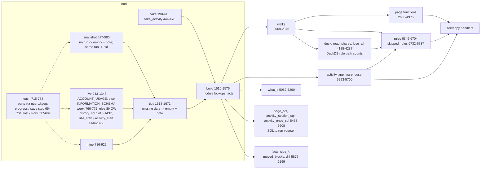
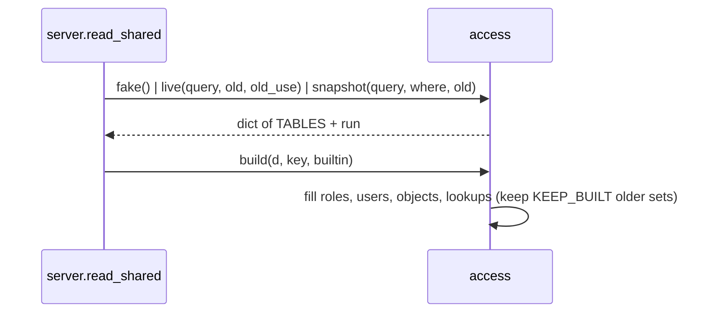

<!-- generated by darshan-singh-meel-knowledge-graph -->
# access.py

All data, walks and rules of the app (6,737 lines). Both versions call it; it imports no Streamlit or FastAPI (CLAUDE.md "Code style").

## Sections by area

| Area | Lines | What is there |
|---|---|---|
| Settings and constants | access.py:1-180 | `gc.set_threshold(700, 10, 1000)`: full collections wait for far more allocations on a loaded account (access.py:30-33); `.env` load (access.py:37), `in_snowflake` / `INSIDE` (access.py:45-59), `ADMIN` (access.py:61), `BUILTIN` patterns (access.py:68-70), `MAX_HOPS`, `FUNC`/`TECH`/`BUILD`, `TABLES` (access.py:71-77), sensitive tags, dormancy, `MAX_PATHS` (access.py:118-128), `RULES` titles (access.py:134-174), `SEVERITY` (access.py:175); activity settings `OPTIONAL`, `ACTIVITY_DAYS`, `QUERY_TAG` (env, default access-explorer, access.py:102), `APP_ST` (env STREAMLIT_APP, default ST_ACCESS_EXPLORER, access.py:103), `INTERACTIVE`, `CLIENTS`, `SPIKE`, `NEW_DAYS` (access.py:77-116), `WORK_HOURS` default business hours 7-19 (access.py:113-114); read settings `STATEMENT_TIMEOUT` (300), `WORKERS` (3), `ACTIVITY_ON` / `HIERARCHY_ON` (env ACTIVITY / HIERARCHY, default on), `SKIP_ACTIVITY` / `SKIP_HIERARCHY` texts (access.py:104-108) |
| Fake data | access.py:181-514 | `SCHEMAS`, `CHAIN`, `FIN_USERS` (access.py:183-195), `fake()` (access.py:198-415), `fake_use()` (access.py:418-441), `fake_activity()` one finding per rule 24-28, HOURS per row, SUPPORT_01's use of the Streamlit app (access.py:444-478); the demo app SALES.MART.ST_CUSTOMER_LOOKUP (access.py:185, access.py:201, access.py:224-225, access.py:263), `fake_previous()` for What changed (access.py:503-514) |
| Snapshot loader | access.py:517-586 | `snapshot(query, where, old=None)`: last OK run of `TBL_ACCESS_RUN`; the same run as `old` -> `old` back (access.py:538-544); else each `TBL_ACCESS_<t>` of that run (`SELECT * EXCLUDE (RUN_ID)`, `WORKERS` at a time); `OBJECT_USE`, `ACTIVITY` optional, not read under `ACTIVITY=0`; `hours_of` parses ACTIVITY `HOURS` JSON (access.py:583-586) |
| Timeouts, progress, parallel reads | access.py:589-785 | `line`, `timed_out` / `timeout_hint` / `step_name` (STATEMENT_TIMEOUT messages, access.py:610-632), `ident`, `qualify`, `progress` / `say` / `took` (progress lines, access.py:648-689), `one`, `each` (`n` at a time, SHOW_THREADS or WORKERS, progress labels, access.py:715-758), `held_db_roles`, `info_schema` |
| My access | access.py:786-929 | `mine(query, db)`: the logged-in user's own access, read with their rights, writes nothing; one `each()` wave for the role SHOWs, user grants, DESC USER and usage (access.py:813-839) |
| Live (SOURCE=direct) | access.py:932-1478 | `READS` / `USE_COLS` / `ACT_COLS` (access.py:933-939); `live(query, old, old_use)` (access.py:943-1348): same dict as `snapshot()`; wave 1 probes, wave 2 ACCOUNT_USAGE reads `WORKERS` at a time, SHOW fallback waves; object use + activity from one ACCESS_HISTORY read for only the weeks / days `old_use` / `old` lack (access.py:1054-1083); `use_sql(since)` (access.py:1351-1367); `activity_sql` (access.py:1370-1415); `history_sql` / `history_rows` (access.py:1418-1443); `use_start` / `activity_start` (access.py:1446-1466); `only()` demo slice (access.py:1469-1478) |
| Missing data | access.py:1579-1671 | `COLS`, `QUIET`, `NEED`, `SRC`, `LONG`, `ROW` (access.py:1579-1589); `hours` (access.py:1592-1606), `usable` (access.py:1609-1615), `tidy` (access.py:1618-1671): every table in build()'s shape, rows without names / day / action left out with a `missing_names` note, missing columns noted (`missing_columns`); `dated` (access.py:488-494) |
| DuckDB walk | access.py:4161-4291 | `rules_stamp` (access.py:4161-4165), `DUCKS` / `close_ducks` (access.py:4168-4174), `duck_table` (access.py:4177-4182), `duck` (access.py:4185-4222), `read_shares` (access.py:4225-4245), `lose_all` (access.py:4248-4287), `lose_key` (access.py:4290-4291) |
| Lookups / build | access.py:1481-1719 | `ROLE_ON` (access.py:1493), `KEEP_BUILT` (access.py:1497), `acts` ACTIVITY rows (access.py:1490), `build()` (access.py:1510-1576), `cached()` (access.py:1685-1689), `kind_of`, `role_db`, `role_kind` (access.py:1692-1717) |
| Names, classes, ladder | access.py:1720-2057 | `uid` / `UTAG` users vs roles (access.py:1720-1726), `priv_class`, `priv_cat`, `category`, `LEVELS` ladder (access.py:1741-1812), `access_objects`, `ladder*`, `reach_counts` (access.py:1816-1914), `who_has` (access.py:1951-1964), `split_name` (access.py:2038) |
| Full walks | access.py:2058-2178 | `down`, `up`, `bfs`, `ups`, `best_paths`, `starts`, `walk`, `depth`, `chains` |
| Fast walks (counted) | access.py:2179-2382 | `dag`, `loops`, `counts`, `shortest`, `listed`, `fast`, `capped_paths` |
| Counted walks to holders | access.py:2384-2487 | `holding`, `tally`, `via_role`, `via_link`, `paths_to`, `reach_without` |
| Walk up | access.py:2489-2545 | `users_on`, `up_walk` (access.py:2496-2528), `up_only_via` |
| Graph inputs | access.py:2547-2769 | `down_graph`, `object_graph`, `role_graph`; `access_of`, `admin_paths`, `account_privs`, `admin_holders`, `who_users`, `who_can` (access.py:2663-2759) |
| Users | access.py:2770-2849 | `login_days`, `is_service`, `is_disabled`, `is_dormant`, `status`, `split_users`, `used_roles` |
| Sensitive data | access.py:2851-3485 | tags (`tag_rules`..`sensitive_cols`, access.py:2853-2906), policies and masking (`clear_for`..`col_view`, access.py:2915-3098), `data_view` (access.py:3100-3119), `governance_kpis` (access.py:3174-3181), `catalog` (access.py:3291-3306), `sens_flow` (access.py:3355-3365), `review_grid` (access.py:3421-3483) |
| Page aggregations | access.py:3486-3774 | `grants`, `grant_rows`, `reach`, `held`, `loses`, `role_stats`, `grantees`, `valid_privs`, `admin_*`, `matrix`, `object_stats`, `has_lacks`, `privs_on` |
| Big accounts | access.py:3775-4049 | `finding_index`, `group_objects`, `MAX_OBJECTS` 12 (access.py:3852), `graph_input` (access.py:3855-3945), `too_big`, `summary` (access.py:3965-4020), `graph_info` |
| Removal and requests | access.py:4050-4603 | `revoke` / `fix_text` text only (access.py:4081-4112), `with_sql` (access.py:4115-4128), `losers`, `removal`, `ask_for`, `can` (access.py:4374-4407), `cut_points`, `nearest`, `suggest`, `approver` |
| Access graph (screen 4) | access.py:4604-4830 | `access_graph` (access.py:4659-4828) |
| What they see (screen 7) | access.py:4831-4855 | `seen` |
| Compare / review / search | access.py:4856-4987 | `compare` (access.py:4872-4926; `match` / `extras` pass through `with_sql`, access.py:4925-4926), `review` (access.py:4929-4935), `search` (access.py:4976-4985) |
| What if | access.py:4988-5262 | `WHAT_IF_OPS` (access.py:4990), `changes_of`, `without_cuts`, `what_if` (access.py:5082-5260) |
| Granted vs used and Activity | access.py:5263-5841 | `use_state`; Activity tab: `act_state`, `client_label`, `activity`, `used_path`, `query_sql`, `activity_graph`, `user_reads`, `app_exposure`, `app_use`, `warehouse_use`, `rule29`, `mark_sensitive`, `activity_sensitive` (access.py:5279-5771); `used_on`, `granted_used` (access.py:5776-5837) |
| SQL to run yourself | access.py:5372-5610 | `DAYS_USAGE`, `QUERIES` (access_queries folder), `NEEDS` (privilege comment) (access.py:5374-5378); `lit`, `query_file`, `plain` (access.py:5391-5412); Activity section queries `ACT_FILTER`, `ACT_BASE`, `OFF`, `ACT_SECTIONS` (access.py:5415-5480), `activity_section_sql` (access.py:5483-5493); `page_sql` (access.py:5513-5608); logic in [logic/page-sql.md](../logic/page-sql.md) |
| What changed | access.py:5842-6203 | `state` / `restore` / `loaded` (access.py:5842-5872), `facts` (access.py:5875-5890), `side_reach` .. `side_below` (access.py:5893-5934), `fact_level` (access.py:5937-5946), `moved` / `moved_blocks` (access.py:5949-5985), `EVENT_NAMES` (access.py:6106), `diff` (access.py:6114-6199) |
| Rules | access.py:6204-6725 | `rule_rows`, `checks`, `find`, `rules_model` ... `rule23`, `rules_activity` 24-28 (access.py:6653-6704), `rule29` (access.py:5703-5718), `findings` (access.py:6707-6713) |

## Load and build

- `snapshot()` reads only `WHERE STATUS = 'OK'` latest run, so a half run is never shown; no OK run, no RUN_ID or an unreadable `TBL_ACCESS_RUN` -> every table empty with NOTES `no_run` (a lost session raises, `lost()` access.py:597-602); a table that fails to read is empty, `UNAVAILABLE`, noted and listed in `UNREAD` (read again next time); the run held already (`old`) costs that one query (access.py:527-579).
- `build()` calls `tidy(d)` first and sets `memo["key"]` last, so a build that stopped half way never counts as done (access.py:1525, access.py:1576); missing, NULL or unreadable data gives empty results plus a note ([business_rule:missing_data_never_fails](../logic/rules.md)).
- `live()` must stay in step with `SP_ACCESS_SNAPSHOT` (docstring access.py:944-946; CLAUDE.md "Direct mode").
- `build()` skips work when `key` matches the last build; keeps older sets in `built` up to `KEEP_BUILT` (access.py:1510-1519).
- Example: the server calls `a.build(d, key, builtin)` under its lock (server.py:330).

## Rules -> functions

| Rules | Function | Lines |
|---|---|---|
| 1, 2, 3, 4, 13, 14 | `rules_model` | access.py:6349-6401 |
| 5, 9, 12 | `rules_admin` | access.py:6404-6427 |
| 6, 7, 10, 11, 15 | `rules_sensitive` | access.py:6430-6485 |
| 8, 16 | `rules_users` | access.py:6488-6500 |
| 17 | `rule17` (+ `readonly_writes` access.py:6302-6337) | access.py:6503-6519 |
| 18 | `rule18` (+ `unusual` access.py:6522-6548) | access.py:6551-6564 |
| 19 | `rule19` | access.py:6567-6581 |
| 20, 21 | `rules_operate` | access.py:6589-6600 |
| 22 | `rule22` | access.py:6603-6620 |
| 23 | `rule23` | access.py:6623-6650 |
| 24, 25, 26, 27, 28 | `rules_activity` (table activity, [logic/activity.md](../logic/activity.md)) | access.py:6653-6704 |
| 29 | `rule29` (Streamlit app exposure, via `app_exposure`) | access.py:5703-5718 |

- `findings()` runs the groups one after another, each timed ("Slowest rules: ..." in the load log), rules 24-28 through `cached("activity", rules_activity)` (access.py:6715), and sorts by rule number (access.py:6707-6723); `checks()` gives `(num, title, grantee, detail, path)` rows (access.py:6253-6255).
- `SCOPED` rules check only names passed in `only` (what_if rechecks only what a change touches) (access.py:6340-6341).

## Key functions

| Name | Does | path:line |
|---|---|---|
| `in_snowflake` | Active Snowpark session or `INSIDE=1` | access.py:45-56 |
| `fake` | Demo data set (at least one finding per rule) | access.py:198-415 |
| `fake_previous` | Earlier demo snapshot for What changed | access.py:503-514 |
| `snapshot` | Last OK run of the `TBL_ACCESS_` tables | access.py:517-580 |
| `mine` | Logged-in user's own access, live; usage from ACCOUNT_USAGE.QUERY_HISTORY, else INFORMATION_SCHEMA.QUERY_HISTORY_BY_USER (access.py:911-922) | access.py:786-929 |
| `live` | Whole account read now (SOURCE=direct): per source ACCOUNT_USAGE first, else INFORMATION_SCHEMA (query history via `week`, tag references and policies per object up to `TAG_FALLBACK_MAX`), else SHOW; `old` / `old_use` rows -> incremental activity / object use read, one shared ACCESS_HISTORY read | access.py:943-1348 |
| `each` | Statements `n` at a time (SHOW_THREADS / WORKERS), in order, failures as exceptions, progress lines; a `cache.parted` query takes the whole wave (`keep`) | access.py:715-758 |
| `progress` / `say` / `step` | Progress sink with a heartbeat every `BEAT` s; a line; a timed build step | access.py:653-704 |
| `lost` | A lost session or no warehouse (606: every SELECT fails, SHOW works) stops a load; any other error is an unreadable table (a note) | access.py:597-602 |
| `tidy` / `usable` / `hours` | Data set in build()'s shape; row usable for the walks; HOURS as a dict | access.py:1618-1671, access.py:1609-1615, access.py:1592-1606 |
| `duck` / `read_shares` / `lose_all` | DuckDB role path counts per hop; per-role reach counts for rules 17 / 23; who loses access for many edges in one query | access.py:4185-4222, access.py:4225-4245, access.py:4248-4287 |
| `below` | `bfs([role])` once per data set (rules 3, 14) | access.py:2108-2110 |
| `rules_stamp` | Hash of access.py and its settings: rule results kept across restarts (server.kept_rules) | access.py:4161-4165 |
| `history_sql` / `history_rows` | One ACCESS_HISTORY scan for object use and activity, split by PART | access.py:1418-1443 |
| `use_start` | Object use weeks to keep and the Monday to read from | access.py:1446-1455 |
| `skipped_rules` | Rules that did not run: HIERARCHY=0 (`WALKS`), ACTIVITY=0 (24-28) | access.py:6732-6737 |
| `activity_once_sql` | Every Activity section from one base read (RESULT_SCAN) | access.py:5496-5510 |
| `activity_sql` / `activity_start` | Activity SELECT per UTC day with HOURS and APP (same text as the procedure) and its incremental window | access.py:1370-1415, access.py:1458-1466 |
| `use_sql` | ACCESS_HISTORY usage SQL from a Monday (metadata only) | access.py:1351-1367 |
| `only` | One user's slice (demo My access) | access.py:1469-1478 |
| `build` | Fill module lookups; memo by key | access.py:1510-1576 |
| `cached` | `fn()` once per data set | access.py:1685-1689 |
| `kind_of` / `role_kind` | user / admin / database / functional / technical / group / object | access.py:1692-1717 |
| `who_has` | Screen 2 entries per user / role | access.py:1951-1964 |
| `down` / `up` / `bfs` | Full path walks down / up, shortest by BFS | access.py:2068-2105 |
| `dag` / `loops` | Role links minus loop back edges; role loops | access.py:2181-2246 |
| `counts` / `shortest` / `listed` / `fast` | Exact path counts, shortest paths, capped listing | access.py:2253-2345 |
| `up_walk` | Counted walk up to holders | access.py:2496-2528 |
| `access_of` / `who_can` | Reference listings (TF parity) | access.py:2663-2665, access.py:2755-2759 |
| `who_users` | Users of an object, counted | access.py:2729-2747 |
| `admin_holders` | Users / roles holding an admin role | access.py:2685-2695 |
| `status` / `is_dormant` | disabled / never / dormant / active | access.py:2814-2828 |
| `sensitive` / `masked` / `data_view` | Sensitive tags, masking, what a role sees | access.py:2897-2900, access.py:2955-2961, access.py:3100-3119 |
| `catalog` / `sens_flow` / `review_grid` | Screens 8, 16, 6 | access.py:3291-3306, access.py:3355-3365, access.py:3421-3483 |
| `grants` / `reach` / `held` / `grantees` / `matrix` | Page rows (cached per walk) | access.py:3488-3723 |
| `has_lacks` | Privileges held vs missing on one object | access.py:3748-3761 |
| `graph_input` / `summary` | Big-account roll-up and fold | access.py:3855-3945, access.py:3965-4020 |
| `revoke` / `fix_text` | IaC + SQL text for a grant edge (never run) | access.py:4081-4112 |
| `with_sql` | A Compare / Request change dict (op grant / revoke, role or privilege + objectType + object, to, toUser) plus its `sql` (revoke via `revoke()`, grant written here with a `-- undo:` line for a role) and `roleDb` / `toDb` from `role_kind()`: the server is the only SQL writer, the web pages never write SQL or guess a role's kind from a dot (never run) | access.py:4115-4128 |
| `can` | Can they? (count, shortest, choke, options) | access.py:4374-4407 |
| `cut_points` / `removal` / `nearest` / `suggest` / `ask_for` | Where to cut, ways to remove, ways in, request roles | access.py:4308-4601 |
| `access_graph` | Screen 4 graph | access.py:4659-4828 |
| `seen` / `compare` / `review` / `search` | Screens 7, 9, review export, search ranking | access.py:4833-4985 |
| `what_if` | Simulated revokes; restores lookups | access.py:5082-5260 |
| `act_state` / `activity` | Activity tab: available or why not; per-day, by-key and per-use numbers for an object, user, role, app or scope, with UTC hours, weekend, kind | access.py:5279-5286, access.py:5293-5346 |
| `query_sql` | Copy-only SQL listing every query behind the tab (never run) | access.py:5349-5369 |
| `lit` / `plain` / `query_file` | SQL literal for a SET line; a query of our own (comments, NEEDS, SET lines, SELECT); an `access_queries/` file with its SET lines filled in (None when the file is missing) | access.py:5391-5394, access.py:5409-5412, access.py:5397-5406 |
| `activity_section_sql` | SQL behind one Activity section (`ACT_SECTIONS` key) for an object, user, role, app or scope (never run) | access.py:5483-5493 |
| `page_sql` | SQL to run yourself behind a page: list of `{title, sql}`, most useful first (never run) | access.py:5513-5608 |
| `used_path` / `activity_graph` | Grant path behind each use; the Paths diagram | access.py:5610-5628, access.py:5631-5655 |
| `user_reads` / `app_exposure` / `app_use` | Objects a user reads; what a Streamlit app shows its viewers with its owner's rights; who can open it, who did, who saw data they can't read | access.py:5658-5660, access.py:5663-5676, access.py:5679-5691 |
| `warehouse_use` | Who ran queries on a warehouse (usage read) and who can but did not | access.py:5694-5700 |
| `activity_sensitive` / `mark_sensitive` | Sensitive columns each user + role used sees; tag text for an untagged table (never run) | access.py:5746-5769, access.py:5721-5743 |
| `granted_used` | Screen 13; also `sql`: the trim of unused grants joined from `changes_of(changes)`, as What if writes it (access.py:5837) | access.py:5794-5837 |
| `facts` / `diff` | Screen 14: what a diff compares, once per data set; events capped to the first `EVENT_NAMES` (200, access.py:6106) people and objects (impact counts all), counts per filter, new / fixed findings, (user, object) pairs only with pairs=True | access.py:5875-5890, access.py:6114-6199 |
| `slow` / `week` / `span` | A timed-out statement (retry or a bigger warehouse helps); an INFORMATION_SCHEMA query history SELECT over its whole 167 h reach in 7 windows of 10,000 rows each; "45 s" / "6 min" for a step's time | access.py:605-607, access.py:766-772, access.py:683-685 |
| `admin_user_paths` | {user: admin_holders() paths} of every admin user without a walk each, once per data set | access.py:1967-1976 |
| `ups_of` / `path_roles` | Parent roles of a walk's links, kept for the last walk; every name on a path from a start to its holders | access.py:2298-2309, access.py:2348-2369 |
| `tag_index` / `governed` | TAG rows by object, once per data set (tags_of looks up three names); tables and views with a tag or a policy, the only ones data_views reads | access.py:2867-2875, access.py:3122-3133 |
| `sensitive_reach` | Sensitive data per granted role (depth 1, PUBLIC included), once per data set, rows shared | access.py:3194-3211 |
| `sens_roles` / `sens_readers` / `sens_path` / `read_path` | {role: sensitive objects it reads} once per data set; users who read one of a set of objects through a granted role; shortest path user -> object of a set; reads([role])[obj] without reading everything else | access.py:3224-3262 |
| `flow_sets` / `flow_follow` | sens_flow() with the users of every box and link; following one box: every user through it, then each user's own links (screen 16) | access.py:3318-3352, access.py:3368-3408 |
| `grant_rows` / `grant_count` | Grant rows of a walk (paths shared, built once per holder set); `len(grants())` without building its rows (the default-role banner of a big user) | access.py:3494-3540, access.py:3543-3549 |
| `loses_objects` | Objects of loses(user, user, role) counted, once per data set | access.py:3597-3605 |
| `by_first` | finding_index() edges by their first node | access.py:3814-3819 |
| `review_parts` | review() without a row per (user, object), once per data set and database | access.py:4938-4973 |
| `side_reach` / `side_tables` / `side_on` / `side_below` | What changed: reach, tables, holders per table and roles below of one facts() side, once per side (its lookups need not be loaded) | access.py:5893-5934 |
| `fact_level` | (level, privileges) on a table or view of a user holding a role tuple in one facts() side | access.py:5937-5946 |
| `moved` / `moved_blocks` | (user, object) pairs one side gives a higher level than the other; the same as blocks [(user, objects, levels)] without one pair each (diff with pairs=False) | access.py:5949-5951, access.py:5954-5985 |
| `rule_rows` / `checks` / `findings` | Rule output for pages and tests; `findings` times each group and names the slowest | access.py:6226-6255, access.py:6707-6723 |
| `rules_activity` | Rules 24-28 on table activity | access.py:6653-6704 |
| `rule29` | Rule 29: Streamlit app shows its owner's sensitive data | access.py:5703-5718 |

- Graph fragment: `function:access.py:<name>` nodes, `implements` edges to `business_rule:rule_N` (_scripts/parts/modules.*.jsonl).
- unclear: `fake()` has no docstring; its content was not inspected line by line here.
